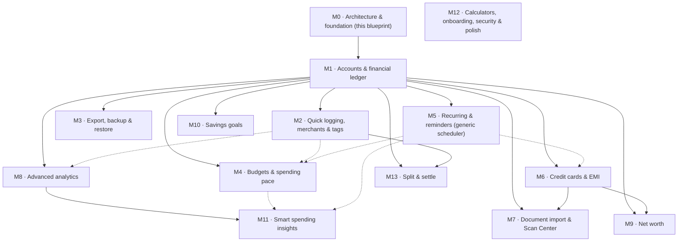

# Master Architecture Blueprint V1 — Expense Tracker → Personal Finance Management

> **Status:** Proposed blueprint for technical-lead review. No application code was changed to produce this document.
>
> **Baseline audited:** `master` at `cf31da7d62d2103c22345e8a582924fe997ee5bb` (merge commit of PR #2; PR #1 and PR #2 both merged). Audit performed against a fetched copy of that exact tree; see §2 and §16 for evidence.
>
> **Scope of this task (Module 0):** architecture inspection, documentation and design only. No feature was implemented.
>
> **How to read the labels in this document:**
>
> - **[Verified]** — checked in the baseline tree (file traced, caller traced, or command run). Evidence is cited by path.
> - **[Approved]** — a product requirement from the Module 0 brief / roadmap.
> - **[Proposed]** — technical design proposed here, not yet implemented or approved.
> - **[Unresolved]** — needs an explicit user or technical-lead decision before implementation. Collected in §15 and in `architecture-decisions.md`.

---

## 1. Executive summary

The current application is a small, working, local-first expense tracker: Drift/SQLite persistence, Google Sheets backup with a careful conditional-acknowledgement sync engine, custom categories, in-app notifications, and a single dashboard screen. Its data model cannot carry the approved 13-module product vision: money is stored as floating-point `double`, transactions carry a category *name* as text and a free-text payment method, there are no accounts, no ledger, no budgets, no recurring rules, no cards, no import pipeline, and no OS-level reminders.

This blueprint keeps what works — the Drift foundation, the Sheets sync engine and its acknowledgement discipline, the local-first save path, and the repository/provider structure — and defines the smallest foundation that can grow into a personal finance application without a rewrite in every module:

1. **Integer minor-unit money** (paise for INR) behind a single `Money` value object. No persisted `double` amounts.
2. **Accounts + a LedgerAccount-based double-entry ledger.** Every financial event writes balanced postings (SUM debits == SUM credits) against `LedgerAccount` rows — user asset/liability accounts, per-category system accounts, and the opening-equity/adjustment system accounts; balances derive from postings, never hand-maintained in two places. Opening balances are dedicated `opening_balance` events, not fields.
3. **Stable identifiers everywhere.** UUIDs for synchronisable records; stable category IDs (never display names) as relationships; archival instead of deletion for anything historical data references. No `transferGroupId`: a transfer is one transaction with two postings and two explicit account references.
4. **Sheets compatibility as a contract, with a distinct V2 identity.** The V1 spreadsheet is preserved untouched as an archive; the new model writes to a separate V2 spreadsheet with its own resolvable identity. Columns A:J are frozen within each version; new fields extend rightward in a frozen K+ order carrying stable identity fields (`CategoryId`, `AccountId`, `FromAccountId`, `ToAccountId`, `CardId`); `syncRevision` stays local-only; amounts are numeric cells produced from integer paise at the boundary only; Sheets never becomes the canonical ledger.
5. **One document-intake pipeline** for camera, gallery, PDF, CSV and Android share intents, ending in human review. Nothing unverified is ever posted automatically.
6. **Security throughout, not at the end.** Masking, retention, temp-file lifecycle and the app-lock-is-not-encryption boundary are specified now, even though the lock UI ships last. Minimum sensitive-file and import protections are a readiness gate *before* Module 7 ships (§11.8), and backup encryption is a hard gate *before* Module 3 ships (§11.7).

The delivery order is fixed (§12–§13): foundation first (Module 1, accounts + ledger), then logging speed, export, budgets, recurring, cards, import, analytics, net worth, goals, insights, polish, and split-and-settle last. Split-and-settle is deliberately last because it depends on accounts, people/groups, and a settled ledger.

**The single biggest decision in this blueprint is the fresh-database strategy (§7, ADR-005/ADR-014).** The user confirmed the existing data is disposable test data. The architecture therefore targets a clean new financial data model in a new database (`expense_tracker_v2`), leaving the old v7 database untouched as an archive — not a destructive reset of the live database. No reset happens in this task, and no destructive action may happen automatically on startup: the old file is never opened by new code, and its cleanup (if ever) must be an explicit, user-approved action.

---

## 2. Current application audit

### 2.1 Baseline verification

| Check | Method | Result |
|---|---|---|
| Master HEAD | GitHub API `git/refs/heads/master` | `cf31da7d62d2103c22345e8a582924fe997ee5bb` — matches the expected HEAD |
| PR #1 (Sheets sync) | GitHub API | Closed, merged 2026-10-31T12:17:16Z, merge commit `6640a49724f07f36c357e163312de46745e57be5` |
| PR #2 (custom categories + schema v7) | GitHub API | Closed, merged 2026-10-31T16:15:35Z, merge commit `cf31da7d62d2103c22345e8a582924fe997ee5bb` |
| Blueprint branch | GitHub API | `feature/architecture-blueprint-v1` did not exist before this task |
| `flutter analyze` on the baseline tree | Ran in a disposable copy of the exact tree | 4 issues: 0 errors, 0 warnings, 4 pre-existing infos (`prefer_initializing_formals` in `google_sheets_backend.dart` and `sync_coordinator.dart`) |
| `flutter test` on the baseline tree | Ran in a disposable copy of the exact tree | **85 passed, 1 failed** — the single failure is the known pre-existing `test/widget_test.dart` Drift Timer failure (see §2.7). No test was weakened, skipped or rewritten |
| Local working copy | Inspected | The local working copy is not a git checkout (no `.git`); it was left untouched by this task. All baseline work used a fetched copy of `master` |

### 2.2 What exists — verified

**Persistence [Verified].** Drift 2.35 + `drift_flutter`, schema version **7** (`lib/data/database/app_database.dart`). Tables in the `@DriftDatabase` list: `Transactions`, `CustomCategories`, `Notifications`. Migration history in `onUpgrade`: v2/v3 raw-SQL `app_settings` create/alter, v4 `customCategories`, v5 drop `app_settings`, v6 `notifications`, v7 `addColumn(transactions.syncRevision)`. The `AppSettings` table *file* (`lib/data/database/app_settings.dart`) still exists but is **not** in the database tables list — legacy only; the migrations create and then drop an `app_settings` table by raw SQL.

**Transactions table [Verified]** (`lib/data/database/transactions.dart`): integer auto-increment `id`; `uuid` unique; `type` text (`Expense`/`Income`); `amount` **REAL (`double`)**; `category` **text name, not a foreign key**; `description`, `paymentMethod` (free text, UI offers UPI/Cash/Card/Bank Transfer), `transactionDate`, `notes`, `createdAt`, `updatedAt` (DateTime, second-precision storage — verified by read-back in the PR #2 review), `syncRevision` integer default 0 (local-only acknowledgement token), `syncStatus` text (`pending`/`synced`), soft-delete `deleted` boolean.

**Custom categories [Verified].** `CustomCategories` table (id, uuid, name, icon code point, createdAt). Eight built-in categories defined in code with stable ids (`food`, `travel`, `shopping`, `bills`, `entertainment`, `health`, `education`, `other`) in `lib/core/categories/category.dart`. Repository rules (verified in code and tests): `updateCategory` delegates to atomic `renameCategory`, which reads the stored name inside the transaction and renames matching transactions; built-in name collisions rejected in the repository using the built-in definitions as source of truth; rename bumps each matching transaction's `syncRevision` and marks it pending, including soft-deleted rows; delete never touches transactions.

**Transaction flows [Verified].** Create/edit/delete/restore/search via `TransactionRepository` + `AddTransactionPage` / `AllTransactionsPage` / `DashboardPage`. Delete is soft-delete with undo (SnackBar). Search matches description/category/paymentMethod/notes. `getBalanceBeforeMonth` exists but has **no callers** (dead code — see §2.5).

**Google authentication [Verified]** (`lib/core/auth/google_auth_service.dart`, google_sign_in 7.2): session restore on startup via lightweight authentication only (never `authenticate()`/`authorizeScopes()` at startup); scopes are exactly `drive.file` + `spreadsheets`; authorization is a separate explicit Settings action; background sync stays silent when not signed in or unauthorized. `GoogleSignInTestPage` exists but has **no callers** (dead code).

**Google Drive / Sheets [Verified]** (`lib/core/sync/google_drive_service.dart`, `google_sheets_backend.dart`, `sheets_sync.dart`, `sync_coordinator.dart`):
- One master spreadsheet in an app-created "Expense Tracker" Drive folder (found by Drive query, not by name; a manually created folder with the same name is generally *not* found — see the backend's own comments).
- Year worksheets; headers A:J: `Date, Type, Category, Description, Amount, UUID, PaymentMethod, Notes, UpdatedAt, Deleted`. Amount is written as a decimal.
- UUID-based upsert; duplicate-UUID rows are reported and never auto-merged; year moves tombstone old-year rows and write the new-year row; a transaction deleted before its first sync creates no row and no worksheet.
- Pure sync engine (`SheetsSyncEngine`) with a backend interface and a fake backend/store test harness; worksheet discovery is all-or-nothing (a failed listing aborts the run before any write or acknowledgement).
- Conditional acknowledgement: `markTransactionSyncedIfUnchanged(id, syncRevision, deleted)` — see §8.
- Coordinator: one run at a time, drain loop for triggers arriving mid-run, bounded retry with backoff 2s/5s/15s/60s (max 4), one notification per run, silent background behaviour for not-signed-in / authorization-missing.
- `setupExpenseTracker()` in `GoogleDriveService` **is** used (called by the backend's spreadsheet resolution) — it is not dead code.

**Notifications [Verified].** In-app only. `NotificationManager` (ChangeNotifier) + Drift `Notifications` table + `NotificationType` enum. There is **no** `flutter_local_notifications` dependency, no scheduling API, and no OS notification. Any reminder feature (Module 5) must add scheduling; nothing today can fire at a future time.

**Providers / state [Verified].** Global singletons in `lib/core/database/database_provider.dart` (`appDatabase`) and `repository_provider.dart` (two repositories). No Riverpod/Bloc/Provider package. Screens are `StatefulWidget`s driven by Drift streams. This is simple and adequate today; §4 recommends keeping it until a module proves otherwise.

**Navigation [Verified].** No router, no bottom navigation. `MaterialApp` with `home: DashboardPage`, imperative `Navigator.push` to settings, summaries, analytics, transaction list and add/edit pages. Theme: Material 3, `ThemeMode.system`, light + dark via `colorSchemeSeed: Colors.indigo` (`lib/app/theme/app_theme.dart`).

**Tests [Verified].** Seven test files: repository tests (custom categories, sync revision, migration), engine tests (Sheets sync with fake backend/store), widget tests (category form, add-transaction page) and the default `widget_test.dart`. Baseline: 85 pass, 1 pre-existing failure (see §2.7). Test-only dev dependency `sqlite3` is used by the migration test to build a raw-SQL v6 fixture.

**Dependencies [Verified]** (`pubspec.yaml`): `flutter`, `cupertino_icons`, `drift`, `drift_flutter`, `uuid`, `google_sign_in`, `googleapis`, `extension_google_sign_in_as_googleapis_auth`; dev: `flutter_test`, `flutter_lints`, `drift_dev`, `build_runner`, `sqlite3`. There are **no** packages for charts, images, files, camera, OCR, sharing, biometrics, HTTP, or date formatting (`intl` is absent).

**Documentation [Verified].** `docs/sheets-sync.md` (716 lines) and `docs/custom-categories.md` (105 lines) are thorough and accurate about the sync/correction history. `README.md` is still the default Flutter template. `AGENTS.md` (repo root) requires: one task at a time, inspect before changing, no proactive future work, run analyze after changes, stop for user testing on Drift changes, show changed files + results at checkpoints, wait for confirmation.

### 2.3 Gaps against the product vision — verified absences

| Capability | Status in baseline |
|---|---|
| Accounts, balances, opening balances, transfers | Absent. Only a payment-method text field |
| Integer money / Money model | Absent. `double` amounts throughout, `toStringAsFixed(2)` display |
| Budgets, recurring rules, reminders | Absent (notifications table exists, but no scheduling or rules) |
| Credit cards / EMI | Absent |
| Merchants, tags, templates | Absent (description/notes free text only) |
| Export / backup / restore files | Absent (Sheets sync only; no CSV/JSON export) |
| Charts | Absent (progress bars only; no chart package) |
| Document import / OCR / share intents | Absent. No intent filters beyond MAIN/LAUNCHER; `MainActivity.kt` has no intent handling |
| Net worth / goals / insights / calculators | Absent |
| App lock / biometrics / encryption | Absent |
| Split / people / groups | Absent |

### 2.4 Strengths to preserve

Local-first saving (UI never waits on Sheets); conditional acknowledgement discipline; pure, fake-testable sync engine; atomic rename-with-transaction-update; built-in names as single source of truth; silent background sync rules; small dependency surface; thorough sync/category documentation.

### 2.5 Dead / legacy code — verified by caller tracing

- `GoogleSignInTestPage` — no callers. **[Proposed]** Remove in Module 1 cleanup (do not remove in this task).
- `TransactionRepository.getBalanceBeforeMonth` — no callers. **[Proposed]** Remove or replace with ledger-derived balances in Module 1.
- `AppSettings` table file + raw-SQL `app_settings` migrations — legacy, table dropped in v5 migration. **[Proposed]** Superseded by the new `AppSettings` entity design (§5); removal is part of the Module 1 fresh-database switch (§7), not this task.
- Default-template `README.md` — **[Proposed]** rewrite as part of Module 12 polish, or with the Module 1 foundation PR if the tech lead prefers.

### 2.6 Risks carried into the redesign

1. **Floating-point money** is the most urgent correctness risk: `double` totals, `double` Sheets amounts, and `toStringAsFixed` display will diverge from integer accounting the moment transfers, splits and reconciliation exist. Module 1 must end this.
2. **Category-as-text** couples history to display names; the rename-propagation machinery exists only because of this. Stable category IDs (§5) remove the coupling.
3. **No account concept** means no balance can ever be computed correctly from current data (a "balance" today would be income-minus-expense over all time, with no opening balance and no per-account split).
4. **Sync scope creep risk:** the Sheets engine is excellent for transactions but was never designed for accounts, cards, documents or settings. §8 scopes it explicitly so it is not stretched into a general backend.
5. **Test baseline fragility:** widget tests mounting live Drift databases need the close-in-body pattern; the pre-existing Timer failure must stay visible (see §2.7).

### 2.7 Known baseline failures — recorded separately, not hidden

- `test/widget_test.dart` — "Expense Tracker app loads" fails with a pending-Timer teardown error (open Drift connection in the widget-test binding). Pre-existing on `master`; reproduced in this audit's baseline run. **Do not weaken, skip or rewrite this test to obtain a green result.** Fixing it is a Module 0/1 hygiene item only if the tech lead approves a fix that addresses the root cause (database lifecycle in the test), with the failure still reported until fixed.
- `flutter analyze`: 4 pre-existing infos only (see §2.1). No errors or warnings on `master`.

---

## 3. Approved product vision

**[Approved]** The application evolves from a basic Expense Tracker into a Personal Finance Management application, organised in four product areas:

1. **TRACK** — record money movement quickly and accurately.
2. **MANAGE** — accounts, budgets, cards, EMIs, goals.
3. **UNDERSTAND** — summaries, analytics, net worth, insights.
4. **AUTOMATE** — recurring rules, bills, reminders, smart rules.

**[Approved]** Five primary destinations: **Home, Track, Manage, Understand, Automate.** The four sections (Track/Manage/Understand/Automate) must have separate landing pages with clearly organised feature navigation. Home provides the financial overview and quick actions. Existing working functionality must be preserved through the redesign (transactions, categories, Sheets backup, summaries/analytics as they exist today — re-homed, not removed).

**[Approved]** Security and privacy are considered throughout the architecture (§10), not postponed to Module 12. Split-and-settle is intentionally the final major feature (Module 13).

---

## 4. Target technical architecture

### 4.1 Principles

1. **Local-first, always.** Every save writes to Drift first and returns; sync, import processing and analytics never block saving. (Preserves the current guarantee.)
2. **One source of truth per fact.** Balances derive from postings; reports derive from transactions + postings; Sheets is a backup copy, never the ledger.
3. **No business logic in widgets.** Widgets read streams/state and dispatch intents to services/repositories; posting rules, parsing, reconciliation and sync decisions live in domain/data layers.
4. **Small, explicit dependencies.** A new package needs a recorded trade-off (see §8.6, §9.4). No package is added in this task.
5. **Stable identities, archival over deletion.** Anything history references is archived, never hard-deleted.
6. **Fail visibly, never silently lose data.** Partial failures keep work pending/reviewable; destructive actions require explicit confirmation.

### 4.2 Layers and boundaries

```
Presentation (features/*/presentation)
  │  reads streams/view-models, dispatches commands, renders states
  ▼
Domain / application services (features/*/domain + core/domain)
  │  Money, posting rules, budget pacing, recurrence expansion,
  │  import pipeline orchestration, duplicate/reconciliation rules
  ▼
Data (features/*/data + data/repositories + data/database)
  │  Drift tables/DAOs, repositories, transaction-scoped writes,
  │  migration strategy
  ▼
External integrations (core/sync, core/import, core/notifications)
     Sheets/Drive backend, OCR/text extractors, share-intent receiver,
     OS notification scheduler — all behind interfaces, all fakeable in tests
```

Rules:

- Presentation never imports `googleapis`, Drift table classes, or OCR libraries directly.
- Domain services never import Flutter widgets or platform channels.
- Repositories own all database transactions; services compose repository calls inside a repository-provided transaction when atomicity spans tables (§6.5).
- Sync adapters map between local rows and external formats; they never contain posting or reporting rules.

### 4.3 State management — decision

**[Proposed, ADR-009]** Keep the current approach: Drift streams + repository singletons + `StatefulWidget`/`ChangeNotifier` for local UI state. Do **not** introduce Riverpod, Bloc or another framework for this redesign. Rationale: the current app is correct and testable without one; the new complexity is in the domain/data layers (ledger, import, sync), not in UI state plumbing. Revisit only with evidence — e.g. if cross-screen derived state (budget pacing + reminders + home overview) becomes unmanageable — and record that evidence in an ADR before adopting anything.

### 4.4 Proposed folder structure (evolves the current tree; no renames in this task)

```
lib/
  app/                  # App widget, theme, navigation shell (5 destinations)
  core/
    domain/             # Money, currency, posting rules, date/period helpers (NEW)
    database/           # AppDatabase, providers (existing, extended)
    categories/         # Built-in category definitions (existing)
    auth/               # Google auth (existing; unchanged scope)
    sync/               # Sheets engine, backend, coordinator (existing; extended per §8)
    import/             # Intake pipeline, extractors, dedupe, reconciliation (NEW, Module 7)
    notifications/      # In-app store (existing) + OS scheduler adapter (NEW, Module 5)
    security/           # App lock, masking helpers (NEW, Module 12; masking helpers earlier)
    share/              # Android share-intent receiver (NEW, Module 7)
    utils/              # Formatting/parsing helpers that are not Money (NEW, minimal)
  data/
    database/           # Drift tables + DAOs (grows per §5; generated code via build_runner only)
    repositories/       # One repository per aggregate (existing pattern, extended)
  features/
    home/               # Home overview + quick actions (NEW shell; dashboard re-homed)
    track/              # Transactions, categories, merchants, tags, templates, import entry
    manage/             # Accounts, budgets, cards/EMI, goals
    understand/         # Summaries, analytics, net worth, insights
    automate/           # Recurring rules, bills, reminders, smart rules
    settings/           # Settings, security, backup/restore, about (existing settings re-homed)
  main.dart             # Startup: notifications init, lightweight auth restore, background sync
```

Existing feature folders (`dashboard`, `summary`, `analytics`, `transactions`, `categories`, `settings`) are re-homed into the five destinations during Modules 1–2 rather than deleted in one big move; each move keeps routes/screens working and is covered by existing widget tests where they exist.

### 4.5 Cross-cutting concerns

- **Errors:** typed failures at service boundaries; user-facing messages never include tokens, file paths, card numbers or raw API errors.
- **Logging:** no financial amounts, descriptions, names, card/account identifiers or document text in logs or crash reports (§10.6).
- **Time:** one clock seam per service that needs determinism in tests (the pattern already introduced for `TransactionRepository` in PR #2 round 4); `DateTime.now()` only at composition roots.
- **IDs:** `uuid` v4 for every synchronisable/imported record; integer auto-increment ids remain internal row ids only and are never used as cross-system identity.

---

## 5. Data model and entity relationships

### 5.1 ER diagram (proposed)

```mermaid
erDiagram
    ACCOUNT |o--|| LEDGER_ACCOUNT : "one user ledger account (1:1 per account; 0..1 account per ledger account)"
    CATEGORY |o--|{ LEDGER_ACCOUNT : "one expense and/or one income ledger account (1 or 2 by kind)"
    LEDGER_ACCOUNT ||--o{ POSTING : "is debited/credited by"
    FINANCIAL_TRANSACTION ||--|{ POSTING : "posts (at least two)"
    FINANCIAL_TRANSACTION ||--o{ TRANSACTION_HISTORY : "audits"
    FINANCIAL_TRANSACTION }o--o| CATEGORY : "classified by stable id (optional)"
    FINANCIAL_TRANSACTION }o--o| MERCHANT : "paid to / received from (optional)"
    FINANCIAL_TRANSACTION ||--o{ TRANSACTION_TAG : "tagged"
    TAG ||--o{ TRANSACTION_TAG : "applied by"
    FINANCIAL_TRANSACTION }o--o| RECURRING_RULE : "generated by (optional)"
    FINANCIAL_TRANSACTION |o--o| EXTRACTION_CANDIDATE : "confirmed from (optional 1:1 via candidate FK; unique)"
    FINANCIAL_TRANSACTION }o--o| FINANCIAL_TRANSACTION : "reversed/refunded by (reversesTransactionId, optional parent)"
    FINANCIAL_TRANSACTION }o--o| FINANCIAL_TRANSACTION : "corrected by adjustment (relatedTransactionId, optional parent)"
    FINANCIAL_TRANSACTION }o--o| ACCOUNT : "source account (transfers/card payments, conditional)"
    FINANCIAL_TRANSACTION }o--o| ACCOUNT : "destination account (transfers/card payments, conditional)"
    FINANCIAL_TRANSACTION }o--o| ACCOUNT : "refund account (refunds, refundAccountId, conditional)"
    FINANCIAL_TRANSACTION }o--o| EMI_SCHEDULE : "charged instalment of (optional)"
    ACCOUNT ||--o| CREDIT_CARD : "at most one card profile"
    CREDIT_CARD ||--o{ CARD_STATEMENT : "bills in"
    CREDIT_CARD |o--o{ EMI_SCHEDULE : "instalment plan on (card EMIs)"
    EMI_SCHEDULE }o--o| ACCOUNT : "loan EMI on (loan EMIs; XOR with card)"
    BUDGET ||--o{ BUDGET_LINE : "allocates per category"
    BUDGET_LINE }o--|| CATEGORY : "covers"
    RECURRING_RULE ||--o{ SCHEDULED_OCCURRENCE : "expands to"
    SCHEDULED_OCCURRENCE }o--o| FINANCIAL_TRANSACTION : "materialises as (optional)"
    IMPORT_BATCH ||--o{ IMPORT_DOCUMENT : "contains"
    IMPORT_DOCUMENT ||--o{ EXTRACTION_CANDIDATE : "yields"
    IMPORT_DOCUMENT ||--o| BANK_STATEMENT_SUMMARY : "at most one bank summary"
    BANK_STATEMENT_SUMMARY }o--o| ACCOUNT : "statement for (optional, until classified)"
    IMPORT_DOCUMENT |o--o| CARD_STATEMENT : "at most one card summary (optional document)"
    IMPORT_DOCUMENT }o--o| ACCOUNT : "statement for (unclassified or bank; mutually exclusive)"
    IMPORT_DOCUMENT }o--o| CREDIT_CARD : "statement for (unclassified or card; mutually exclusive)"
    SAVINGS_GOAL ||--o{ GOAL_CONTRIBUTION : "funded by"
    GOAL_CONTRIBUTION }o--o| ACCOUNT : "moves from (transfer kind only, conditional)"
    GOAL_CONTRIBUTION }o--o| FINANCIAL_TRANSACTION : "backed by transfer (transfer kind only, conditional)"
    APP_SETTINGS |o--o| ACCOUNT : "one settings row, optional default account"
    PERSON ||--o{ GROUP_MEMBER : "joins"
    GROUP ||--o{ GROUP_MEMBER : "has"
    GROUP ||--o{ SPLIT_EXPENSE : "contains (Module 13)"
    PERSON ||--o{ SPLIT_EXPENSE : "participates (Module 13)"
```



Notes (each line above is drawn once, in one direction, and matches exactly one dictionary FK — no duplicate or reverse-duplicate lines): `SPLIT_EXPENSE` and split share/settlement entities are shown only as placeholders for Module 13; they are **not** designed in detail here and must not be built early. `NET_WORTH_ASSET` and `NET_WORTH_LIABILITY` are standalone manual holdings with **no** relationship to `ACCOUNT` (they are deliberately absent from the diagram: net worth is derived account balances plus manual assets minus manual liabilities). `CARD_STATEMENT` never owns an `EMI_SCHEDULE`: an EMI spans multiple billing cycles and belongs to its `CREDIT_CARD`; individual instalment charges are `FINANCIAL_TRANSACTION`s with an optional `emiScheduleId`. `CATEGORY` maps to one expense ledger account and/or one income ledger account depending on its kind (`both` → two rows; `expense`/`income` → one). `ACCOUNT` ↔ `CREDIT_CARD` is at most one card profile per account, and each card belongs to exactly one account; there is no direct `ACCOUNT` ↔ `CARD_STATEMENT` line — statements belong to `CREDIT_CARD` only. `IMPORT_DOCUMENT` summaries are at most one of the appropriate type per document (`BANK_STATEMENT_SUMMARY` *or* `CARD_STATEMENT`, never both as statement summaries for one document). `IMPORT_DOCUMENT` mutual exclusion: once classified, exactly one of `accountId`/`creditCardId` is set; both null means unclassified; both set is invalid (enforced in the service layer, §5.2). `APP_SETTINGS` is a single row whose `defaultAccountId` is an optional (0..1) reference to one `ACCOUNT`; neither side is mandatory — most accounts are not the default, and no default account is valid. `REMINDER` targets are polymorphic (`targetKind` + `targetUuid`, §5.2) and are therefore deliberately **not** drawn as FK lines. `FINANCIAL_TRANSACTION` → `EXTRACTION_CANDIDATE` is a query over the candidate's `confirmedTransactionId`, not a stored FK (§6.6 provenance rule); the relationship is optional 1:1 in both directions and `confirmedTransactionId` is unique. The two self-referencing transaction lines are separate relationships: reversal/refund dependents point back via `reversesTransactionId`, adjustment dependents via `relatedTransactionId`; in each case the parent reference is nullable and one parent may have many dependents. `EMI_SCHEDULE` belongs to exactly one of a `CREDIT_CARD` (card EMIs) or an `ACCOUNT` (loan EMIs) — the XOR rule in §5.2. `BANK_STATEMENT_SUMMARY` → `ACCOUNT` is optional until the document is classified. `SCHEDULED_OCCURRENCE` → `FINANCIAL_TRANSACTION` is optional until materialised, and `GOAL_CONTRIBUTION` → `ACCOUNT`/`FINANCIAL_TRANSACTION` are conditional on `contributionKind = transfer`. `CARD_STATEMENT` → `IMPORT_DOCUMENT` is optional: manually created statements have no source document. Every `FINANCIAL_TRANSACTION` has at least two `POSTING`s — the diagram's one-or-more end is a Mermaid minimum; the ≥2 rule is normative in §6.3.

### 5.2 Data dictionary

Conventions for every entity below: **PK** = primary key; **FK** = foreign key; **Amount** states the storage representation; **Lifecycle** states delete/archive rules; **Sync** states whether the entity participates in Google Sheets sync; **Sensitive** flags data needing masking/retention care (§10). All synchronisable entities carry `uuid` (TEXT, unique), `createdAt`, `updatedAt`, `syncRevision` (local-only integer, as established in PR #2) and `syncStatus` where they sync. `deleted` is a soft-delete flag wherever history must survive. Amounts are integer minor units (§6) unless stated otherwise. Nothing in this dictionary is implemented in this task.

**Account** — A place money lives or is owed. Purpose: balance holder and posting target.
PK: `uuid`. Fields: `name`, `kind` (`bank` | `cash` | `wallet` | `other_asset` | `credit_card_liability`), `currencyCode` (default `INR`), `icon`, `color`, `isArchived`, `archivedAt`, `displayOrder`. There is **no** `openingPostingId` field: the opening balance is a dedicated `FinancialTransaction` of kind `opening_balance` (§6.4), and the account-to-ledger mapping is one-directional from `LedgerAccount.userAccountId` (no circular foreign key). Amounts: no stored balance field — balance derives from postings (§6.4); opening balance is an opening transaction, not a mutable number. Relationships: 1:1 `LedgerAccount` (kind `user_asset` or `user_liability`, created in the same database transaction as the account); 0/1 CreditCard profile (only when `kind = credit_card_liability`). Lifecycle: archive only; never hard-delete while postings exist. Archived accounts disappear from pickers but keep history and balances. Sync: **[Proposed]** scoped — account *names/kinds* sync only under the §8 rules; balances are never synced (derived locally). Sensitive: account names only; masked account numbers live on the CreditCard/statement entities, never here.

**LedgerAccount** — The ledger-level account that every posting references. Purpose: give every financial event a balanced double-entry representation without exposing bookkeeping accounts to the user. This is the small abstraction that resolves the counterpart question: there is exactly one kind of posting target, and user accounts, category accounts and equity accounts are all ledger accounts of different kinds.
PK: `ledgerAccountId` (stable string id; user ledger accounts use the account's `uuid`, system ledger accounts use fixed ids — see below). Fields: `kind` (`user_asset` | `user_liability` | `system_expense` | `system_income` | `system_opening_equity` | `system_adjustment`), `userAccountId` (nullable; set iff `kind` is `user_asset`/`user_liability`), `categoryId` (nullable; set iff `kind` is `system_expense`/`system_income`), `isSystem` (true for every `system_*` kind), `normalBalance` (`debit` | `credit` — §6.3), `isArchived` (mirrors its category/account archival). Fixed system ids: `opening_equity` (one row, kind `system_opening_equity`), `adjustments` (one row, kind `system_adjustment`); per-category system accounts use id `expense:<categoryId>` / `income:<categoryId>`, created in the same transaction as the category and archived with it. Validation (service layer + tests): exactly one of `userAccountId`/`categoryId` is set for user/system-category kinds, neither is set for `opening_equity`/`adjustments`; a posting may reference only a `LedgerAccount` row that exists and is not archived. Amounts: none stored (balances derive from postings). Relationships: 1:N Postings; 0/1 Account; 0/1 Category. Lifecycle: never hard-deleted; archived with its account/category. Sync: no — ledger accounts are local bookkeeping structure. Sensitive: no. **System ledger accounts are never shown as normal user accounts**: account pickers, Home balances and Manage lists query `isSystem = false` only.

**FinancialTransaction** — The business event the user understands (a purchase, salary, transfer, payment, refund). Purpose: reporting, search, history, sync unit.
PK: `uuid`. FKs: `categoryId` (stable category id, nullable for transfers/card payments/opening balances; for a refund, the immutable category snapshot taken from the original at refund creation, §6.3), `merchantId` (nullable), `recurringRuleId` (nullable), `reversesTransactionId` (nullable, self-reference — set on refunds and reversals, pointing at the original transaction), `relatedTransactionId` (nullable, self-reference — set on adjustments that correct another transaction, e.g. an opening-balance correction; optional for an opening-balance correction when no original opening event exists, §6.4), `emiScheduleId` (nullable — instalment charges), `sourceAccountId` (nullable; required iff `kind = transfer` or `kind = card_payment` — the funding account for a card payment, §6.3 case F), `destinationAccountId` (nullable; required iff `kind = transfer` or `kind = card_payment`), `refundAccountId` (nullable; required iff `kind = refund` — the account money returns to or is paid out of, §6.3). There is **no** `candidateId` on this row and **no** `transferGroupId`: import provenance is stored authoritatively on `ExtractionCandidate.confirmedTransactionId` (the inverse is a query, §6.6), and a transfer is one financial event with two postings and two explicit account references (§6.3 transfer design). Fields: `kind` (`expense` | `income` | `transfer` | `card_payment` | `refund` | `adjustment` | `opening_balance` | `reversal`), `occurredAt` (date), `amountMinorUnits` (the event amount, always positive; for a refund, the refunded amount — see §6.3 for the maximum; for a transfer, the moved amount; for an opening balance, the absolute opening amount — sign lives in postings and, for Sheets, in `BalanceDirection`), `currencyCode`, `description`, `notes`, `paymentChannel` (UPI/cash/card/bank — replaces free-text payment method), `status` (`active` | `deleted` — there is no stored `reversed` status; reversed is derived, §6.6), `source` (`manual` | `recurring` | `import` | `template`), `adjustmentReason` (nullable; required iff `kind = adjustment`: `opening_balance_correction` | `balance_correction` | `fee_correction` | `other`). Amounts: integer minor units, always positive. Relationships: 1:N Postings (≥2, balanced, §6.3); N:M Tags; 1:N History rows; 0..N refunds/reversals pointing back via `reversesTransactionId`. Lifecycle: soft-delete only; restore re-includes postings; lifecycle invariants (reversal/refund coexistence, edit/delete guards, capacity revalidation) are in §6.6. At most one active `opening_balance` transaction per account (enforced in the service layer; an account created at zero has none until a later opening event or adjustment establishes one, §6.4). Sync: yes — the Sheets sync unit (§8). Sensitive: description/notes are user text; never logged.

**Posting (ledger entry)** — One side of a balanced financial event. Purpose: the single source of truth for balances.
PK: `uuid`. FKs: `transactionId`, `ledgerAccountId` (→ `LedgerAccount` — the *only* account reference a posting carries; the user account, category account or equity account is resolved through the ledger account's mapping). Fields: `direction` (`debit` | `credit` — distinct values, never a signed amount), `amountMinorUnits` (always strictly positive; direction carries the sign — zero-amount postings are forbidden), `currencyCode` (must equal the ledger account's currency in V1), `postingDate` (equals transaction date in V1). Amounts: integer minor units, positive only. Relationships: N:1 Transaction, N:1 LedgerAccount. Lifecycle: never edited directly; replaced atomically with its transaction (old postings superseded in the same DB transaction, history row records the change). Sync: no — postings are derived locally from transactions; Sheets never receives postings. Sensitive: no.

**TransactionHistory** — Audit trail for edits. Purpose: answer "what changed?" without complicating the ledger.
PK: `uuid`. FK: `transactionId`. Fields: `changedAt`, `changeKind` (`created` | `edited` | `deleted` | `restored` | `renamed_category`), `beforeSnapshot` (structured field values before the change — amounts as minor units, category id, account ids; never full document text), `afterSnapshot`. Lifecycle: append-only; retained with the transaction; deleted only if the user explicitly purges history (Module 12 decision — **[Unresolved]**). Sync: no. Sensitive: contains old descriptions — same handling as transaction text.

**Category** — Stable classification. Purpose: reporting taxonomy that survives renames.
PK: `categoryId` (stable string id, e.g. `food`; built-ins use the existing eight ids). Fields: `name`, `iconCodePoint`, `color`, `kind` (`expense` | `income` | `both`), `origin` (`builtin` | `custom`), `isArchived`, `parentCategoryId` (nullable — subcategories are **[Proposed, deferred]**; V1 keeps the flat list), `displayOrder`. Amounts: none. Relationships: referenced by transactions/budget lines by id; historical rows keep the id even if the category is archived. Lifecycle: built-ins can be renamed by the user? **[Unresolved]** — default: built-in names are fixed strings in code, user-renaming built-ins is out of scope for V1; custom categories can be renamed (propagation becomes unnecessary — history references the id) and archived (never deleted while referenced; delete allowed only when zero transactions reference it, otherwise archive). Sync: category definitions are local configuration; **[Proposed]** not synced to Sheets (Sheets carries the category *name* per row for readability, resolved back to id by name on import — see §8.5). Sensitive: no.

**Merchant** — Named counterparty. Purpose: fast logging, analytics by payee, import matching.
PK: `uuid`. Fields: `name` (trimmed, case-insensitive unique), `defaultCategoryId` (nullable), `lastUsedAt`, `useCount`. Lifecycle: merge/rename in Manage; deleting a merchant nulls the reference (transactions keep their description text). Sync: no. Sensitive: names only.

**Tag / TransactionTag** — Free-form labels (e.g. `trip-goa`, `tax-2026`).
Tag PK: `uuid`; fields `name` (case-insensitive unique), `color`. TransactionTag: composite (`transactionId`, `tagId`). Lifecycle: deleting a tag removes only links. Sync: **[Proposed]** tags sync as a comma-joined column in the Sheets extension area (§8.3), not as separate rows. Sensitive: no.

**Budget** — A spending plan for a period. Purpose: pacing + alerts.
PK: `uuid`. Fields: `name`, `periodKind` (`monthly` | `custom`), `startDate`, `endDate`, `totalLimitMinorUnits` (nullable — overall cap), `currencyCode`, `isActive`. Relationships: 1:N BudgetLines. Lifecycle: deactivating stops alerts; history retained. Sync: no (local planning data). Sensitive: no.

**BudgetLine** — Per-category allocation inside a budget.
PK: `uuid`. FKs: `budgetId`, `categoryId`. Fields: `limitMinorUnits`, `alertAtPercent` (default 80/100 — see §11). Amounts: integer minor units. Lifecycle: follows its budget. Sync: no.

**RecurringRule** — A template that generates transactions on a schedule.
PK: `uuid`. FKs: `categoryId`, `accountId` (destination/source), `merchantId` (nullable). Fields: `title`, `kind`, `amountMinorUnits`, `currencyCode`, `frequency` (`daily` | `weekly` | `monthly` | `yearly`), `interval`, `dayOfMonth`/`weekday` rules, `startDate`, `endDate` (nullable), `nextRunDate`, `isActive`, `autoPost` (bool — **[Proposed default: false]**; occurrences are created as drafts/confirmations unless the user opts into auto-posting), `reminderDaysBefore`. Lifecycle: pausing stops generation; deleting a rule never deletes generated transactions. Sync: rules themselves do not sync; generated transactions sync normally. Sensitive: no.

**ScheduledOccurrence** — One expected instance of a rule. Purpose: upcoming-bills list, reminder scheduling, skip/confirm handling.
PK: `uuid`. FKs: `ruleId`, `transactionId` (nullable until materialised). Fields: `dueDate`, `state` (`pending` | `posted` | `skipped` | `overdue`), `amountMinorUnits` (snapshot of the rule amount at expansion). Lifecycle: generated by expansion; retained as history. Sync: no. Sensitive: no.

**CreditCard** — Profile for a liability account. Purpose: limits, cycles, due dates, statements.
PK: `uuid`. FK: `accountId` (unique — the liability account, 1:1; at most one card profile per account, each card belongs to exactly one account). Fields: `issuer`, `name`, `maskedNumber` (last 4 digits only — full numbers are never stored), `creditLimitMinorUnits`, `billingDayOfMonth`, `dueDayOfMonth`, `isActive`. Amounts: integer minor units. Lifecycle: archiving the card archives the account; statements retained. Sync: **[Proposed]** profile syncs only as name/issuer/last4 under §8 rules; limits/dates are local. Sensitive: **yes** — last4 + issuer only; never store full PAN, CVV or PIN (§10.3).

**CardStatement** — One billing cycle for one card. Purpose: reconciliation + due tracking. Statement *totals* live here; individual statement lines are `ExtractionCandidate`s (imported) or `FinancialTransaction`s (confirmed) — never duplicated as statement rows.
PK: `uuid`. FKs: `creditCardId`, `importDocumentId` (nullable — set when the statement was produced by document import; null for manually entered statements in Module 6). **Statement/document consistency (normative, final corrections):** for an imported statement, `creditCardId` must equal `ImportDocument.creditCardId` once classified; `importDocumentId` is unique where set (at most one card-statement summary per document, and a document has at most one summary of the appropriate type); classification and summary creation/update persist consistently inside one database transaction (§9.6). Manual statements keep `importDocumentId` null. Relationship chain: `ImportDocument` (0..1 statement summary per document) → `CardStatement` → `CreditCard`; an EMI schedule is **not** owned by a statement (it belongs to the card and spans cycles — see `EmiSchedule`). Fields: `issuer`, `maskedCardIdentity` (last 4 digits only — never a full number), `periodStart`, `periodEnd`, `statementDate`, `dueDate`, `totalDueMinorUnits`, `minimumDueMinorUnits`, `creditLimitMinorUnits` (nullable — when present on the document), `availableLimitMinorUnits` (nullable), `previousBalanceMinorUnits`, `closingBalanceMinorUnits`, `paymentsMinorUnits`, `purchasesMinorUnits`, `refundsMinorUnits`, `feesMinorUnits`, `taxesMinorUnits`, `source` (`manual` | `import`), `reconciliationStatus` (`unreconciled` | `reconciled` | `discrepancy` — §9.6), `reconciliationNote` (nullable). Amounts: integer minor units. Lifecycle: immutable once reconciled except by correction entry (an `adjustment` transaction linked via `relatedTransactionId`, never by editing totals in place). Sync: no (local). Sensitive: **yes** — amounts + last-4 only; never store full card numbers, CVV, PIN or PDF passwords.

**BankStatementSummary** — Document-level summary/reconciliation record for one bank statement. Purpose: hold statement totals and reconciliation state separately from extracted line candidates, so totals are never double-counted as transactions.
PK: `uuid`. FKs: `importDocumentId` (1:1 — the summary references its document; the document does not reference the summary, avoiding a circular dependency), `accountId` (nullable until the document is classified to an account). **Statement/document consistency (normative, final corrections):** once classified, `accountId` must equal `ImportDocument.accountId`; `importDocumentId` is unique (at most one bank summary per document, and a document has at most one summary of the appropriate type); classification and summary creation/update persist consistently inside one database transaction (§9.6). A persisted mismatch is invalid and must be rejected by service validation (covered by a test). Fields: `issuer`, `maskedAccountIdentity` (last 4 digits only), `accountType` (nullable), `periodStart`, `periodEnd`, `openingBalanceMinorUnits`, `closingBalanceMinorUnits`, `totalDebitsMinorUnits`, `totalCreditsMinorUnits`, `feesMinorUnits`, `taxesMinorUnits`, `lineCount`, `reconciliationStatus` (`unreconciled` | `reconciled` | `discrepancy`), `reconciliationNote` (nullable). Amounts: integer minor units. Lifecycle: created with its document's classification; immutable once reconciled except by correction. Sync: no. Sensitive: **yes** — balances + last-4 only.

**EmiSchedule** — Instalment plan. Purpose: EMI tracking + reminders. An EMI spans multiple billing cycles: it belongs to its card (or loan account), not to any one statement.
PK: `uuid`. FKs: `creditCardId` (nullable — card EMIs) or `accountId` (nullable — loan EMIs; exactly one of the two is set), `originTransactionId` (nullable — the originating purchase). Fields: `title`, `totalMinorUnits`, `instalmentMinorUnits`, `totalInstalments`, `paidInstalments`, `startDate`, `dueDayOfMonth`, `interestRatePercent` (nullable, display only — no interest computation in V1), `isActive`. Individual instalment charges are `FinancialTransaction`s with `emiScheduleId` set; a statement *contains* instalment charges only by date range, never by ownership. Amounts: integer minor units. Lifecycle: completes when instalments are exhausted; each due instalment links to a transaction when paid. Sync: no. Sensitive: no.

**ImportBatch** — One import session. Purpose: history, undo, recovery.
PK: `uuid`. Fields: `sourceKind` (`camera` | `gallery` | `pdf` | `csv` | `share`), `createdAt`, `state` (`in_progress` | `review` | `completed` | `partially_failed` | `discarded`), `fileCount`, `confirmedCount`, `duplicateCount`. Lifecycle: retained as history; discarding a batch discards its unconfirmed candidates and (per retention setting) its documents. Sync: no. Sensitive: batch metadata only.

**ImportDocument** — One source file/text. Purpose: provenance, re-extraction, audit. This row carries *document-level* metadata only: statement totals live in `BankStatementSummary` / `CardStatement`, and individual lines live in `ExtractionCandidate`s — the three levels are never mixed, so statement totals can never be double-counted as transactions.
PK: `uuid`. FKs: `batchId`, `accountId` (nullable), `creditCardId` (nullable). **Mutual-exclusion rule (normative):** once classified, exactly one of `accountId`/`creditCardId` is set for statement documents (bank statement → `accountId`; card statement → `creditCardId`); both null means unclassified (receipts/images/text may stay unclassified to an account until review assigns one, or remain null if the user imports without an account link); both set is invalid and must be rejected by the import service validation and covered by a test. **Summary consistency (normative, final corrections):** when a statement document is classified, its summary's account/card reference must equal this row's `accountId`/`creditCardId` (`BankStatementSummary.accountId`, `CardStatement.creditCardId` — §5.2 summary entries); classification and summary creation/update persist in one database transaction, and reclassification updates both rows atomically (§9.6). Fields: `documentKind` (see §9.2), `originalFileName`, `storedPath` (app-private storage, nullable for text shares), `mimeType`, `pageCount`, `classification`, `classificationConfidence`, `issuer`, `statementPeriodStart/End` (classification hints only — authoritative period lives on the summary entity), `passwordProtected` bool (password itself never stored), `contentHash` (for idempotent re-import detection), `retentionExpiresAt` (nullable), `state`. The document does **not** carry opening/closing balances or statement totals (those are summary fields), and does **not** reference its summary row (summaries reference the document, avoiding a circular foreign key). Amounts: none on this row. Lifecycle: retained per retention setting (§9.7); deletion removes the stored file and the row. Sync: **never** — original documents are never uploaded to Sheets (§8.7). Sensitive: **yes** — financial documents; app-private storage only. Never store full card numbers, CVV, PIN or PDF passwords anywhere in the import model.

**ExtractionCandidate** — One parsed transaction awaiting review. Purpose: human confirmation gate.
PK: `uuid`. FKs: `documentId`, `matchedTransactionId` (nullable — duplicate match), `confirmedTransactionId` (nullable, unique — the **authoritative** stored link to the confirmed transaction; at most one transaction per candidate and at most one candidate per transaction, enforced by the unique constraint and the atomic confirmation in §6.6; set atomically with transaction + posting creation, §6.6). Candidates are *line items only*: statement totals (opening/closing balances, total due, total purchases/payments) are never candidates — they live on `BankStatementSummary`/`CardStatement` (§6). Creating a candidate from a totals row is a modelling error and must be prevented by the extraction service (totals are parsed into the summary entity, lines into candidates). Fields: per-field values (`occurredAt`, `description`, `debitMinorUnits`/`creditMinorUnits`, `reference`, `channel`, `runningBalanceMinorUnits`) each with `confidence` (0–1) and `source` (`extracted` | `corrected` | `inferred`), `duplicateScore`, `duplicateReason`, `state` (`pending` | `confirmed` | `duplicate_skipped` | `discarded`), `reviewedAt`. Amounts: integer minor units. Lifecycle: confirmed candidates create FinancialTransactions; discarded candidates retained for audit until batch retention expires. Sync: no. Sensitive: **yes** — extracted financial data; same handling as transactions.

**Reminder / NotificationRecord** — Scheduled and delivered reminders. Purpose: bills, due dates, budget alerts, sync outcomes.
PK: `uuid`. FKs: polymorphic target (`targetKind` + `targetUuid`: rule / card / EMI / budget). Fields: `kind` (`bill_due` | `card_due` | `emi_due` | `budget_alert` | `sync`), `scheduledFor`, `deliveredAt`, `state` (`scheduled` | `delivered` | `dismissed` | `acted`), `title`, `message`. Lifecycle: delivered records retained as in-app history (existing Notifications behaviour). Sync: no. Sensitive: titles/messages must not contain card numbers or amounts beyond what the user already sees in-app — masking rules apply (§10).

**SavingsGoal** — A target with contributions.
PK: `uuid`. Fields: `name`, `targetMinorUnits`, `currencyCode`, `targetDate` (nullable), `icon`, `isArchived`. Relationships: 1:N GoalContributions. Lifecycle: archive on completion/abandon; contributions retained. Sync: no. Sensitive: no.

**GoalContribution** — Money allocated to, or actually moved for, a goal. The two kinds are distinct and must never be conflated: a *virtual allocation* changes only the goal's progress (no account balance moves), while a *transfer contribution* moves real money between accounts.
PK: `uuid`. FKs: `goalId`, `accountId` (nullable — required iff `contributionKind = transfer`, the source account), `transactionId` (nullable — required iff `contributionKind = transfer`, the backing `transfer` transaction). Fields: `contributionKind` (`allocation` | `transfer`), `amountMinorUnits`, `occurredAt`, `note`. Amounts: integer minor units. Lifecycle: follows its goal; deleting a contribution does not delete the backing transaction (it unlinks it; the transfer itself is deleted only through the normal transaction delete path). Reporting: allocations count toward goal progress only and never toward income/expense or account balances; transfer contributions count toward goal progress *and* move balances via their backing transaction exactly once (the contribution row itself is never also counted as a transaction). Sync: no. Sensitive: no.

**NetWorthAsset / NetWorthLiability** — Manual holdings outside accounts (e.g. property, gold, personal loans). These are standalone records with **no relationship to `Account`**: account-backed net worth derives from ledger balances, and manual holdings are added/subtracted separately. Never link a manual holding to an account row (that would double-count it).
PK: `uuid`. Fields: `name`, `kind`, `valueMinorUnits`, `currencyCode`, `valuedAt`, `isArchived`. Amounts: integer minor units. Lifecycle: archive only. Sync: no. Sensitive: values only.

**Person / Group / GroupMember** — Split-and-settle placeholders (Module 13 only).
Person PK: `uuid`; fields `name`, `contactHint` (nullable — no contact import in V1), `isSelf`. Group PK: `uuid`; fields `name`, `kind`. GroupMember: (`groupId`, `personId`). Lifecycle: archiving a person/group preserves history. Sync: no (split data is local-only in V1 design; sync of split data is **[Unresolved]**). Sensitive: names only. **Do not build these entities before Module 13** except as foreign-key placeholders if Module 1 needs them — it does not.

**AppSettings** — Single-row application configuration (replaces the legacy `app_settings` concept).
PK: fixed id `1`. Fields: `currencyCode` (default `INR`), `defaultAccountId` (nullable FK → `Account`, cardinality 0..1 — at most one default account, and none is valid), `themeMode` (`system` | `light` | `dark` — mirrors current system behaviour, user choice added in Module 12), `appLockEnabled`, `documentRetentionDays`, `defaultReminderDays`, `sheetsBackupEnabled`, `setupCompleted`. Lifecycle: one row, updated in place, never deleted. Sync: no — settings are device-local (Sheets backup on/off is a local choice; the spreadsheet identity itself stays in the existing backend resolution flow). Sensitive: no secrets (no tokens, no passwords).

### 5.3 Identity and relationship rules (normative)

1. Every synchronisable/imported record has a `uuid` v4. Integer ids are internal only.
2. Relationships use stable ids/UUIDs — never display names. (Current `category` text coupling is removed by the Module 1 fresh-database switch; see §7.)
3. Built-in categories keep their existing string ids (`food`, …). Custom categories get stable ids at creation (UUID-based or `custom_<uuid>` — exact form is a Module 1 implementation detail, recorded in the Module 1 plan, not here).
4. Archival, not deletion, for categories, accounts, merchants, goals and people/groups once referenced.
5. `syncRevision`/`syncStatus` exist only on entities that sync (transactions in V1; possibly categories/accounts later only under §8 rules). They are never part of any external format.

---

## 6. Money and financial-ledger rules

### 6.1 Money value object [Proposed]

```text
Money { amountMinorUnits: int, currencyCode: String }   // e.g. Money(125075, "INR") = ₹1,250.75
Currency { code: String, minorUnitDigits: int }          // INR -> 2; JPY -> 0 (future)
```

Rules (normative for Modules 1+):

- Money is immutable; arithmetic returns new Money and requires equal `currencyCode` (cross-currency arithmetic is a compile-time/logic error in V1 — see §6.7).
- Addition/subtraction are exact integer operations. There is no floating-point path for persisted or computed financial totals.
- Comparison uses minor units only.
- Zero is `Money(0, code)`; negative Money values are never stored as amounts — direction/sign lives in postings and transaction kinds (§6.3), not in negative amounts.
- The `Money` type lives in `core/domain/money.dart` with unit tests covering §14. It is the *only* place that converts between minor units, decimal strings and display strings.

### 6.2 Currency, formatting, parsing, rounding

- **Initial currency: INR only [Approved].** `currencyCode = "INR"`, 100 paise = ₹1. The data model carries `currencyCode` on every money-bearing row so a future currency choice does not require a schema redesign — but no multi-currency behaviour, exchange rates, or currency picker is built in V1.
- **Formatting:** `Money → display string` uses minor-unit integer division/modulo (e.g. `125075 → ₹1,250.75`, Indian digit grouping per locale conventions). No `double` intermediate. The `intl` package is *not* currently a dependency; whether to add it for grouping/symbols is a Module 1 implementation choice to be recorded, not decided here. **[Unresolved]** only in the sense of package selection, not of the integer rule.
- **Parsing (user input):** parse the decimal *string* directly to minor units: split on the decimal separator, validate digits, pad the fractional part to the currency's minor digits. **For normal manual INR input, more than 2 fractional digits are rejected** with a field error ("Amounts support up to 2 decimal places") — the user must correct the value; the app must not silently round what the user typed, because silent rounding contradicts the displayed "maximum two decimal places" rule and can change the amount the user intended. There is exactly one exception, and it is a *separate, documented* rule: **importer normalisation** (§9.2) — values arriving from documents/CSVs/Sheets with more than 2 fractional digits are normalised by round-half-away-from-zero at the import parse boundary, and the original raw string is retained on the candidate for audit. Never parse via `double` (`double.parse("1250.75") * 100` is forbidden by this blueprint).
- **Rounding:** rounding happens **only** at the importer-normalisation boundary (§9.2) and at the Sheets-import boundary (§6.5), using round-half-away-from-zero, and is unit-tested. There is no rounding inside totals: totals are exact integer sums. Manual input is never rounded (it is validated and rejected if over-precise, above).

### 6.3 Posting rules — the ledger (LedgerAccount model, decided)

**[Decided in review round 2 — the counterpart representation is no longer unresolved.]** The ledger has exactly one posting target type: `LedgerAccount` (§5.2). A `Posting` references one valid `LedgerAccount`, carries a distinct `direction` (`debit` | `credit`), and an always-positive integer `amountMinorUnits`. There is no signed-amount representation and no separate "clearing" concept: the counterpart of every user-account movement is a ledger account — a system expense/income ledger account for a category, the opening-equity ledger account, the adjustments ledger account, or another user ledger account (transfers, card payments).

**Two separate rules — do not conflate them:**

1. **Balancing invariant (per financial event):** `SUM(debit posting amounts) == SUM(credit posting amounts)` over all postings of one `FinancialTransaction`. This holds for every event, with no exceptions. It is enforced by the posting service (which constructs postings, never accepts arbitrary posting lists from callers) and by a test that replays every rule below.
2. **Normal-balance rules (per ledger account, for reading balances):** each ledger account kind has a normal balance side. A ledger account's balance is the signed sum of its postings *on its normal side minus the opposite side*:
   - `user_asset` and `system_expense`: normal balance **debit**. Balance = debits − credits.
   - `user_liability`, `system_income`, `system_opening_equity`, `system_adjustment`: normal balance **credit**. Balance = credits − debits.
   - A user-facing asset "balance" is its ledger account's normal balance; a card "owed" figure is its liability ledger account's normal balance. System ledger accounts have balances too (they are what make reporting work), but they are never displayed as accounts.

**Ledger account mapping (how the entities connect):**

- Each user `Account` maps 1:1 to a `LedgerAccount` (`user_asset` for bank/cash/wallet/other-asset, `user_liability` for credit-card liability), via `LedgerAccount.userAccountId`. The mapping is one-directional — `Account` carries no ledger foreign key, so account creation cannot deadlock on insertion order (§6.4).
- Each `Category` maps to one `LedgerAccount` per applicable side via `LedgerAccount.categoryId`: one system ledger account for an expense-only or income-only category, two (one `system_expense`, one `system_income`) for a category of kind `both`; the posting service picks by transaction kind.
- `opening_equity` is a single system ledger account (normal balance credit). `adjustments` is a single system ledger account (normal balance credit).

**Posting examples — stated with actual entity relationships.** In each case the `FinancialTransaction` row carries the kind/category/amount, and the postings below are the complete posting set (amounts positive, directions as shown, sums equal):

| Case | FinancialTransaction | Postings (LedgerAccount ← direction, amount) | Effect |
|---|---|---|---|
| A. Bank expense ₹500 (Food) | kind `expense`, categoryId `food`, amount 50000 | `expense:food` ← debit 50000; Bank's ledger account ← credit 50000 | Bank balance −500; Food expense +500 |
| B. Cash expense ₹200 (Travel) | kind `expense`, categoryId `travel`, amount 20000 | `expense:travel` ← debit 20000; Cash's ledger account ← credit 20000 | Cash −200; Travel expense +200 |
| C. Income ₹10,000 to Bank (Salary) | kind `income`, categoryId `salary`, amount 1000000 | Bank's ledger account ← debit 1000000; `income:salary` ← credit 1000000 | Bank +10,000; Salary income +10,000 |
| D. Transfer ₹1,000 Bank → Cash | kind `transfer`, `sourceAccountId` = Bank, `destinationAccountId` = Cash, amount 100000, no category | Cash's ledger account ← debit 100000; Bank's ledger account ← credit 100000 | Bank −1,000; Cash +1,000; income/expense unchanged. **One transaction, two postings, no transfer group id.** |
| E. Credit-card purchase ₹2,000 (Shopping) | kind `expense`, categoryId `shopping`, amount 200000; the *payment* account is the card's liability account | `expense:shopping` ← debit 200000; Card's liability ledger account ← credit 200000 | Owed +2,000; Shopping expense +2,000; bank unchanged |
| F. Card bill payment ₹2,000 Bank → Card | kind `card_payment`, `sourceAccountId` = Bank, `destinationAccountId` = Card account, amount 200000, no category | Card's liability ledger account ← debit 200000; Bank's ledger account ← credit 200000 | Bank −2,000; owed −2,000; **not** a new expense |
| G. Refund ₹500 (original Food expense, Bank) | kind `refund`, `reversesTransactionId` = original, amount 50000, categoryId `food` | Bank's ledger account ← debit 50000; `expense:food` ← credit 50000 | Bank +500; Food expense −500 (mirrors the original postings' directions) |

**Transfers and card payments are kinds, not categories.** They carry no expense/income category. Refunds carry the original category and link to the original transaction.

**Transfer design (chosen, single design):** one `FinancialTransaction` (kind `transfer`), exactly two postings, `sourceAccountId` + `destinationAccountId` on the transaction. Same-currency enforcement: both accounts must share `currencyCode` (in V1 all are INR; the check is still written and tested). A transfer to the same account is rejected. There is no `transferGroupId` in the data model, the Sheets contract, or any API: the single transaction row *is* the group.

**Refund rules (normative):** the refund account is named by one neutral field, `refundAccountId`, on the refund transaction — required for every refund, for both directions of money movement. There is no separate "destination" concept and no direction-dependent field name.

- A refund *must* set `reversesTransactionId` to an active `expense` or `income` transaction (refunding a transfer, card payment, opening balance or adjustment is rejected — those are corrected via `adjustment`/`reversal`, §6.6) and *must* set `refundAccountId`.
- **Partial refunds** are allowed: any amount from 1 paisa up to the maximum refundable amount.
- **Multiple refunds** against one original are allowed; each is its own `refund` transaction linked to the same original.
- **Maximum refundable amount** = original `amountMinorUnits` − SUM(`amountMinorUnits` of all active, non-deleted refunds with `reversesTransactionId` = original). An over-refund is rejected by the refund service (validation + test). Deleting (soft) a refund restores refundable capacity (see lifecycle invariants, §6.6, for revalidation on restore).
- **`refundAccountId` defaults** to the original transaction's account (the account whose ledger was moved by the original), but it is always stored explicitly — the default is a UI pre-fill, not an omission. If the money moves through a different account, `refundAccountId` names that account and the UI requires the user to confirm the non-default account. Column M in Sheets is always `refundAccountId` (§8.2).
- **Expense refund (money returns to an account):** postings mirror the original expense postings with directions reversed, for the refund amount, against the same category ledger account and the `refundAccountId` ledger account. Example — original: Bank expense ₹500, Food. Refund ₹200 to the same account: debit Bank's ledger account 20000, credit `expense:food` 20000. Refund ₹200 to a *different* account (Cash): debit Cash's ledger account 20000, credit `expense:food` 20000 — the category side is identical; only the account side changes, and `refundAccountId` = Cash records which.
- **Income refund (money is paid out of an account):** postings mirror the original income postings with directions reversed. Example — original: salary income ₹10,000 to Bank. Refund (overpayment returned) ₹1,000 paid out of Bank: debit `income:salary` 100000, credit Bank's ledger account 100000 — money leaves Bank; the amount stays positive and the movement direction is expressed entirely through the postings. Paid out of a different account (Cash): debit `income:salary` 100000, credit Cash's ledger account 100000, `refundAccountId` = Cash.
- **Refund category snapshot (normative, review round 4).** At refund creation, the refund's `categoryId` is copied from the original transaction's *current* `categoryId` and becomes the refund's immutable category snapshot. Changing the original transaction's category later does not rewrite the refund row, its postings, or its snapshot. Reporting nets the refund against the refund's own stored category in the refund's own period (`occurredAt`); the link to the original is preserved through `reversesTransactionId`, so reporting can always show which original a refund belongs to. **Reporting consequence (stated, not silent):** an original transaction recategorised after a refund exists may leave the refund attributed to the earlier category while the original is attributed to the new one. That split is the intended snapshot behaviour for historic refunds — historic refunds are never silently reclassified. A refund created *after* a recategorisation snapshots the category as it stands at refund creation. Restoring a soft-deleted refund preserves its stored snapshot; the category is never re-derived from the original's current category on restore.
- **Reporting:** refunds net against the original category in the *refund's* period (occurredAt), never by restating prior periods; a refund never creates income (an income refund reduces income). Fully-refunded transactions remain visible in history with their refunds linked.

**Adjustment semantics (normative):** kind `adjustment` corrects a balance or a prior event without pretending to be income/expense. An adjustment *must* carry `adjustmentReason` and *must* name a counterpart ledger account. Its postings are always two: the affected account's ledger account and the counterpart ledger account. **Counterpart rules (normative — the reason determines the counterpart):** `opening_balance_correction` always uses the `opening_equity` ledger account (this is the opening-equity correction design in §6.4, preserved here; it never uses the `adjustments` account); `balance_correction` — a pure balance correction with no category effect — uses the system `adjustments` ledger account; an adjustment correcting a categorised amount, including `fee_correction` and `other` where the amount being corrected was categorised, uses the relevant category ledger account and carries that `categoryId` (it then adjusts that category's reporting totals); `fee_correction`/`other` correcting a purely uncategorised balance use the `adjustments` account. When the counterpart is `opening_equity` or `adjustments`, the adjustment carries no `categoryId`. `relatedTransactionId` never overrides the reason: for `opening_balance_correction`, the related event (when set) must be an `opening_balance` event, and an adjustment whose reason and related event disagree is rejected by validation. Adjustments that correct another transaction set `relatedTransactionId` (subject to the §6.4 optionality for opening-balance corrections with no original event). Adjustments are reported separately from income/expense unless their counterpart is a category ledger account. An adjustment is never used to fabricate income, and never used where a refund is the correct kind.

**Reversal semantics:** kind `reversal` fully negates a prior transaction: postings mirror the original with directions reversed for the full amount, `reversesTransactionId` is set, and the original stays in history (it is not deleted). Which kinds support full reversal, how "reversed" is determined, and how reversals coexist with refunds are defined by the lifecycle invariants in §6.6 — there is no stored `reversed` status.

### 6.4 Balances and opening balances

- **Derived, always.** A ledger account's balance is computed from its postings using its normal-balance rule (§6.3). A user account's balance is its ledger account's balance. There is no mutable `balance` column to drift out of sync.
- **Opening balance is a dedicated financial event.** Creating an account with an opening balance writes one `FinancialTransaction` of kind `opening_balance` (occurredAt = the opening date, amount = the opening amount, no category) with exactly two postings: for a positive opening balance on an asset account, debit the account's ledger account and credit `opening_equity`; for a liability account (e.g. an existing card balance owed), credit the liability ledger account and debit `opening_equity`; a negative asset opening balance reverses the directions. The transaction gets a `TransactionHistory` row (`created`), like every other event. There is no `openingPostingId` on `Account` and no separate opening-balance field anywhere.
- **Zero opening balance: no event, no postings.** An account created with a zero opening balance gets **no** `opening_balance` transaction and **no** postings — zero-value postings are forbidden by the positive-only posting rule (§6.3), and a zero-amount transaction would be a meaningless event. The account's balance is 0 by derivation (no postings). A zero opening balance creates no Sheets row (§8.3). **Later entry of a non-zero opening balance (review round 4 — two separate paths, because there is no existing opening event to edit):**
  - **No subsequent financial activity:** when the user later enters a non-zero opening balance for an account that was created at zero and has no other postings, create a **new** `opening_balance` event (insertion order as above). This is creation, not an edit: no opening event existed. The at-most-one-active-opening-balance rule is satisfied because the account had no opening event before. Entering zero again creates no event.
  - **Financial activity already exists:** never rewrite history. When the account already has postings and the user discovers the opening balance was incorrect, create an **`adjustment`** transaction with `adjustmentReason = opening_balance_correction` and counterpart `opening_equity` (the `opening_balance_correction` counterpart rule in §6.3 — never the `adjustments` account), for the correction amount (the full discovered opening amount if none was ever recorded; the delta if an opening event exists and was wrong). `relatedTransactionId` is set to the opening event when one exists and is **omitted (optional)** when none exists — the adjustment must not require a nonexistent related transaction. The adjustment's postings move the account's ledger account against `opening_equity` in the direction that establishes or corrects the opening position. The original opening transaction, when one exists, stays untouched and auditable. The adjustment is not an `opening_balance` event and creates no opening event; once activity exists, no `opening_balance` event may be created for the account afterwards.
- **Editing an opening balance (before any other activity on the account, and only when an opening event exists):** replace the opening transaction's postings atomically (same transaction, new postings + history row). This is the only case where opening postings are rewritten.
- **Negative asset opening balance, locally and in Sheets.** Locally, the amount stays positive (`amountMinorUnits` = absolute value) and the sign is expressed entirely through the postings (reversed directions, above) — amounts are never negative. In the V2 Sheets row the same rule holds: `Amount` is the absolute value (positive numeric cell) and column Y `BalanceDirection` carries the sign: `positive` if the opening balance increases the account's normal balance, `negative` if it decreases it (a negative asset opening balance, or a negative liability opening balance). A reader reconstructs the signed opening balance as ±`Amount` per `BalanceDirection`; without column Y the meaning would be lost, which is why Y is part of the frozen K+ order (§8.2).
- **Insertion order (no circular dependencies):** inside one database transaction: (1) insert the `Account` row; (2) insert its `LedgerAccount` row (`userAccountId` → the account); (3) insert the `opening_balance` `FinancialTransaction`; (4) insert its two postings; (5) insert the history row. No step references a row that does not exist yet, and no foreign key points back at a row created later — the mapping is one-directional (`LedgerAccount` → `Account`), and postings point at already-inserted transactions and ledger accounts.
- **Editing an opening balance (before any other activity on the account):** replace the opening transaction's postings atomically (same transaction, new postings + history row). This is the only case where opening postings are rewritten.
- **Reversing an opening balance:** post a `reversal` transaction mirroring the opening postings in full, linked via `reversesTransactionId`. The original row is never deleted, and the original's reversed status is derived (§6.6), never stored. An account with activity may have its opening balance reversed only via this path (the service rejects direct deletion of an opening transaction once other postings exist for the account).
- **Cached balances are not in V1** unless profiling proves a need; if added later, the cache must be updated in the same DB transaction as the postings and covered by a reconciliation test. **[Proposed]**
- **Archived accounts** keep computing balances; they are excluded from pickers and from "available balance" totals on Home (which sums asset accounts only, excluding credit-card liabilities — shown separately as "owed").

### 6.5 Edits, deletes, restores, atomicity

- **Edit:** read transaction + postings, write new postings, append a `TransactionHistory` row, bump `syncRevision`, set `syncStatus = pending` — all in **one** Drift transaction. If any step fails, nothing is written.
- **Delete (soft):** set `deleted`, bump revision, mark pending — in one transaction. Postings are retained but excluded from balances/reporting by the `deleted` flag (the exclusion is a query predicate, not a posting deletion, so restore is exact).
- **Restore:** clear `deleted`, bump revision, mark pending — one transaction.
- **Category rename/retire:** with stable ids, rename is a Category-row update only — no transaction rewriting (the PR #2 propagation machinery becomes unnecessary after the fresh-database switch). Retire = archive.
- **Sheets conversion (external boundary only, §8.5):** local paise → sheet numeric cell happens only in the sync adapter, and **floating-point arithmetic is prohibited for all internal totals and balance calculations** — totals and balances are integer sums over postings; `double` appears nowhere in domain, repository or reporting code. At the Sheets boundary the adapter converts integer paise to a numeric spreadsheet cell value without any `double` division in application code (implementation detail for Module 1: produce the cell as a JSON number from the integer-derived decimal representation, with the value type asserted NUMBER in tests — see §8.5). Sheet → local (import/reconciliation) parses the numeric cell value back to paise via decimal-string parsing per §6.2 (importer normalisation rule), never via `double` arithmetic.
- **No partial updates:** any service that touches more than one table (transaction + postings + history; rename + affected rows; goal contribution + transfer) must run inside one Drift `transaction {}`. The existing codebase already uses this pattern for renames; extend it as the rule.

### 6.6 Transaction lifecycle invariants (refund / reversal / delete / edit)

These invariants resolve the status-enum question: `FinancialTransaction.status` has exactly two stored values, `active` and `deleted`. **There is no stored `reversed` status.** "Reversed" is a *derived* property: a transaction is reversed iff there exists an active (non-deleted) `reversal` transaction whose `reversesTransactionId` points at it. No field is maintained to track this, and no code may store or cache a reversed flag that could drift from the reversal rows (the derived check is a query).

1. **Which kinds support full reversal.** Full reversal (`kind = reversal`, amount exactly equal to the original) is supported for: `opening_balance`, `adjustment`, `transfer`, `card_payment`, `expense`, and `income`. Every kind except `refund` and `reversal` itself can be reversed: a refund is undone by deleting (soft) the refund, never by reversing it; a reversal is undone by deleting (soft) the reversal. A reversal's amount must equal the original's amount exactly — partial negation is a refund (expense/income) or an adjustment (other kinds), never a partial reversal.
2. **Original postings stay included; the reversal nets them.** When a transaction is reversed, the original's postings remain included in balances and reporting. The reversal's mirror postings sum with them to a net-zero effect for that event. Nothing is excluded, nothing is double-counted: balances reflect original + reversal together, and deleting (soft) the reversal restores the original's full effect. This is why reversal must not also flip the original's `deleted` flag — doing so would remove the original postings *and* keep the reversal postings, double-counting the negation.
3. **Refunds and full reversals cannot coexist while active.** While an active reversal exists for an original, no new refund against that original may be created (refundable capacity is zero — the whole amount is already negated). While any active refund exists for an original, a full reversal of that original is rejected; the refunds must first be deleted (soft) — or the correction must be made by further refunds/adjustments. The check runs inside the same database transaction as the create, so the two states can never be created concurrently.
4. **Cumulative amount limit.** At all times, for any original: SUM(active refund amounts) ≤ original amount, and if an active reversal exists, SUM(active refund amounts) = 0 and the reversal amount = original amount. No combination of active refunds + reversal may exceed the original amount. This is enforced by the same revalidation routine on every lifecycle operation (below), never by trusting a cached total.
5. **Deleting an original with active refunds/reversal is rejected.** An original transaction that has any active refund or active reversal cannot be soft-deleted directly: the service rejects the delete with an explicit error. The user must first delete the dependent refunds/reversal (which restores capacity / un-reverses), or delete the whole chain in dependency order through the UI flow. This guarantees the invariant: **no lifecycle operation may leave active refund postings affecting balances without a valid original transaction.** Originals are never hard-deleted, so a refund's `reversesTransactionId` always resolves.
6. **Editing an original after refunds exist.** Amount edits revalidate capacity in the same transaction: the new amount must be ≥ SUM(active refund amounts); an edit that would take the amount below the refunded total is rejected. Category edits do not rewrite refunds — a refund's category is its immutable snapshot taken at creation (§6.3 refund category snapshot); the link is via `reversesTransactionId`, not via a category that must stay in sync with the original. Account-side edits (replacing postings) are rejected while active refunds exist, because the refunds' postings were built against the original postings — the user must delete the refunds first, edit, then re-create them.
7. **Restoring a deleted refund revalidates capacity.** Restoring a soft-deleted refund re-includes its postings. Before the restore commits, capacity is recomputed from current active rows: if the original was edited down, or another refund was created meanwhile, or a reversal now exists, and the restored refund would breach the cumulative limit, the restore is rejected with an explicit error. Restoring a refund preserves its stored category snapshot (§6.3); the category is never re-derived from the original's current category. The same revalidation runs when restoring a deleted original (its refunds, if any were deleted alongside it, stay deleted until individually restored and revalidated) and when restoring a deleted reversal.
8. **Revalidation is always recomputed, never cached.** Refundable capacity, reversed-derived status, and cumulative totals are computed from the current active rows inside the creating/editing/restoring transaction. No stored counter, flag, or cached total may be trusted for these decisions.
9. **At most one active reversal per original (new in review round 4).** For any original transaction, at most one non-deleted `reversal` transaction may reference it via `reversesTransactionId` at any time. Creation of a reversal revalidates this inside the same database transaction as the reversal's insert: if an active reversal already references the original, the creation is rejected with an explicit error. Restoration of a soft-deleted reversal revalidates the same way inside the same transaction: if another active reversal now references the original, the restore is rejected. Deleting (soft) the active reversal makes the original eligible for a new reversal. This invariant holds together with rules 3–4: an active reversal and active refunds can never coexist for the same original, and no combination may exceed the original amount.
10. **Editing an original with an active reversal is rejected (new in review round 4).** While an active reversal references an original, the original cannot be edited through any edit path in §6.5 — amount, accounts, category, date, or description changes are all rejected while the reversal remains active. The user must delete (soft) the reversal first, make the edit, and then recreate the reversal if it is still required; alternatively, where appropriate, the user may record a separate `adjustment` transaction, which creates a new event without editing the original row and without disturbing the original↔reversal mirror. No edit may ever be applied that causes the original's postings and its reversal's postings to stop cancelling correctly.

**Import provenance (single authoritative FK).** `ExtractionCandidate.confirmedTransactionId` is the *only* stored link between a confirmed candidate and its transaction; `FinancialTransaction` carries no `candidateId` (see §5.2). The inverse ("which candidate produced this transaction?") is a query over candidates, never a second independently maintained field that could disagree. **Insert/update order, atomic:** inside one database transaction — (1) insert the `FinancialTransaction`, (2) insert its postings, (3) update the candidate (`confirmedTransactionId` = the new transaction, `state = confirmed`). If any step fails, nothing persists: there is never a transaction without its candidate link, and never a candidate marked confirmed without its transaction and postings.

### 6.7 Cross-currency boundaries [Approved scope]

- V1 is single-currency (INR). All accounts, transactions and budgets carry `currencyCode = INR`.
- A transfer between accounts of different currencies is **blocked by validation** in V1 (there are no different-currency accounts in V1, so the rule is a guard for the future).
- **No exchange rates are invented, fetched, or stored.** Multi-currency support, if ever approved, is a separate design (exchange-rate source, rate date, conversion postings) — explicitly out of scope for Modules 0–13.

### 6.8 Why this model (and why not full accounting)

Full double-entry accounting (chart of accounts, journals, trial balance) is disproportionate for a single-user app and would slow every module. The `LedgerAccount` model keeps the one property that matters — *balances always reconcile to events, by construction* — with three small tables and one invariant, and it answers the counterpart question with real rows instead of a convention. It is also exactly the model SpendMate's split/posting design and the current app's `syncRevision` discipline already gesture toward, without importing their complexity (no multi-user, no Apps Script, no worlds).

---

## 7. Fresh database strategy

**[Approved — user-confirmed]** The existing application data is disposable testing data. The architecture targets a clean new financial data model.

**Nothing is reset in this task.** No schema version is changed, no migration code is removed, no local or remote data is deleted here.

### 7.1 Safe clean-start strategy [Decided in review round 2 — replaces the earlier reset proposal]

The current application uses a global database singleton (`appDatabase`, `lib/core/database/database_provider.dart`) opening a Drift database named `expense_tracker` at schema v7. Deleting or resetting that live database would be destructive and unsafe. The decided approach is a **fresh database identity**, not a reset of the existing one:

1. **New database identity/name: `expense_tracker_v2`.** Module 1 introduces the new database under this name. The new schema is created with `onCreate` at the new schema version (exact number set in Module 1, continuing the sequence — e.g. 8). There is **no migration from v7**: the v2 database is a different SQLite file, so the old migration chain is simply never run against it.
2. **Old v7 database left untouched as an archive/fallback.** The `expense_tracker` database file is never opened by the new code, never modified, and never deleted during normal operation. It remains on the device until an **explicit, user-approved cleanup action** (a dedicated, confirmed settings action, proposed for Module 12 polish — not Module 1) removes it, and only after the validation in §7.3 has passed. Cleanup is never automatic and never part of startup.
3. **No deletion of a live/open SQLite database.** Deletion, if it ever happens, runs only when no connection to that file is open, after explicit confirmation, and from a code path that cannot run during normal startup. The singleton is replaced by an injectable database provider/factory (the new code constructs/open the v2 database once, explicitly, at startup; the old file is never opened, so there is nothing live to delete).
4. **No automatic destructive reset during normal startup.** First launch with the new code: if the `expense_tracker_v2` file does not exist, create it via `onCreate`; if it exists, open it normally. Startup never deletes, never re-creates, and never re-initialises an existing v2 database. A "start fresh" action, if ever offered, is a separate confirmed user action that targets only the v2 file and requires the same explicit confirmation as any destructive action.
5. **Migration code:** the existing v2–v7 migration chain is retained until Module 1 lands (it still describes the old database); the Module 1 PR removes it *in the same change* as the fresh-database switch, with the removal called out in the PR description, since no code path will open the old database afterwards. Until then, do not remove it (this task does not).
6. **Paired with the Sheets V2 identity (§8.2):** new local database + new V2 spreadsheet; old local database + old V1 spreadsheet both preserved as archives. The two archives are independent: deleting one never implies deleting the other.

### 7.2 Consequences

- Historical test transactions, categories and notification rows are inaccessible in the new app (they live in the untouched old file). That is the approved outcome for disposable test data; the *execution* (Module 1) still needs per-module approval, and §7.3 validation must pass first.
- Disk usage temporarily includes both database files until explicit cleanup. Import-document storage from the old app does not exist (no import feature yet), so no document files need migrating.
- Any device that has not updated keeps the old app + old database + V1 sync behaviour until it updates — the separate V2 spreadsheet identity (§8.2) is what keeps old and new clients from corrupting each other's data: they never write to the same spreadsheet.
- Rollback/fallback: because the old file is untouched, the previous app version can still open it (reinstalling the old build restores the old app state). This fallback lasts until explicit cleanup.
- The migration test for v6→v7 stays in the suite until the Module 1 PR; after the fresh-database switch it is superseded by new-schema tests (recorded in that PR, not deleted silently).

### 7.3 Validation procedure (Module 1, before the switch is considered done)

1. Fresh install / first launch: `expense_tracker_v2` file is created, schema version asserts to the new baseline, all new tables exist.
2. Old file untouched: the `expense_tracker` file still exists with unchanged size/content (verified in device testing by file inspection; in automated tests, a fixture-based check asserts the factory never opens the old name).
3. Smoke: create an account with an opening balance + one transaction; verify derived balances, postings balance (SUM debits == SUM credits), and history rows.
4. Restart: relaunch — data persists, no re-creation, no reset, no duplicate opening transactions.
5. Sheets: sync resolves the V2 spreadsheet identity (new file, `_meta` version 2); assert no write calls target the V1 spreadsheet identity (fake-backend test + device check of Drive).
6. Cleanup gating: confirm no code path deletes either database file during startup (code review + a test asserting the factory opens only the v2 name).

### 7.4 Schema versioning after the fresh start [Proposed]

The new baseline starts at a new schema version (exact number set in Module 1 — e.g. 8, continuing the sequence, with `onCreate` creating the full new model). Future changes then use normal Drift migrations from that baseline. Do not reuse version 7 for a different schema.

---

## 8. Google Sheets compatibility contract

**[Verified]** Current state: one spreadsheet, year worksheets, A:J headers, UUID upsert, conditional acknowledgement via local `syncRevision`, retry-safe idempotent engine. **[Proposed]** The contract below freezes what must never break and scopes what may extend.

### 8.1 Normative rules

1. **Columns A:J are frozen within each version, in order:** `Date, Type, Category, Description, Amount, UUID, PaymentMethod, Notes, UpdatedAt, Deleted`. No reordering, renaming, or repurposing within a version. V1's A:J and V2's A:J are identical headers in identical order, so a V2 sheet is readable at the A:J level by any V1-era reader — but V1 and V2 are *different spreadsheets* (§8.2) and must never be merged or written by the other version's code path.
2. **Extensions go right, versioned, frozen.** New fields use columns K onward in the fixed order frozen in §8.2. No new field may be inserted between A and J, and the K+ order may not change within a schema version.
3. **UUID is the only row identity.** Upsert-by-UUID, duplicate handling, year-move tombstoning and deleted-before-first-sync behaviour are preserved exactly as implemented.
4. **Local-first is preserved.** Saves never wait on Sheets; sync is fire-and-forget with bounded retry; failures leave rows pending.
5. **`syncRevision` is local-only.** It never appears in any sheet column, header, or meta worksheet. The acknowledgement comparison stays ID + revision + deleted + pending.
6. **Sheet amounts are numeric cells.** The `Amount` column holds a numeric spreadsheet value (see §8.5), produced from integer paise at the external boundary only. Sheets must never receive paise integers in `Amount`, and must never receive a decimal *text string* written under RAW input where a numeric cell is intended.
7. **Sheets is not the canonical ledger.** Sheets is a backup/readable copy of *transactions*. Balances, postings, ledger accounts, documents, settings and split data are never reconstructed from Sheets. If Sheets and local data disagree, local data wins for display; reconciliation is a user-visible import/review flow, never a silent overwrite. Reversal rows in particular do not encode posting effects on their own — see the `OriginalUuid` interpretation rule in §8.3.
8. **Sensitive data stays out by default.** No card numbers beyond last 4, no full account numbers, no document files/text, no PDF passwords, no tokens. See §8.7.
9. **`Type` (column B) uses the full kind vocabulary in V2** — `Expense`, `Income`, `Transfer`, `CardPayment`, `Refund`, `Adjustment`, `OpeningBalance`, `Reversal` — exactly the `FinancialTransaction.kind` values (all eight, no omissions). Old V1 semantics (where `Type` could only be `Expense`/`Income`) must never misclassify new kinds: a V2 reader maps `Type` by exact kind match and rejects unknown values as errors (flagged, never coerced into Expense/Income); a V1 spreadsheet contains only `Expense`/`Income` rows by construction and is never written by V2 code.

### 8.2 V2 spreadsheet identity and versioned extension strategy [Decided in review round 2]

**Distinct V2 identity (decided).** The new financial model writes to a **distinct V2 spreadsheet**, separate from the existing V1 spreadsheet:

- The V1 spreadsheet is preserved **completely untouched as an archive**: V2 code never opens it for writing, never resolves its identity for writes, and never migrates, rewrites or deletes its rows. The only permitted V1 contact is read-only, and only if a future explicit user action (e.g. an archive viewer) is approved — no such action exists in Modules 1–13.
- The V2 spreadsheet has its **own persisted/resolvable identity**, following the existing backend pattern (Drive find-or-create per sync run, never a hardcoded id): a distinct spreadsheet title (`Expense Tracker v2`), resolved by a Drive query scoped to app-created files with an `appProperties` marker (`expenseTrackerSchemaVersion = 2`) that disambiguates it from any user-created or V1 file. The resolved Drive file id is the V2 identity; it is held in memory for the sync run (as today) and re-resolved on the next run — it is never written into the spreadsheet itself and never stored in the local database as a secret. If resolution finds no V2 spreadsheet, the backend creates one (same find-or-create discipline as V1, including the all-or-nothing discovery rule: a failed listing aborts before any write).
- V2 starts empty. **V1 rows are not migrated into V2** — there is no automatic migration, no UUID-preserving copy, and no dual-write. This is consistent with the approved disposable-test-data premise and the fresh-database strategy (§7): the V1 spreadsheet remains the readable archive of test history; the user's real history starts in V2. If the user later wants V1 history in the new app, that is a separately approved import (manual, reviewed, new UUIDs) — not part of Modules 1–3.
- A `_meta` worksheet in the V2 spreadsheet records `sheetSchemaVersion = 2` and the writer version. A spreadsheet without `_meta` is treated as V1 and is never written by V2 code.

**Frozen K+ field order (normative — this order is frozen by this specification; future fields append after Y with a schema-version bump):**

| Col | Header | Content | Notes |
|---|---|---|---|
| K | `Kind` | Transaction kind verbatim (`Expense`, `Income`, `Transfer`, `CardPayment`, `Refund`, `Adjustment`, `OpeningBalance`, `Reversal`) | Mirrors `Type` (B) explicitly so kind is unambiguous even where B is read loosely; all eight kinds, no omissions |
| L | `CategoryId` | Stable category id (`food`, custom id) | Empty for transfers/card payments/opening balances |
| M | `AccountId` | Account UUID — the transaction's primary account: expense/income → the account; transfer → the destination account (source in O); card payment → the card account (source in O); refund → `refundAccountId` (§6.3); opening balance → the account | Stable identity; never a name alone. For a refund, column M is always the refund account, never silently the original account. For a reversal row, column M follows the §8.3 reversal mapping (swapped destination for transfer/card-payment reversals; same account for opening-balance reversals) |
| N | `Account` | Account display name (the account identified in M) | Human-readable; names are not relationships |
| O | `FromAccountId` | Source account UUID | Transfers + card payments only (including their reversals, swapped per §8.3) |
| P | `FromAccount` | Source account display name | Human-readable |
| Q | `ToAccountId` | Destination account UUID | Transfers + card payments only (including their reversals, swapped per §8.3) |
| R | `ToAccount` | Destination account display name | Human-readable |
| S | `CardId` | CreditCard UUID | Card purchases/payments only; empty otherwise; never a card number |
| T | `Merchant` | Merchant name | Human-readable |
| U | `Tags` | Comma-joined tag names | Human-readable |
| V | `OriginalUuid` | UUID of the original transaction (refunds and reversals) | Empty otherwise |
| W | `RelatedUuid` | UUID of the related transaction (adjustments correcting another event) | Empty otherwise |
| X | `Source` | `manual` / `recurring` / `import` / `template` | Human-readable |
| Y | `BalanceDirection` | `positive` / `negative` — opening balances only | Sign of the opening balance relative to the account's normal balance (§6.4, §8.3); empty for all other kinds, including non-opening-balance reversals. Opening-balance reversal rows carry the inverted direction (§8.3). Added in review round 3 before any V2 sheet was ever written, so the K–X freeze was amended pre-write, not broken post-write |

There is **no** `TransferGroupId` column: a transfer is one row (see §8.3). Readers must tolerate missing K+ columns (V1 sheets have none) and unknown columns after Y (future versions): ignore, never fail. Writers must never *shrink* a sheet: extending headers A:J → A:Y on first V2 write for a year worksheet follows the existing header-extension behaviour (extend, don't rewrite data rows).

### 8.3 Transfers and card payments — sync representation [Decided]

- A transfer syncs as **one row** (the transaction), with `Type = Transfer`, `Kind = Transfer`, `Amount` = the moved amount (numeric cell), `FromAccountId`/`FromAccount` and `ToAccountId`/`ToAccount` set, `CategoryId` empty, and no category name in column C (or the literal `—`? No: column C stays empty for kind rows without a category — empty is the frozen convention; a reader must treat empty C + kind Transfer as "no category", never as "Other").
- A card payment syncs as **one row**, `Type = CardPayment`, `Kind = CardPayment`, `FromAccountId` = bank account, `ToAccountId` = card account, `CardId` = the card, amount = payment. The original purchase row is untouched; the payment must never be counted as an expense by any reader (kind-based reporting, §6.3).
- Refunds sync as one row with `Type = Refund`, `Kind = Refund`, `OriginalUuid` set, category = the refund's category snapshot (the original's category at refund creation, §6.3 — later recategorisation of the original does not rewrite the refund row), `CategoryId` = the snapshot category id, `AccountId` = `refundAccountId` (§6.3 — the account the money returns to or is paid out of; never silently the original account when they differ), `Account` = that account's name.
- Adjustments sync as one row with `Type = Adjustment`, `Kind = Adjustment`, `RelatedUuid` set when correcting another event.
- Opening balances sync as one row with `Type = OpeningBalance`, `Kind = OpeningBalance`, `AccountId` set, `Amount` = the absolute opening amount (always positive), and `BalanceDirection` (column Y) = `positive` if the opening balance increases the account's normal balance, `negative` if it decreases it (e.g. a negative asset opening balance). A reader reconstructs the signed opening balance as ±`Amount` per `BalanceDirection`; the amount itself is never negative. Zero opening balances create no transaction and therefore no row (§6.4). (Opening balances are ordinary synced transactions; their postings stay local.)
- Reversals sync as one row with `Type = Reversal`, `Kind = Reversal`, `OriginalUuid` set to the reversed transaction's UUID, and `Amount` = the original amount (always positive — the reversal's postings, not the sheet amount, carry the negation). A reader must treat a `Reversal` row as negating its original — never as a new expense or income — and must reject any `Type`/`Kind` value outside the eight-kind vocabulary rather than interpreting it as an expense. **Reversal mapping and interpretation (normative, review round 4; interpretation corrected in the final corrections):** reversal rows are self-describing for human-readable account/category context — a reader can see which accounts and categories a reversal relates to — but they do not independently encode every posting direction, and no new column is added for this round. `OriginalUuid` is authoritative and must be resolved to understand the original transaction's kind and exact posting effect: an Expense reversal and an Income reversal may share category/account identifiers while their ledger effects differ, and an Adjustment reversal's exact effect cannot always be determined from copied identifiers alone (its counterpart depends on the original adjustment's reason and context, §6.3). Readers must not calculate ledger balances or reversal effects by summing positive `Amount` values without resolving the original. Sheets remains a transaction backup/readable copy, not a canonical posting ledger (§8.1 rule 7). The swap/invert rules in the table below are preserved: fields representing money movement describe the *reversed* movement, not a verbatim copy of the original row. Names always follow their IDs (a swapped `FromAccountId` carries the original destination account's name, and vice versa). `Description` (D) is the reversal transaction's own description; `Merchant` (T) and `Tags` (U) are copied from the original row; `RelatedUuid` (W) is empty for every reversal (reversals link via `OriginalUuid`, never via `relatedTransactionId`); `Source` (X) is the reversal transaction's own source; `Date` (A), `UpdatedAt` (I) and `Deleted` (J) are the reversal row's own values.

  | Original kind | `CategoryId` (L) / `Category` (C) | `AccountId` (M) / `Account` (N) | `FromAccountId` (O) / `FromAccount` (P) | `ToAccountId` (Q) / `ToAccount` (R) | `CardId` (S) | `BalanceDirection` (Y) |
  |---|---|---|---|---|---|---|
  | Expense / Income | Copied from the original row | Copied from the original row | Empty, unless the original row uses them | Empty, unless the original row uses them | Preserved when relevant to the original card purchase (copied from the original row) | Empty |
  | Transfer | Empty (as on the original row) | **Swapped:** the original `FromAccountId` (the new destination) | **Swapped:** the original `ToAccountId` | **Swapped:** the original `FromAccountId` | Empty (as on the original row) | Empty |
  | CardPayment | Empty (as on the original row) | **Swapped:** the original `FromAccountId` — the bank/source account, which is the new destination | **Swapped:** the original `ToAccountId` (the card account) | **Swapped:** the original `FromAccountId` (the bank/source account) | Preserved: the card being affected (copied from the original row) | Empty |
  | OpeningBalance | Empty (as on the original row) | Same as the original row | Empty (as on the original row) | Empty (as on the original row) | Empty (as on the original row) | **Inverted** from the original row: `positive` becomes `negative` and vice versa (the inverted value lets a reader recover the original `BalanceDirection` from the reversal row itself; the full posting effect still requires resolving `OriginalUuid`, per the interpretation rule above) |
  | Adjustment | Copied from the original row as applicable | Copied from the original row as applicable | Copied from the original row as applicable; never invented where the original adjustment had none | Copied from the original row as applicable; never invented where the original adjustment had none | Copied from the original row as applicable | Empty |

  The swap/invert rules above describe only the Sheets representation of the reversed movement. Locally, reversal postings are always the exact inverse of the original postings (§6.3/§6.6). The sheet row alone does not reproduce that effect: only by resolving `OriginalUuid` and applying the original's kind and posting directions can a reader determine the negated account effect.
- **No second informational row** for any of these kinds: one transaction = one row, always. A V1-era reader opening a V2 sheet sees kind strings it does not know in column B; it must not coerce them (rule 9 above) — and in practice it never will, because V1 and V2 are different spreadsheets.

### 8.4 Accounts and cards — sync scope [Proposed]

- Account/card *data* does not get its own worksheets in V2. Account and card identities travel inside transaction rows (columns M–S) for readability and reconciliation only.
- A separate `Accounts` worksheet is **deferred** until a concrete need (multi-device account lists) is approved; inventing it now would make Sheets a second source of truth for configuration. **[Unresolved]** — revisit after Module 1.
- Balances are never written to Sheets. A reader computing "balance" from the sheet would be wrong (transfers, card payments, opening postings) — the contract states this explicitly so no future feature relies on it.

### 8.5 Old V1 rows — migration and compatibility

- **No migration.** V1 rows stay in the V1 spreadsheet, untouched. The new app does not read V1 rows into the new model automatically. The V1 spreadsheet remains readable by the old app version and by any spreadsheet viewer exactly as today.
- **Compatibility for readers:** new code reading a V1-format row (only possible if a user explicitly opens a V1 sheet through a future archive feature — not in Modules 1–13) maps: `Category` name → category id by exact name match against built-ins/customs (fallback: keep the name as a legacy text field for display; never invent an id); `PaymentMethod` text → `paymentChannel` by the existing fixed list; unknown `Type` values are rejected/flagged, never coerced. `Amount` is parsed from the numeric cell value via decimal-string parsing (importer normalisation rule, §6.2).
- **Money conversion at the Sheets boundary (normative — representation limit, decided in review round 3):** internal amounts are integer paise at all times except inside the sync adapter. The adapter converts paise to a **numeric spreadsheet cell value** at the external boundary only: it derives the decimal representation from the integer (string arithmetic — e.g. `125075` → `1250.75`) and writes it as a JSON *number* through the Sheets API with an input option that stores a NUMBER cell (not a text string under RAW). It must **not** write a decimal text string under RAW input, and must **not** compute the value with floating-point division (`paise / 100` as a `double`) anywhere in application code. Reading back: the adapter parses the cell's numeric value to paise via decimal-string parsing (never `double` arithmetic), applying the importer-normalisation rule for any excess fractional digits.
  - **Representation limit (no universal paise-level round-tripping is claimed):** spreadsheet numeric cells are binary64 (`double`). At rupee magnitudes below 2^46 the binary64 spacing (ULP) is at most 0.0078125 — under one paisa — so every paise value round-trips: the nearest representable double is within half a ULP (0.00390625) of the intended decimal, and adjacent paise values (0.01 apart) map to distinct doubles. At 2^46 and above the spacing is 0.015625, which exceeds one paisa, so adjacent paise values can collapse onto one double and a single successful round-trip test at `9007199254740991` paise (₹90,071,992,547,409.91, the old test value) proves nothing about neighbouring values. The earlier test value is therefore **withdrawn**. The defined safe maximum is **`MAX_SHEET_AMOUNT_PAISE = 7036874417766399`** (₹70,368,744,177,663.99 — the largest paise value below 2^46 rupees). The sync adapter **validates** this limit: a transaction whose amount exceeds it is left `pending` with a user-visible sync error (never silently truncated, rounded, or written). The local ledger has no such limit (SQLite 64-bit integers); the limit constrains only the Sheets numeric representation.
  - **Round-trip tests (required, Module 1):** `0`, `1`, `99`, `100`, `125075`, plus limit tests at `7036874417766398` (below), `7036874417766399` (at — round-trips, NUMBER type asserted in the fake-backend capture), and `7036874417766400` (above — must be *rejected* by validation, with no round-trip claimed). Reading a sheet value above the limit during import flags the candidate as unimportable (reason recorded), never as paise.
  - **Alternative considered and rejected:** adding an exact integer-paise column alongside `Amount` would duplicate the amount, invite reader confusion about which column is authoritative, and break the sheet's human readability. It is rejected unless a real use case above the limit ever appears — at which point it needs a new ADR, not a silent column addition.
- The existing Drive resolution (app-created folder, find-or-create) pattern is unchanged in shape; only the identity (title + marker) differs for V2. The Module 1 fresh-database decision (§7) and this V2 identity decision are paired: new local database + new spreadsheet, old database + old spreadsheet both preserved as archives.

### 8.6 What does not change

Google authentication, scopes (`drive.file` + `spreadsheets`), the engine's duplicate/year-move/deleted-before-sync rules, the coordinator's retry/backoff/drain behaviour, and the one-notification-per-run rule are all preserved. Any change to these needs its own review; none is proposed here.

### 8.7 Privacy boundary for sync

- Never upload: original documents, extracted document text beyond confirmed transaction fields, full card/account numbers, CVV/PIN (never stored at all), PDF passwords, tokens, or file paths.
- Confirmed transaction fields (date, type, category name, description, amount, account *names*, merchant, tags) are the only new data that may appear in K+ columns, and only after user confirmation of the transaction (imported candidates sync only once confirmed — never while pending review).

---

## 9. Document import and scan architecture

### 9.1 Intake pipeline (one pipeline, all sources) [Proposed]

```
Input (camera / gallery / PDF / CSV / share)
  → Intake: copy into app-private staging, assign ImportBatch + ImportDocument, record provenance
  → Classification: document kind + issuer guess + confidence
  → Extraction: OCR and/or text extraction → structured fields (§9.2) + per-field confidence
  → Normalisation: dates, amounts (→ paise, §6.2, under the importer-normalisation rule below), descriptions, references. Statement totals are parsed into `BankStatementSummary` / `CardStatement`; line items are parsed into `ExtractionCandidate`s — the two are never mixed (§9.6).
  → Duplicate detection: reference-based first, fallback matching second (§9.5)
  → Statement reconciliation (statement kinds only, §9.6)
  → Review: human sees candidates with confidence + duplicate flags, corrects fields
  → Confirmation: user confirms → FinancialTransaction + Postings created (atomic, §6.5)
  → Cleanup: staging/temp files handled per retention (§9.7); batch marked completed/partial
```

Rules: stages are explicit states on `ImportDocument`/`ExtractionCandidate` (§5.2); a failure at any stage leaves the batch in a recoverable state with the failure recorded — never a half-posted import; **no automatic posting** of unverified data, ever. The same pipeline serves every source; sources differ only at intake and at extraction (image OCR vs PDF text vs CSV parsing vs shared text).

### 9.2 Document classes and extraction fields

**Bank statement.** Issuer/bank; masked account number (last 4 only); account type where available; statement period; opening and closing balances; per line: transaction date, posting date, description, debit, credit, running balance, UTR/reference number, payment channel, fees and taxes.

**Credit card statement.** Issuer; masked card number / last 4; billing period; statement date; payment due date; total amount due; minimum amount due; credit limit and available limit if present; previous balance; payments; purchases; refunds; fees; taxes; EMI transactions and instalments.

**Receipt / payment image (incl. UPI confirmations and payment screenshots).** Merchant; amount; date/time; currency; payment method; payment reference; line items when available; tax details when available.

**Other financial documents.** Classified as `other`; extraction is best-effort (amount/date/merchant if present); review is mandatory; no statement reconciliation applies.

**CSV upload.** Header-mapped columns (user confirms mapping on first use per format); rows become candidates through the same normalisation/dedupe/review stages. CSV is *structured* input, not OCR — extraction confidence is high for present fields, low for inferred ones.

**Importer normalisation rule (the only place rounding is permitted — §6.2):** amounts arriving from documents, CSVs or Sheets cells with more than 2 fractional digits are normalised by round-half-away-from-zero to whole paise at the import parse boundary. The original raw string/number is retained on the candidate (`rawAmountText`) for audit, and the normalised value is shown in review. This rule applies *only* to imported data — manual input rejects over-precise values instead (§6.2). Never normalise with `double` arithmetic.

### 9.3 Confidence, correction, and review

- Every extracted field carries `confidence` (0–1) and `source` (`extracted` | `corrected` | `inferred`). Low-confidence fields are visually flagged in review; the user can correct any field; corrected values replace extracted ones and are marked as such.
- Document-level classification confidence gates the review UI: below a threshold, the document is shown as "unclassified — please check" with manual kind selection.
- Review shows: candidate amount/date/merchant/category (category suggested from merchant/defaults, user-changeable), duplicate warnings, and statement reconciliation status. Confirm is per-candidate and per-batch ("confirm all non-duplicates" is allowed only for candidates above a confidence threshold — exact threshold is a Module 7 detail).

### 9.4 Extraction approach — evaluation, no selection yet

**[Proposed evaluation — no package is selected or added in this task. Final selection needs tech-lead approval in Module 7.]**

| Approach | Strengths | Risks / trade-offs |
|---|---|---|
| On-device OCR (e.g. ML Kit Text Recognition, evaluated in Module 7) | No network, no document upload, works offline, privacy-preserving | Accuracy varies by image quality/language; model/download size; API surface must be abstracted behind an extractor interface |
| On-device ML document understanding | Better structure for statements | Heavier, more complex, harder to test deterministically |
| Cloud OCR / LLM extraction | Highest accuracy on messy statements | Sends financial documents off-device — conflicts with the privacy posture (§10); cost, latency, availability; requires explicit user consent per document |
| PDF text-layer extraction first, OCR fallback | Fast and exact when the PDF has a text layer (most bank statements do) | Scanned PDFs still need OCR; password-protected PDFs need in-memory unlock (§10.4) |
| CSV parsing (Dart, no OCR) | Deterministic, testable | Format variance; header mapping UX needed |

**Recommendation [Proposed]:** PDF text-layer first with OCR fallback for images/scans, fully on-device in V1; cloud extraction explicitly out of scope for V1 unless the user/lead approves a consent-gated opt-in later. The extractor interface (`DocumentExtractor` returning structured fields + confidences) must be defined in Module 7 so approaches can be swapped without touching the pipeline, review UI, or ledger code. Deterministic unit tests use fixture documents with fixed expected extractions; OCR accuracy itself is measured, not unit-tested, with a small labelled fixture set.

### 9.5 Duplicate detection

Order of checks (first match wins, all recorded with reason):

1. **Reference match:** UTR/reference number + account/card + amount (exact) → duplicate.
2. **Strong fuzzy match:** same account, same date (±1 day), same amount (paise-exact), normalised description similarity above threshold → likely duplicate, flagged for user decision.
3. **Weak match:** amount + date only → shown as "possible duplicate" in review, never auto-skipped.
4. **No match:** new candidate.

User-selected resolution: for each flagged candidate the user chooses *Skip as duplicate* (links to the existing transaction), *Import anyway* (creates a new transaction; the link is recorded), or *Edit then import*. Duplicate decisions are stored on the candidate for audit. Re-importing the same document must reproduce the same duplicate flags (idempotent re-run) — import is keyed by document content hash + batch, recorded on `ImportDocument`.

### 9.6 Statement reconciliation

Reconciliation is stored, not implied: for bank statements on `BankStatementSummary`, for card statements on `CardStatement` (relationship chain `ImportDocument` → `CardStatement` → `CreditCard`; the document may summarise at most one statement, and the summary references the document). Statement totals and line candidates are stored separately (§5.2) so totals can never be double-counted as transactions: the reconciliation check compares *totals* against *candidate sums*, it never creates transactions from totals.

For bank/card statements: `opening balance + Σ(credits) − Σ(debits)` must equal `closing balance` within a small tolerance (1 paisa, to absorb statement rounding) over *confirmed* lines, and for card statements the category totals (payments/purchases/refunds/fees/taxes) must sum consistently with the statement's total-due movement. The result is recorded as `reconciliationStatus` (`reconciled` | `discrepancy` | `unreconciled`) with a `reconciliationNote` on the summary entity. Mismatches surface as: missing lines (extracted line count vs statement totals), unparsed lines (flagged for manual entry), and balance drift (shown as an explicit reconciliation warning — the batch can still complete, but the warning is recorded and visible). Reconciliation never blocks confirming individual correct lines, and never auto-creates balancing entries.

**Statement/document reference consistency (normative, final corrections).** For an imported bank statement, `BankStatementSummary.accountId` must equal `ImportDocument.accountId` once classified; for an imported card statement, `CardStatement.creditCardId` must equal `ImportDocument.creditCardId` once classified. Classification and summary creation/update — including reclassification — persist consistently inside one database transaction, so the document and its summary can never disagree after a committed operation. Document-summary uniqueness is enforced for the one-to-one cases: `BankStatementSummary.importDocumentId` and `CardStatement.importDocumentId` are unique (where set), a document has at most one summary of the appropriate type, and manual `CardStatement`s keep `importDocumentId` null. Service validation rejects any persisted mismatch; the atomicity and equality rules are covered by tests (§5.2).

### 9.7 Privacy, retention, and recovery

- Originals live in **app-private storage only** (never in shared galleries/downloads unless the user explicitly exports). No document, image or PDF content is uploaded to Sheets, Drive (except the existing Sheets backup of *confirmed transactions*), or any cloud OCR in V1.
- **Retention setting** (default proposed: keep originals until the batch is deleted, with options 30 days / until confirmed / until user deletes — exact default is **[Unresolved]**, Module 7). Expired documents are deleted (file + row) by a cleanup pass; deletion is recorded.
- **Interrupted imports:** batch/document state persists at every stage; reopening the app resumes at the recorded state (re-extraction is idempotent; already-confirmed candidates are not re-created).
- **Partial failures:** per-document failure does not fail the batch; failed documents are listed with reason + retry action. Multi-page PDFs process page-by-page with per-page progress; a failed page does not discard good pages.
- **Password-protected PDFs:** password is requested in-app, held in memory only for the extraction session, never persisted or logged; a wrong password is a per-document failure with retry (§10.4).
- **Temporary files:** staging copies are deleted when the batch completes/discards or when retention expires, whichever the setting dictates; temp files created during extraction are deleted in a `finally` block. No temp file may survive an app restart unaccounted for — startup cleanup removes orphaned staging files not referenced by any batch/document row.

### 9.8 Import batch history and undo

Every batch is listed in Track → Import history with state, counts, and per-candidate outcomes. Undo for a confirmed batch = delete the created transactions through the normal soft-delete path (each becomes a tombstone that syncs), never a silent row deletion. Batch deletion (user action) deletes documents per retention and discards unconfirmed candidates.

---

## 10. Android share-intent design

### 10.1 What must be supported [Approved]

Receiving shares from other apps (notably payment apps such as CRED) as a **first-class intake method**: images, PDFs and text, via `ACTION_SEND` and `ACTION_SEND_MULTIPLE`, received while the app is running (warm) or launched from a terminated state (cold).

### 10.2 Android side [Proposed]

- `AndroidManifest.xml`: `intent-filter`s on the main activity for `ACTION_SEND` and `ACTION_SEND_MULTIPLE` with MIME types `image/*`, `application/pdf`, and `text/plain` (plus `text/*` only if the tech lead approves the broader match — narrower is safer for share-sheet relevance).
- Incoming content URIs are resolved through the content resolver / `FileProvider`-compatible handling and **copied immediately into app-private staging** (§9.7) — the source URI may become inaccessible once the sharing app closes.
- Cold start: the launch intent is captured at startup and delivered to the pipeline once the app is initialised. Warm start: new intents are delivered via `onNewIntent` and streamed to the pipeline. Both paths converge on the same intake entry point; the UI shows an "Import shared items" entry that opens the review flow for the created batch.
- Text shares (`EXTRA_TEXT`) become a text `ImportDocument` (e.g. a pasted UPI confirmation) and go through text parsing + review like any other candidate. `EXTRA_STREAM` (single/multiple) becomes file documents.
- Permissions: no new *install-time* permissions for receiving shares. Reading shared content uses the granted URI permission from the intent; camera/gallery intake (in-app) needs the usual runtime permissions, requested with an explanation at first use (§11.6). Scoped storage rules apply: never write received files to shared storage.

### 10.3 Flutter side — evaluation, no selection yet

**[Proposed evaluation — no package selected/added in this task.]** Two approaches to evaluate in Module 7:

| Approach | Strengths | Risks |
|---|---|---|
| Established sharing plugin (e.g. `receive_sharing_intent`, to be evaluated) | Battle-tested cold/warm handling, less native code | Dependency health/version risk; API may not cover all MIME combinations; must be wrapped behind an app-owned `ShareIntake` interface so it can be replaced |
| Custom MethodChannel + minimal native code | Full control, no third-party risk | More code to own/test; cold-start edge cases (intent redelivery, multiple shares) must be handled and tested on device |

**Recommendation [Proposed]:** evaluate the established plugin first behind an interface; fall back to a custom channel only if evaluation shows gaps. Either way, the Dart side exposes a single stream/entry-point (`ShareIntake`) consumed by the import pipeline — no widget talks to platform channels directly.

### 10.4 Compatibility limitation (must be stated, not promised away)

**The source application controls what it shares and whether this app appears in its share menu.** CRED or any payment app may share only text, only an image, or nothing at all; it may restrict sharing to specific targets; Android share-sheet ranking is system-controlled. The architecture therefore treats share intake as *best-effort*: if a share arrives, it is handled; if an app never offers this app, in-app camera/gallery/PDF/CSV intake remains the supported path. No product copy may promise "share from any payment app". Device testing in Module 7 must cover at least: cold start with image, cold start with PDF, warm share while running, multiple images, text-only share, and a share from an app that offers no share target (expected: no-op, documented).

### 10.5 iOS / other platforms

Out of scope for V1 (Android-first, per the existing app). The intake pipeline is platform-agnostic; a future iOS share extension would feed the same `ShareIntake` entry point. No iOS work is proposed here.

---

## 11. Security and privacy

### 11.1 App lock / PIN / biometrics [Proposed]

- Gate: biometric (fingerprint/face, where available) with PIN fallback, configurable in Settings (Module 12). Lock engages on app background after a configurable timeout and on demand.
- **App lock is an access gate, not encryption.** This must be stated in UI copy and in this document: locking the UI does not encrypt the database file. Database encryption (e.g. SQLCipher via Drift encryption support) is a separate decision (§11.7, **[Unresolved]**).
- PIN handling: never store a PIN in plaintext; store only a salted hash (or delegate to platform secure storage / keystore-backed mechanisms — exact mechanism is a Module 12 decision). Failed-attempt behaviour (delay/lockout) is specified in Module 12.
- Lock state must not break background sync: sync may run while locked (it already runs without UI); locked state only gates *viewing* data.

### 11.2 Sensitive data handling

- **Masking (normative):** display only last 4 digits of card/account numbers everywhere (lists, statements, Sheets extension columns, notifications, logs). Full numbers are never stored; masked numbers are stored only where §5 says so.
- **Never store:** CVV, card PIN, UPI PIN, PDF passwords, tokens, secrets. Enforced by code review + a test that asserts no such field exists on card/document entities (Module 7/12).
- **Descriptions/notes** are user text and may contain sensitive details by user choice; they are treated as sensitive for logging/export purposes (never logged; export includes them only because the user explicitly exports *their own* data).

### 11.3 File storage and temporary-file lifecycle

- App-private storage for: Drift database, import originals/staging, backup files (before user-chosen export location). No financial files in public/shared directories by default.
- Temp/staging files: created in a dedicated staging directory, deleted on batch completion/discard, on retention expiry, and by startup orphan cleanup (§9.7). Extraction temp files deleted in `finally`.
- Backup/export files written to user-chosen locations are the user's responsibility once exported; the app must warn that an exported file is unencrypted unless backup encryption is enabled (§11.7).

### 11.4 PDF passwords

Requested in-app, held in memory only for the extraction session, never persisted, never logged, never included in any export/sync. Wrong-password and cancelled states are normal per-document failures.

### 11.5 Card-number masking (see §11.2)

Applies to: UI, Sheets extension columns (last 4 only), notifications, logs, crash reports, and any support/debug export. A dedicated masking helper in `core/security/` is the only place that formats a masked number.

### 11.6 Logs, crash reports, permissions, consent

- **Logs:** no amounts, descriptions, names, identifiers (UUIDs except in local debug builds — and never in release logs), card/account data, document text, tokens, or file paths. Sync failures log only the failure *kind*.
- **Crash reports:** none is integrated today; if one is added (Module 12), it must be opt-in, must scrub financial data, and must be recorded as a decision. No crash reporting is proposed in this blueprint.
- **Permissions (Android, requested at first use with explanation):** camera (scan), photos/media (gallery), notifications (reminders, Module 5), biometrics (app lock, Module 12). No SMS, contacts, or location permissions — the app must never request them. Share receiving needs no extra permission (§10.2).
- **Consent:** document processing is on-device in V1 (no consent dialog needed for upload, because there is none). Any future cloud processing requires explicit per-use consent and a new ADR. Backup/export actions are explicit user actions; Sheets backup consent is the existing sign-in/authorization flow, unchanged.

### 11.7 Backup encryption decision [Unresolved]

Whether local backup/restore files (Module 3) and/or the Drift database are encrypted, with what key management (user password vs device keystore), is **unresolved** and must be decided before Module 3 ships export — exporting unencrypted financial data without a decision would bake in a privacy regression. **This is a hard gate: no Module 3 export/restore code ships until the decision is recorded in an ADR.** Options to decide between (Module 3 briefing): (a) unencrypted export with explicit user warning (matches AboutMoney-style free export simplicity, weakest privacy); (b) password-protected encrypted export (stronger, needs password UX + recovery story); (c) encrypted database via SQLCipher + encrypted export (strongest, most complexity). No option is selected here.

### 11.8 Google Sheets data scope

Existing scopes (`drive.file` + `spreadsheets`) are retained; no new scopes are proposed. Sheets receives only confirmed transaction fields (§8.7). The V2 spreadsheet lives under its own resolvable Drive identity (§8.2); the user can delete it from Drive at any time — the app must handle a missing spreadsheet by re-resolving (existing behaviour), never by failing destructively. The V1 spreadsheet is never written by V2 code (§8.2).

### 11.9 Local document retention and Module 7 readiness gate

See §9.7. Retention is user-configurable; the default is unresolved (Module 7). Retention expiry deletes files *and* rows; the deletion is recorded in batch history metadata (counts only, no content).

**Module 7 readiness gate (minimum protections before import ships, even though app lock itself stays in Module 12):** before any Module 7 build ships, all of the following must be in place and tested: documents stored in app-private storage only; no document content, card/account identifiers or amounts in logs; temp/staging cleanup on completion, discard, failure and startup (§9.7); masked display (last-4 only) everywhere including review UI and notifications; no cloud upload path exists in the import code; PDF passwords held in memory only; the `ImportDocument` mutual-exclusion validation (§5.2) enforced. The Module 7 PR must list this gate explicitly in its description.

---

## 12. Navigation and dashboard specification

### 12.1 Shell [Proposed]

- Material 3 `NavigationBar` with five destinations: **Home, Track, Manage, Understand, Automate**. The current single-dashboard + imperative-push navigation is replaced by this shell during Modules 1–2, re-homing existing screens (dashboard content → Home; transaction list/add → Track; summaries/analytics → Understand; settings → Settings, reached from Home/Manage headers).
- Each destination is a separate landing page with its own scroll state. Deep links are deferred (**[Unresolved]** — no deep-link scheme is proposed in V1).
- Navigation state survives the app-lock gate: locking returns the user to the locked screen; unlocking restores the previous destination (no data is re-fetched insecurely).

### 12.2 Home

- **Financial overview:** available asset-account balance (asset accounts only, derived §6.4), credit-card outstanding as a *separate* figure (never netted into "balance"), income and expenses for the selected period (month selector, as today), budget overview when budgets exist (overall pacing bar + top over-budget categories), upcoming reminders when any exist (next 3, tap → Automate), recent transactions (latest 5–8, tap → Track).
- **Quick actions:** Add (transaction), Transfer, Scan, Import. Each opens its flow directly; Add pre-fills nothing except the smart defaults from Module 2.
- **Four section entry points:** cards/tiles for Track, Manage, Understand, Automate with one-line status each (e.g. "3 bills due this week").
- **States:** empty (no accounts yet → onboarding/setup prompt, Module 12; no transactions → Add CTA), loading (skeleton for balance cards while streams initialise — streams are local so this is brief), error (database/sync errors surface as a non-blocking banner; Home never shows a full-screen error for a sync failure).

### 12.3 Track

Landing page sections: Add/Edit transaction; Search + transaction history (existing list, extended with filters: date range, category, account, merchant, tag, amount range); Category management (existing page, re-homed); Merchants & Tags; Import & Scan (entry to §9 pipeline + batch history); Transaction templates (Module 2).

### 12.4 Manage

Landing page sections: Accounts (list with derived balances, archive/restore, add/edit); Budgets (list + pacing, Module 4); Credit cards (list with owed/limit/due, Module 6); EMIs (Module 6); Savings goals (Module 10).

### 12.5 Understand

Landing page sections: Monthly/yearly summaries (existing pages, re-homed); Analytics (charts, Module 8); Net worth (Module 9); Insights (Module 11). Existing analytics (category progress bars) remain until Module 8 replaces them with charts — no gap where analytics disappears.

### 12.6 Automate

Landing page sections: Recurring transactions (rules list + next runs, Module 5); Upcoming bills (occurrences + statements due); Reminders (scheduled/delivered history); Budget alerts (thresholds + recent alerts); Smart rules (Module 11 — e.g. auto-categorise by merchant; rules are suggestions requiring confirmation unless the user opts into auto-apply, **[Proposed default: confirm]**).

### 12.7 Common states and layout

- **Empty states:** every list has an illustrated/text empty state with a single primary action (e.g. "Add your first account"). No dead-end screens.
- **Loading:** local streams → brief skeletons; import/sync operations → inline progress with cancel where safe (cancelling never discards confirmed data).
- **Errors:** inline, actionable messages (retry, open settings, view details). Destructive actions (delete/archive, database cleanup) require confirmation dialogs; irreversible actions require explicit confirmation text where the data loss is significant (database cleanup, batch discard with documents).
- **Responsive:** phone-first single column. Tablet/large screens: two-column content where lists + detail coexist (proposed; exact breakpoints in Module 1/2 implementation). Text scaling and accessibility labels are required on all new screens; colour is never the only signal for over-budget/overdue states.

---

## 13. Module dependency graph

**Read this graph as hard technical dependencies only (solid arrows).** Delivery order is the module numbering M0 → M13, which is *not* the same thing as dependency: a module may be delivered later than another without depending on it, and an optional integration (dashed arrow) is never a reason to delay or block a module. Split-and-settle (M13) is last by delivery order and by dependency.



- **Solid = hard dependency** (the module cannot be built correctly without the target's entities/services): every implementation module hard-depends on M1's ledger; M7 additionally hard-depends on M6's card/statement entities (card-statement import needs a `CreditCard` to link to); M9 hard-depends on M6's liabilities; M11 hard-depends on M8's aggregates; M13 hard-depends on M1 (settlements post through the ledger) and M2 (transaction creation/editing flows it reuses for split expenses).
- **Dashed = optional integration** (usable without it; adopt when ready, never a blocker): M5's generic reminder scheduler is *reused* by M6 for card reminders, by M4 for budget alerts, and by M11 for insight nudges — but M6, M4 and M11 are all buildable and shippable with in-app reminders first, and M5's delivery is not on their critical path. M2's merchants/tags are *consumed* by M4 (budget defaults) and M8 (merchant analytics) as data, not as dependencies — M4 budgets and M8 analytics work on categories/transactions alone.
- **Explicit non-dependencies (decided):** M13 does **not** hard-depend on M5 — recurring rules are not needed for split/settle, and recurring splits are explicitly out of scope. Budgets (M4) do **not** require recurring transactions (M5). Analytics (M8) does **not** require M2's merchants/tags as a hard dependency. M12 has no hard-dependency arrows: its *requirements* (security, onboarding, polish) apply throughout (§14), while the module itself completes the remaining pieces last.

| Module | Hard dependencies | Delivery order note | Optional integrations |
|---|---|---|---|
| 1 Accounts & ledger | M0 | First implementation module | Sheets engine (unchanged) |
| 2 Quick logging | M1 | — | — |
| 3 Export/backup/restore | M1 | Encryption decision is a gate (§11.7), not a dependency | Sheets V2 contract (§8) |
| 4 Budgets & pace | M1 | Does not require M5 | M2 merchants/tags (defaults); M5 scheduler (alerts) |
| 5 Recurring & reminders | M1 | Provides the generic scheduler others reuse | — |
| 6 Cards & EMI | M1 | Card UI/billing live here; M1 provides only the generic liability-ledger foundation | M5 scheduler (card reminders) |
| 7 Import & Scan | M1, M6 | Needs card entities for statement import | M2 logging flows (confirmation UX) |
| 8 Analytics | M1 | — | M2 merchants/tags (breakdowns) |
| 9 Net worth | M1, M6 | — | — |
| 10 Goals | M1 | Allocations vs transfers distinguished (§5.2) | — |
| 11 Insights | M8 | — | M4 budgets, M5 scheduler (nudges) |
| 12 Calculators/onboarding/security/polish | — (requirements apply throughout) | Last-but-one by delivery; app lock here, minimum protections gated at M7 (§11.9) | — |
| 13 Split & settle | M1, M2 | Last, always | — (no M5 dependency; recurring splits out of scope) |

---

## 14. Strict implementation roadmap

One module at a time, branch + PR per module, tech-lead review before merge, user device testing before the next module starts (per `AGENTS.md`). No module may start until the previous module's PR is merged and the tech lead approves the next brief. Each module's PR must state: files changed, schema changes, migration behaviour, test results, and device-test checklist.

| # | Module | Objective (exit criteria in brief) | Must NOT include |
|---|---|---|---|
| 0 | Master architecture & foundation | This blueprint + ADRs reviewed and approved. No code. | Any feature code, deps, schema change |
| 1 | Accounts & financial ledger | `LedgerAccount` model (§6.3) + Account/Transaction/Posting/History; posting rules A–G incl. transfer/refund/adjustment; derived balances; opening-balance events (§6.4); fresh database `expense_tracker_v2` with `onCreate` (§7) + validation procedure; Sheets V2 identity + frozen K+ order (§8.2); dead-code cleanup (§2.5). Generic liability-ledger foundation only — no card UI/billing (Module 6). | Budgets, recurring, cards UI, import |
| 2 | Quick logging, merchants, tags | Sub-5-second add flow; favourites/templates; merchant + tag management; smart defaults; search/filter upgrades. | OCR/import, budgets |
| 3 | Export, backup & restore | CSV export; JSON backup/restore; **backup-encryption decision implemented — hard gate (§11.7): no export ships undecided.** | Cloud backup beyond Sheets |
| 4 | Budgets & spending pace | Overall + per-category budgets; pacing ("safe per day"); 80/100% alerts (in-app; OS alerts via M5 scheduler as an optional integration when ready). Does not require M5. | Recurring rules |
| 5 | Recurring & reminders | Rules, occurrences, auto-post option (default off), **generic OS reminder scheduler** (reused optionally by M4/M6/M11), bill list. | Smart rules (M11) |
| 6 | Credit cards & EMI | Card profiles, statements, due tracking, EMI schedules (spanning cycles, §5.2), card postings wired to M1 ledger. May reuse M5 scheduler for card reminders (optional). | Statement import (that's M7) |
| 7 | Document Import & Scan Center | Full §9 pipeline + §10 share intents; statement reconciliation via summary entities; dedupe; retention; recovery; **Module 7 readiness gate (§11.9) must be listed and met in the PR.** | Cloud OCR (out of scope V1) |
| 8 | Advanced analytics | Charts, trends, comparisons, top merchants, by-account/payment views. Merchants/tags are optional data sources, not hard dependencies. | Insights/recommendations (M11) |
| 9 | Net worth | Derived net worth from accounts + manual assets/liabilities (no account linkage for manual holdings); history chart. | Investment tracking/prices |
| 10 | Savings goals | Goals + contributions, distinguishing **virtual allocations** (goal progress only) from **transfer contributions** (real money movement via backing transfer transaction, §5.2); progress UI. | Auto-saving rules (M11 territory if ever) |
| 11 | Smart spending insights | Merchant/category insights, anomaly flags, smart rules (confirm-by-default). | Auto-posting without confirmation |
| 12 | Calculators, onboarding, security & polish | Tax/FD-RD calculators; setup wizard; app lock/PIN/biometrics; old-database cleanup action (explicit, confirmed, §7.1); README + polish; accessibility pass. | New financial features |
| 13 | Split & settle | People/groups, split methods, balances, debt simplification, settlements, UPI QR. Hard depends on M1 + M2 only; no M5 dependency; recurring splits out of scope. | Multi-user sync (local-only V1) |

**Security slices per module (not postponed):** M1 masking helpers + no-sensitive-logging rule + `LedgerAccount` visibility rule (`isSystem` never in pickers); M3 backup-encryption decision (hard gate); M5 notification content masking; M6 card-data rules (last-4 only, no CVV/PIN); M7 readiness gate (§11.9: private storage, log hygiene, temp cleanup, masked display, no cloud path, memory-only PDF passwords, mutual-exclusion validation); M12 lock + polish + old-database cleanup action. Each module brief must list its security slice explicitly.

---

## 15. Testing and quality strategy

### 15.1 Levels

- **Unit:** Money (precision, parsing, rounding, formatting), posting-rule service (each case A–G + refund + transfer), recurrence expansion, dedupe scoring, Sheets row mapping (paise ↔ decimal), masking helpers.
- **Repository / database:** CRUD + soft-delete/restore + rename/archive invariants, atomicity (multi-table writes fail as a unit — tested by forcing a failure mid-transaction where the executor supports it), derived-balance reconciliation (derived sum == expected for scripted histories), category-id stability (rename never rewrites transactions after M1).
- **Migration:** v6→v7 test retained until the M1 fresh-database switch; new-baseline + each future migration gets a fixture test (old DB → new DB, data preserved, new fields defaulted). No hand-edited generated code, ever.
- **Integration:** sync engine with fake backend/store (existing harness, extended for v2 columns + transfer/card rows); import pipeline end-to-end on fixture documents (text-layer PDF, scanned-image fixture, CSV fixture, shared-text fixture); share-intent flows on device (cold/warm/multiple/text).
- **Widget:** one test per new screen flow (add, transfer, budget create, rule create, import review confirm, lock gate) using the existing close-database-in-body pattern; no new widget test may mount a live DB without closing it in the body.
- **Device (user, I2304 or equivalent):** per-module checklist in each PR description — install/launch, happy path, edit/delete/restore, offline save, Sheets sync + retry (airplane-mode), import from gallery/share, reminder delivery (M5+), lock/unlock (M12). No APK build is claimed from the sandbox (no Android SDK/JDK there); device results are reported by the user/tester with branch + commit.

### 15.2 Required coverage (minimum, per brief)

Money precision/rounding (including the reject-vs-normalise distinction, §6.2); ledger invariants (SUM debits == SUM credits per transaction; positive-only posting amounts; every posting references a valid, non-archived `LedgerAccount`; system accounts never appear in account queries); account balances (derived, normal-balance rules); transfers (one transaction, two postings, same-currency, no self-transfer); card purchase/payment; refunds (partial, multiple, maximum refundable amount, over-refund rejection, `refundAccountId`, category snapshot and restore behaviour); adjustments and reversals (one active reversal per original, edit block while a reversal is active, Sheets reversal mapping per kind with the `OriginalUuid` interpretation rule; adjustment counterpart rules by reason — `opening_equity` / `adjustments` / category ledger, §6.3); opening balances (event + edit/correct/reverse paths, insertion order); edit/delete/restore consistency; category-id stability; `ImportDocument` mutual exclusion (account vs card); statement/document reference consistency (summary equality, uniqueness, atomic classification — §5.2/§9.6); duplicate import detection; statement reconciliation (summary entities vs candidate sums, no double-counting of totals); Sheets compatibility (V1 archive untouched; V2 identity resolution; frozen K+ order incl. column Y; `Type`/kind mapping incl. `Reversal`; numeric-cell round-trips for 0, 1, 99, 100, 125075 and limit tests at/below/above `7036874417766399` paise with NUMBER-type assertion and above-limit rejection — §8.5); backup/restore; database transaction atomicity; fresh-database validation (§7.3: v2 creation, old file untouched, restart persistence, no startup deletion); historical integrity (archive/rename never corrupts history).

### 15.3 Quality gates per PR

`dart format` on changed files (changed-files only — never a full-tree format pass; see the round-3 lesson where a full-tree pass reformatted 15 untouched files); `flutter analyze` (0 errors/warnings; pre-existing infos reported separately); full `flutter test` with the baseline failure reported separately until fixed; build_runner regeneration verified (generated diff reviewed, never hand-edited); PR description states schema/migration behaviour + device checklist + (where applicable) its security slice / readiness gate. **Baseline failures are never hidden:** the `widget_test.dart` Timer failure stays reported until a root-cause fix lands, and no test is weakened/skipped/deleted to green the suite.

---

## 16. Explicit architecture decisions and unresolved questions

### 16.1 Decisions (summary — full ADR text in `architecture-decisions.md`)

Review rounds 2–4 and the final Module 0 corrections (2026-11-01) resolved the modelling contradictions flagged by the technical lead. Decisions marked **Accepted** below are now part of the approved blueprint direction; **Proposed** items await tech-lead approval of this revision; **Unresolved** items are genuine open questions (§16.2). History is preserved in the ADRs file via dated amendment notes — nothing was silently overwritten. ADR-012 was restored in round 4 from the blueprint's recorded decisions (see its restoration note in the ADRs file); its decision itself is unchanged.

| ID | Decision | Status |
|---|---|---|
| ADR-001 | Integer minor-unit money (paise), Money value object, no persisted `double`; manual input rejects over-precise values, importer normalisation is the only rounding path (amended R2) | Accepted (product decision) |
| ADR-002 | INR-only in V1; currency code carried everywhere; no exchange rates | Accepted (product decision) |
| ADR-003 | `LedgerAccount` ledger: Transaction + balanced Postings against ledger accounts; normal-balance rules separate from the balancing invariant; system accounts never shown as user accounts (amended R2 — counterpart question decided; amended R4 — zero-opening-balance later-entry paths) | Accepted |
| ADR-004 | Stable category ids; archival over deletion; rename needs no propagation after M1 (status corrected R3) | Accepted |
| ADR-005 | Fresh database identity `expense_tracker_v2` via `onCreate`; old v7 database untouched as archive; no deletion of a live/open database; no automatic destructive reset on startup (amended R2 — replaces reset proposal) | Accepted |
| ADR-006 | Distinct V2 spreadsheet identity (V1 untouched archive); A:J frozen within each version; K+ order frozen K–Y (§8.2) incl. stable identity fields + `BalanceDirection`; `Type`/`Kind` eight-kind vocabulary incl. `Reversal`; numeric-cell money conversion with representation limit `7036874417766399` paise (amended R3); syncRevision local-only; Sheets never canonical (amended R2, R3, R4 — R4: per-kind reversal mapping; final corrections: `OriginalUuid` interpretation rule) | Accepted |
| ADR-007 | On-device import processing; no auto-posting; documents never uploaded; retention-gated storage; statement summaries separate from candidates; `ImportDocument` mutual exclusion; M7 readiness gate (amended R2, R3, R4 — R3: single provenance FK; R4: unique `confirmedTransactionId`; final corrections: statement/document reference consistency) | Accepted (data model/privacy); Proposed (extraction package selection) |
| ADR-008 | Android share intents as first-class intake; source-app limitation stated; plugin vs channel to be evaluated in M7 | Proposed |
| ADR-009 | No new state-management framework; keep streams + repositories | Proposed |
| ADR-010 | Notifications: in-app store now; generic OS scheduler added in M5 behind an interface, reused optionally by M4/M6/M11 | Proposed |
| ADR-011 | App lock is a gate, not encryption; DB/backup encryption undecided — hard gate before Module 3 export ships; M7 readiness gate before Module 7 ships (amended R2) | Proposed / Unresolved (encryption option) |
| ADR-012 | Split-and-settle last; local-only in V1; no multi-user sync design; no hard dependency on M5 (restored R4 — entry was absent from the ADRs file; decision unchanged) | Accepted (roadmap) |
| ADR-013 | Transfer (one transaction, two postings, explicit source/destination, no group id), refund (`refundAccountId`, partial/multiple, maximum refundable amount, original linkage) and adjustment/reversal semantics + lifecycle invariants (derived reversed status, coexistence/capacity rules) (new R2, amended R3, R4 — R4: one active reversal, edit block, refund snapshot, card-payment accounts; final corrections: adjustment counterpart rules by reason) | Accepted |
| ADR-014 | Fresh-database strategy detail: injectable provider replaces the global singleton for the v2 database; validation procedure §7.3 (new R2; see ADR-005) | Accepted |
| ADR-015 | Sheets V2 identity detail: distinct title + `appProperties` marker, per-run resolution, V1 never written by V2 code, no migration of V1 rows (new R2; see ADR-006) | Accepted |
| ADR-016 | Input precision: reject >2 decimals for manual INR input; importer normalisation (round-half-away-from-zero, raw retained) as the sole exception (new R2; see ADR-001) | Accepted |
| ADR-017 | Savings-goal allocation (virtual) vs transfer contribution (real money movement) distinguished (new R2) | Accepted |

### 16.2 Unresolved questions — genuine open items requiring user / technical-lead approval

The following are the *only* remaining unresolved decisions. Everything else decided in review rounds 2–4 and the final corrections was decided and is recorded above.

1. **Backup/DB encryption option:** (a) unencrypted export + warning, (b) password-protected encrypted export, or (c) SQLCipher + encrypted export (§11.7). Must be decided before Module 3 ships (hard gate); the *option* is unresolved, the *timing* is decided.
2. **Document retention default:** keep-until-deleted vs 30 days vs until-confirmed (§9.7, Module 7).
3. **Accounts worksheet:** separate worksheet now, later, or never (§8.4; revisit after Module 1).
4. **Built-in category renaming:** fixed names (recommended) vs user-renamable built-ins (§5.2).
5. **OCR/extraction package:** on-device approach selection in Module 7 (§9.4); cloud extraction stays out of scope unless explicitly approved with consent design.
6. **Share-intake implementation:** established plugin vs custom channel (§10.3, Module 7).
7. **Chart package:** selection in Module 8 (no chart package exists today).
8. **Notification scheduler package:** selection in Module 5 (generic scheduler, §13).
9. **App-lock mechanism:** biometric/PIN details + PIN storage mechanism (Module 12).
10. **History purge:** whether `TransactionHistory` can ever be purged by the user (§5.2).
11. **Deep links:** deferred; decide if/when a scheme is needed (no proposal in V1).
12. **Split sync:** whether split data ever syncs (local-only in V1 design; revisit in Module 13).
13. **`_meta` worksheet placement/format detail:** exact cell layout of the V2 `_meta` worksheet (Module 1 implementation detail; the version-2 marker requirement is decided).

### 16.3 Appendix — audit evidence index

- Baseline tree: fetched tarball of `master@cf31da7d` (364,437 bytes); file list in §2.
- Files traced in full or in the relevant sections: `lib/main.dart`, `lib/app/app.dart`, `lib/app/theme/app_theme.dart`, `lib/core/auth/*`, `lib/core/categories/category.dart`, `lib/core/database/*`, `lib/core/notifications/*`, `lib/core/sync/*` (all four files), `lib/data/database/*` (all + generated schema), `lib/data/repositories/*`, `lib/features/*` (all pages, navigation call sites), `test/*` (all seven files), `docs/*`, `pubspec.yaml`, `pubspec.lock`, `AGENTS.md`, `AndroidManifest.xml`, `MainActivity.kt`.
- Caller tracing: `grep` over `lib/` + `test/` for `setupExpenseTracker`, `GoogleSignInTestPage`, `getBalanceBeforeMonth`, `AppSettings`, `flutter_local_notifications`, sharing/camera/OCR identifiers, intent filters.
- Commands run (disposable copy): `flutter pub get`, `flutter analyze` (4 infos), `flutter test` (85 pass / 1 pre-existing failure). No code was modified in the audited copy for the purpose of the audit; `pub get` artifacts stayed in the disposable copy.
- GitHub API checks: master ref, PR #1/#2 merge state, blueprint-branch absence — all before any branch/commit work.
- This task changed **no** Dart/Kotlin code, ran **no** build_runner generation for application code, added/removed **no** dependencies, changed **no** schema version, and reset **no** database (local or remote). The only files created are the two architecture documents on the blueprint branch.
- **Initial blueprint (Module 0, 2026-10-31):** introduced by commit `c4ba82b6` (parent `cf31da7d`, the merged PR #2 head).
- **Review corrections round 2 (2026-11-01):** docs-only corrections introduced by commit `4fa1305c` (parent `c4ba82b6`; see the revision note in `architecture-decisions.md`). No code was re-audited — the baseline tree is unchanged since Module 0 — and no code, schema, dependency, Sheets or database state was touched. The corrections resolve the modelling contradictions listed in §16.1/ADR amendments; the remaining genuine unresolved questions are §16.2.
- **Review corrections round 3 (2026-11-01):** docs-only corrections introduced by commit `c530ab9a` (parent `4fa1305c`) (Sheets numeric representation limit, `Reversal` vocabulary, column Y, ER diagram correction, refund/lifecycle invariants, single candidate-provenance FK, ADR-004 status correction, opening-balance edge cases). No code, schema, dependency, Sheets or database state was touched.
- **Review corrections round 4 (2026-11-01):** docs-only corrections introduced by commit `ba7ef359` (parent `c530ab9a`) (ADR-012 restoration from the blueprint's recorded decisions; ER cardinalities corrected to the data dictionary; card-payment account requirements; one-active-reversal invariant and edit block; refund category snapshot; zero-opening-balance later-entry paths; per-kind reversal Sheets mapping; ADR revision history v2/v4). No code, schema, dependency, Sheets or database state was touched.
- **Final Module 0 corrections (2026-11-01, this commit):** docs-only corrections (adjustment counterpart rules by reason; reversal `OriginalUuid` interpretation rule; statement/document reference consistency; ADR v4 revision-entry correction and v5 history; §16.3 commit references corrected to introducing commits). No code, schema, dependency, Sheets or database state was touched.

---

*End of blueprint. Awaiting technical-lead review and approval. Do not start Module 1 without explicit approval.*
