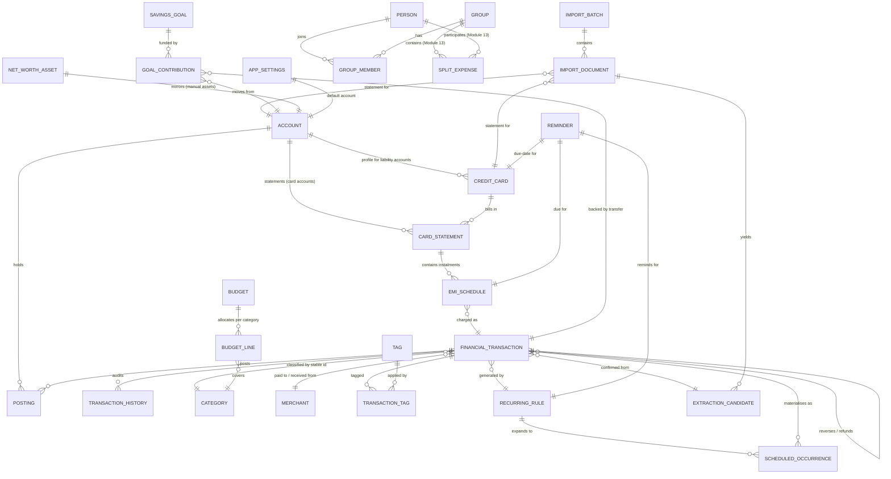
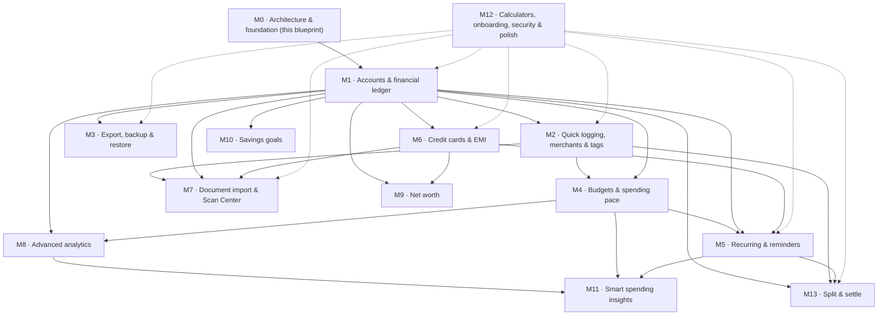

# Master Architecture Blueprint V1 — Expense Tracker → Personal Finance Management

> **Status:** Proposed blueprint for technical-lead review. No application code was changed to produce this document.
>
> **Baseline audited:** `master` at `cf31da7d62d2103c22345e8a582924fe997ee5bb` (merge commit of PR #2; PR #1 and PR #2 both merged). Audit performed against a fetched copy of that exact tree; see §2 and §16 for evidence.
>
> **Scope of this task (Module 0):** architecture inspection, documentation and design only. No feature was implemented.
>
> **How to read the labels in this document:**
>
> - **[Verified]** — checked in the baseline tree (file traced, caller traced, or command run). Evidence is cited by path.
> - **[Approved]** — a product requirement from the Module 0 brief / roadmap.
> - **[Proposed]** — technical design proposed here, not yet implemented or approved.
> - **[Unresolved]** — needs an explicit user or technical-lead decision before implementation. Collected in §15 and in `architecture-decisions.md`.

---

## 1. Executive summary

The current application is a small, working, local-first expense tracker: Drift/SQLite persistence, Google Sheets backup with a careful conditional-acknowledgement sync engine, custom categories, in-app notifications, and a single dashboard screen. Its data model cannot carry the approved 13-module product vision: money is stored as floating-point `double`, transactions carry a category *name* as text and a free-text payment method, there are no accounts, no ledger, no budgets, no recurring rules, no cards, no import pipeline, and no OS-level reminders.

This blueprint keeps what works — the Drift foundation, the Sheets sync engine and its acknowledgement discipline, the local-first save path, and the repository/provider structure — and defines the smallest foundation that can grow into a personal finance application without a rewrite in every module:

1. **Integer minor-unit money** (paise for INR) behind a single `Money` value object. No persisted `double` amounts.
2. **Accounts + a double-entry-lite ledger.** Every financial event writes balanced postings inside one database transaction; balances are derived from postings, never hand-maintained in two places.
3. **Stable identifiers everywhere.** UUIDs for synchronisable records; stable category IDs (never display names) as relationships; archival instead of deletion for anything historical data references.
4. **Sheets compatibility as a contract.** Columns A:J are frozen forever; new fields extend rightward under a versioned schema; `syncRevision` stays local-only; Sheets never becomes the canonical ledger.
5. **One document-intake pipeline** for camera, gallery, PDF, CSV and Android share intents, ending in human review. Nothing unverified is ever posted automatically.
6. **Security throughout, not at the end.** Masking, retention, temp-file lifecycle and the app-lock-is-not-encryption boundary are specified now, even though the security module ships last.

The delivery order is fixed (§12–§13): foundation first (Module 1, accounts + ledger), then logging speed, export, budgets, recurring, cards, import, analytics, net worth, goals, insights, polish, and split-and-settle last. Split-and-settle is deliberately last because it depends on accounts, people/groups, and a settled ledger.

**The single biggest decision in this blueprint is the database reset (§7.6, ADR-005).** The user confirmed the existing data is disposable test data. The architecture therefore targets a clean new financial data model rather than a migration that pretends test data must be preserved. No reset happens in this task, and no reset may happen silently in production: it must be an explicit, user-approved action in the Module 1 implementation, with the existing spreadsheet left untouched.

---

## 2. Current application audit

### 2.1 Baseline verification

| Check | Method | Result |
|---|---|---|
| Master HEAD | GitHub API `git/refs/heads/master` | `cf31da7d62d2103c22345e8a582924fe997ee5bb` — matches the expected HEAD |
| PR #1 (Sheets sync) | GitHub API | Closed, merged 2026-10-31T12:17:16Z, merge commit `6640a49724f07f36c357e163312de46745e57be5` |
| PR #2 (custom categories + schema v7) | GitHub API | Closed, merged 2026-10-31T16:15:35Z, merge commit `cf31da7d62d2103c22345e8a582924fe997ee5bb` |
| Blueprint branch | GitHub API | `feature/architecture-blueprint-v1` did not exist before this task |
| `flutter analyze` on the baseline tree | Ran in a disposable copy of the exact tree | 4 issues: 0 errors, 0 warnings, 4 pre-existing infos (`prefer_initializing_formals` in `google_sheets_backend.dart` and `sync_coordinator.dart`) |
| `flutter test` on the baseline tree | Ran in a disposable copy of the exact tree | **85 passed, 1 failed** — the single failure is the known pre-existing `test/widget_test.dart` Drift Timer failure (see §2.7). No test was weakened, skipped or rewritten |
| Local working copy | Inspected | The local working copy is not a git checkout (no `.git`); it was left untouched by this task. All baseline work used a fetched copy of `master` |

### 2.2 What exists — verified

**Persistence [Verified].** Drift 2.35 + `drift_flutter`, schema version **7** (`lib/data/database/app_database.dart`). Tables in the `@DriftDatabase` list: `Transactions`, `CustomCategories`, `Notifications`. Migration history in `onUpgrade`: v2/v3 raw-SQL `app_settings` create/alter, v4 `customCategories`, v5 drop `app_settings`, v6 `notifications`, v7 `addColumn(transactions.syncRevision)`. The `AppSettings` table *file* (`lib/data/database/app_settings.dart`) still exists but is **not** in the database tables list — legacy only; the migrations create and then drop an `app_settings` table by raw SQL.

**Transactions table [Verified]** (`lib/data/database/transactions.dart`): integer auto-increment `id`; `uuid` unique; `type` text (`Expense`/`Income`); `amount` **REAL (`double`)**; `category` **text name, not a foreign key**; `description`, `paymentMethod` (free text, UI offers UPI/Cash/Card/Bank Transfer), `transactionDate`, `notes`, `createdAt`, `updatedAt` (DateTime, second-precision storage — verified by read-back in the PR #2 review), `syncRevision` integer default 0 (local-only acknowledgement token), `syncStatus` text (`pending`/`synced`), soft-delete `deleted` boolean.

**Custom categories [Verified].** `CustomCategories` table (id, uuid, name, icon code point, createdAt). Eight built-in categories defined in code with stable ids (`food`, `travel`, `shopping`, `bills`, `entertainment`, `health`, `education`, `other`) in `lib/core/categories/category.dart`. Repository rules (verified in code and tests): `updateCategory` delegates to atomic `renameCategory`, which reads the stored name inside the transaction and renames matching transactions; built-in name collisions rejected in the repository using the built-in definitions as source of truth; rename bumps each matching transaction's `syncRevision` and marks it pending, including soft-deleted rows; delete never touches transactions.

**Transaction flows [Verified].** Create/edit/delete/restore/search via `TransactionRepository` + `AddTransactionPage` / `AllTransactionsPage` / `DashboardPage`. Delete is soft-delete with undo (SnackBar). Search matches description/category/paymentMethod/notes. `getBalanceBeforeMonth` exists but has **no callers** (dead code — see §2.5).

**Google authentication [Verified]** (`lib/core/auth/google_auth_service.dart`, google_sign_in 7.2): session restore on startup via lightweight authentication only (never `authenticate()`/`authorizeScopes()` at startup); scopes are exactly `drive.file` + `spreadsheets`; authorization is a separate explicit Settings action; background sync stays silent when not signed in or unauthorized. `GoogleSignInTestPage` exists but has **no callers** (dead code).

**Google Drive / Sheets [Verified]** (`lib/core/sync/google_drive_service.dart`, `google_sheets_backend.dart`, `sheets_sync.dart`, `sync_coordinator.dart`):
- One master spreadsheet in an app-created "Expense Tracker" Drive folder (found by Drive query, not by name; a manually created folder with the same name is generally *not* found — see the backend's own comments).
- Year worksheets; headers A:J: `Date, Type, Category, Description, Amount, UUID, PaymentMethod, Notes, UpdatedAt, Deleted`. Amount is written as a decimal.
- UUID-based upsert; duplicate-UUID rows are reported and never auto-merged; year moves tombstone old-year rows and write the new-year row; a transaction deleted before its first sync creates no row and no worksheet.
- Pure sync engine (`SheetsSyncEngine`) with a backend interface and a fake backend/store test harness; worksheet discovery is all-or-nothing (a failed listing aborts the run before any write or acknowledgement).
- Conditional acknowledgement: `markTransactionSyncedIfUnchanged(id, syncRevision, deleted)` — see §8.
- Coordinator: one run at a time, drain loop for triggers arriving mid-run, bounded retry with backoff 2s/5s/15s/60s (max 4), one notification per run, silent background behaviour for not-signed-in / authorization-missing.
- `setupExpenseTracker()` in `GoogleDriveService` **is** used (called by the backend's spreadsheet resolution) — it is not dead code.

**Notifications [Verified].** In-app only. `NotificationManager` (ChangeNotifier) + Drift `Notifications` table + `NotificationType` enum. There is **no** `flutter_local_notifications` dependency, no scheduling API, and no OS notification. Any reminder feature (Module 5) must add scheduling; nothing today can fire at a future time.

**Providers / state [Verified].** Global singletons in `lib/core/database/database_provider.dart` (`appDatabase`) and `repository_provider.dart` (two repositories). No Riverpod/Bloc/Provider package. Screens are `StatefulWidget`s driven by Drift streams. This is simple and adequate today; §4 recommends keeping it until a module proves otherwise.

**Navigation [Verified].** No router, no bottom navigation. `MaterialApp` with `home: DashboardPage`, imperative `Navigator.push` to settings, summaries, analytics, transaction list and add/edit pages. Theme: Material 3, `ThemeMode.system`, light + dark via `colorSchemeSeed: Colors.indigo` (`lib/app/theme/app_theme.dart`).

**Tests [Verified].** Seven test files: repository tests (custom categories, sync revision, migration), engine tests (Sheets sync with fake backend/store), widget tests (category form, add-transaction page) and the default `widget_test.dart`. Baseline: 85 pass, 1 pre-existing failure (see §2.7). Test-only dev dependency `sqlite3` is used by the migration test to build a raw-SQL v6 fixture.

**Dependencies [Verified]** (`pubspec.yaml`): `flutter`, `cupertino_icons`, `drift`, `drift_flutter`, `uuid`, `google_sign_in`, `googleapis`, `extension_google_sign_in_as_googleapis_auth`; dev: `flutter_test`, `flutter_lints`, `drift_dev`, `build_runner`, `sqlite3`. There are **no** packages for charts, images, files, camera, OCR, sharing, biometrics, HTTP, or date formatting (`intl` is absent).

**Documentation [Verified].** `docs/sheets-sync.md` (716 lines) and `docs/custom-categories.md` (105 lines) are thorough and accurate about the sync/correction history. `README.md` is still the default Flutter template. `AGENTS.md` (repo root) requires: one task at a time, inspect before changing, no proactive future work, run analyze after changes, stop for user testing on Drift changes, show changed files + results at checkpoints, wait for confirmation.

### 2.3 Gaps against the product vision — verified absences

| Capability | Status in baseline |
|---|---|
| Accounts, balances, opening balances, transfers | Absent. Only a payment-method text field |
| Integer money / Money model | Absent. `double` amounts throughout, `toStringAsFixed(2)` display |
| Budgets, recurring rules, reminders | Absent (notifications table exists, but no scheduling or rules) |
| Credit cards / EMI | Absent |
| Merchants, tags, templates | Absent (description/notes free text only) |
| Export / backup / restore files | Absent (Sheets sync only; no CSV/JSON export) |
| Charts | Absent (progress bars only; no chart package) |
| Document import / OCR / share intents | Absent. No intent filters beyond MAIN/LAUNCHER; `MainActivity.kt` has no intent handling |
| Net worth / goals / insights / calculators | Absent |
| App lock / biometrics / encryption | Absent |
| Split / people / groups | Absent |

### 2.4 Strengths to preserve

Local-first saving (UI never waits on Sheets); conditional acknowledgement discipline; pure, fake-testable sync engine; atomic rename-with-transaction-update; built-in names as single source of truth; silent background sync rules; small dependency surface; thorough sync/category documentation.

### 2.5 Dead / legacy code — verified by caller tracing

- `GoogleSignInTestPage` — no callers. **[Proposed]** Remove in Module 1 cleanup (do not remove in this task).
- `TransactionRepository.getBalanceBeforeMonth` — no callers. **[Proposed]** Remove or replace with ledger-derived balances in Module 1.
- `AppSettings` table file + raw-SQL `app_settings` migrations — legacy, table dropped in v5 migration. **[Proposed]** Superseded by the new `AppSettings` entity design (§5); removal is part of the Module 1 reset decision, not this task.
- Default-template `README.md` — **[Proposed]** rewrite as part of Module 12 polish, or with the Module 1 foundation PR if the tech lead prefers.

### 2.6 Risks carried into the redesign

1. **Floating-point money** is the most urgent correctness risk: `double` totals, `double` Sheets amounts, and `toStringAsFixed` display will diverge from integer accounting the moment transfers, splits and reconciliation exist. Module 1 must end this.
2. **Category-as-text** couples history to display names; the rename-propagation machinery exists only because of this. Stable category IDs (§5) remove the coupling.
3. **No account concept** means no balance can ever be computed correctly from current data (a "balance" today would be income-minus-expense over all time, with no opening balance and no per-account split).
4. **Sync scope creep risk:** the Sheets engine is excellent for transactions but was never designed for accounts, cards, documents or settings. §8 scopes it explicitly so it is not stretched into a general backend.
5. **Test baseline fragility:** widget tests mounting live Drift databases need the close-in-body pattern; the pre-existing Timer failure must stay visible (see §2.7).

### 2.7 Known baseline failures — recorded separately, not hidden

- `test/widget_test.dart` — "Expense Tracker app loads" fails with a pending-Timer teardown error (open Drift connection in the widget-test binding). Pre-existing on `master`; reproduced in this audit's baseline run. **Do not weaken, skip or rewrite this test to obtain a green result.** Fixing it is a Module 0/1 hygiene item only if the tech lead approves a fix that addresses the root cause (database lifecycle in the test), with the failure still reported until fixed.
- `flutter analyze`: 4 pre-existing infos only (see §2.1). No errors or warnings on `master`.

---

## 3. Approved product vision

**[Approved]** The application evolves from a basic Expense Tracker into a Personal Finance Management application, organised in four product areas:

1. **TRACK** — record money movement quickly and accurately.
2. **MANAGE** — accounts, budgets, cards, EMIs, goals.
3. **UNDERSTAND** — summaries, analytics, net worth, insights.
4. **AUTOMATE** — recurring rules, bills, reminders, smart rules.

**[Approved]** Five primary destinations: **Home, Track, Manage, Understand, Automate.** The four sections (Track/Manage/Understand/Automate) must have separate landing pages with clearly organised feature navigation. Home provides the financial overview and quick actions. Existing working functionality must be preserved through the redesign (transactions, categories, Sheets backup, summaries/analytics as they exist today — re-homed, not removed).

**[Approved]** Security and privacy are considered throughout the architecture (§10), not postponed to Module 12. Split-and-settle is intentionally the final major feature (Module 13).

---

## 4. Target technical architecture

### 4.1 Principles

1. **Local-first, always.** Every save writes to Drift first and returns; sync, import processing and analytics never block saving. (Preserves the current guarantee.)
2. **One source of truth per fact.** Balances derive from postings; reports derive from transactions + postings; Sheets is a backup copy, never the ledger.
3. **No business logic in widgets.** Widgets read streams/state and dispatch intents to services/repositories; posting rules, parsing, reconciliation and sync decisions live in domain/data layers.
4. **Small, explicit dependencies.** A new package needs a recorded trade-off (see §8.6, §9.4). No package is added in this task.
5. **Stable identities, archival over deletion.** Anything history references is archived, never hard-deleted.
6. **Fail visibly, never silently lose data.** Partial failures keep work pending/reviewable; destructive actions require explicit confirmation.

### 4.2 Layers and boundaries

```
Presentation (features/*/presentation)
  │  reads streams/view-models, dispatches commands, renders states
  ▼
Domain / application services (features/*/domain + core/domain)
  │  Money, posting rules, budget pacing, recurrence expansion,
  │  import pipeline orchestration, duplicate/reconciliation rules
  ▼
Data (features/*/data + data/repositories + data/database)
  │  Drift tables/DAOs, repositories, transaction-scoped writes,
  │  migration strategy
  ▼
External integrations (core/sync, core/import, core/notifications)
     Sheets/Drive backend, OCR/text extractors, share-intent receiver,
     OS notification scheduler — all behind interfaces, all fakeable in tests
```

Rules:

- Presentation never imports `googleapis`, Drift table classes, or OCR libraries directly.
- Domain services never import Flutter widgets or platform channels.
- Repositories own all database transactions; services compose repository calls inside a repository-provided transaction when atomicity spans tables (§6.5).
- Sync adapters map between local rows and external formats; they never contain posting or reporting rules.

### 4.3 State management — decision

**[Proposed, ADR-009]** Keep the current approach: Drift streams + repository singletons + `StatefulWidget`/`ChangeNotifier` for local UI state. Do **not** introduce Riverpod, Bloc or another framework for this redesign. Rationale: the current app is correct and testable without one; the new complexity is in the domain/data layers (ledger, import, sync), not in UI state plumbing. Revisit only with evidence — e.g. if cross-screen derived state (budget pacing + reminders + home overview) becomes unmanageable — and record that evidence in an ADR before adopting anything.

### 4.4 Proposed folder structure (evolves the current tree; no renames in this task)

```
lib/
  app/                  # App widget, theme, navigation shell (5 destinations)
  core/
    domain/             # Money, currency, posting rules, date/period helpers (NEW)
    database/           # AppDatabase, providers (existing, extended)
    categories/         # Built-in category definitions (existing)
    auth/               # Google auth (existing; unchanged scope)
    sync/               # Sheets engine, backend, coordinator (existing; extended per §8)
    import/             # Intake pipeline, extractors, dedupe, reconciliation (NEW, Module 7)
    notifications/      # In-app store (existing) + OS scheduler adapter (NEW, Module 5)
    security/           # App lock, masking helpers (NEW, Module 12; masking helpers earlier)
    share/              # Android share-intent receiver (NEW, Module 7)
    utils/              # Formatting/parsing helpers that are not Money (NEW, minimal)
  data/
    database/           # Drift tables + DAOs (grows per §5; generated code via build_runner only)
    repositories/       # One repository per aggregate (existing pattern, extended)
  features/
    home/               # Home overview + quick actions (NEW shell; dashboard re-homed)
    track/              # Transactions, categories, merchants, tags, templates, import entry
    manage/             # Accounts, budgets, cards/EMI, goals
    understand/         # Summaries, analytics, net worth, insights
    automate/           # Recurring rules, bills, reminders, smart rules
    settings/           # Settings, security, backup/restore, about (existing settings re-homed)
  main.dart             # Startup: notifications init, lightweight auth restore, background sync
```

Existing feature folders (`dashboard`, `summary`, `analytics`, `transactions`, `categories`, `settings`) are re-homed into the five destinations during Modules 1–2 rather than deleted in one big move; each move keeps routes/screens working and is covered by existing widget tests where they exist.

### 4.5 Cross-cutting concerns

- **Errors:** typed failures at service boundaries; user-facing messages never include tokens, file paths, card numbers or raw API errors.
- **Logging:** no financial amounts, descriptions, names, card/account identifiers or document text in logs or crash reports (§10.6).
- **Time:** one clock seam per service that needs determinism in tests (the pattern already introduced for `TransactionRepository` in PR #2 round 4); `DateTime.now()` only at composition roots.
- **IDs:** `uuid` v4 for every synchronisable/imported record; integer auto-increment ids remain internal row ids only and are never used as cross-system identity.

---

## 5. Data model and entity relationships

### 5.1 ER diagram (proposed)



Notes: `SPLIT_EXPENSE` and split share/settlement entities are shown only as placeholders for Module 13; they are **not** designed in detail here and must not be built early. `NET_WORTH_ASSET`/`NET_WORTH_LIABILITY` are manual (non-account) holdings; account-backed net worth derives from `ACCOUNT` + postings.

### 5.2 Data dictionary

Conventions for every entity below: **PK** = primary key; **FK** = foreign key; **Amount** states the storage representation; **Lifecycle** states delete/archive rules; **Sync** states whether the entity participates in Google Sheets sync; **Sensitive** flags data needing masking/retention care (§10). All synchronisable entities carry `uuid` (TEXT, unique), `createdAt`, `updatedAt`, `syncRevision` (local-only integer, as established in PR #2) and `syncStatus` where they sync. `deleted` is a soft-delete flag wherever history must survive. Amounts are integer minor units (§6) unless stated otherwise. Nothing in this dictionary is implemented in this task.

**Account** — A place money lives or is owed. Purpose: balance holder and posting target.
PK: `uuid`. Fields: `name`, `kind` (`bank` | `cash` | `wallet` | `other_asset` | `credit_card_liability`), `currencyCode` (default `INR`), `icon`, `color`, `isArchived`, `archivedAt`, `displayOrder`, `openingPostingId` (FK → Posting, nullable). Amounts: no stored balance field — balance derives from postings (§6.4); opening balance is an opening posting, not a mutable number. Relationships: 1:N Postings; 0/1 CreditCard profile (only when `kind = credit_card_liability`). Lifecycle: archive only; never hard-delete while postings exist. Archived accounts disappear from pickers but keep history and balances. Sync: **[Proposed]** scoped — account *names/kinds* sync only under the §8 rules; balances are never synced (derived locally). Sensitive: account names only; masked account numbers live on the CreditCard/statement entities, never here.

**FinancialTransaction** — The business event the user understands (a purchase, salary, transfer, payment, refund). Purpose: reporting, search, history, sync unit.
PK: `uuid`. FKs: `categoryId` (stable category id, nullable for transfers), `merchantId` (nullable), `recurringRuleId` (nullable), `candidateId` (nullable), `reversesTransactionId` (nullable, self-reference for refunds), `transferGroupId` (nullable, shared by the two legs of a transfer — see §6.3). Fields: `kind` (`expense` | `income` | `transfer` | `card_payment` | `refund` | `adjustment`), `occurredAt` (date), `amountMinorUnits` (see §6.2 for which amount a transfer/refund carries), `currencyCode`, `description`, `notes`, `paymentChannel` (UPI/cash/card/bank — replaces free-text payment method), `status` (`active` | `deleted`), `source` (`manual` | `recurring` | `import` | `template`). Amounts: integer minor units. Relationships: 1:N Postings (≥2, balanced); N:M Tags; 1:N History rows. Lifecycle: soft-delete only; restore re-includes postings. Sync: yes — the Sheets sync unit (§8). Sensitive: description/notes are user text; never logged.

**Posting (ledger entry)** — One side of a balanced financial event. Purpose: the single source of truth for balances.
PK: `uuid`. FKs: `transactionId`, `accountId`. Fields: `direction` (`debit` | `credit` — defined in §6.3), `amountMinorUnits` (always positive; direction carries the sign), `currencyCode` (must equal the account currency in V1), `postingDate` (equals transaction date in V1). Amounts: integer minor units. Relationships: N:1 Transaction, N:1 Account. Lifecycle: never edited directly; replaced atomically with its transaction (old postings superseded in the same DB transaction, history row records the change). Sync: no — postings are derived locally from transactions; Sheets never receives postings. Sensitive: no.

**TransactionHistory** — Audit trail for edits. Purpose: answer "what changed?" without complicating the ledger.
PK: `uuid`. FK: `transactionId`. Fields: `changedAt`, `changeKind` (`created` | `edited` | `deleted` | `restored` | `renamed_category`), `beforeSnapshot` (structured field values before the change — amounts as minor units, category id, account ids; never full document text), `afterSnapshot`. Lifecycle: append-only; retained with the transaction; deleted only if the user explicitly purges history (Module 12 decision — **[Unresolved]**). Sync: no. Sensitive: contains old descriptions — same handling as transaction text.

**Category** — Stable classification. Purpose: reporting taxonomy that survives renames.
PK: `categoryId` (stable string id, e.g. `food`; built-ins use the existing eight ids). Fields: `name`, `iconCodePoint`, `color`, `kind` (`expense` | `income` | `both`), `origin` (`builtin` | `custom`), `isArchived`, `parentCategoryId` (nullable — subcategories are **[Proposed, deferred]**; V1 keeps the flat list), `displayOrder`. Amounts: none. Relationships: referenced by transactions/budget lines by id; historical rows keep the id even if the category is archived. Lifecycle: built-ins can be renamed by the user? **[Unresolved]** — default: built-in names are fixed strings in code, user-renaming built-ins is out of scope for V1; custom categories can be renamed (propagation becomes unnecessary — history references the id) and archived (never deleted while referenced; delete allowed only when zero transactions reference it, otherwise archive). Sync: category definitions are local configuration; **[Proposed]** not synced to Sheets (Sheets carries the category *name* per row for readability, resolved back to id by name on import — see §8.5). Sensitive: no.

**Merchant** — Named counterparty. Purpose: fast logging, analytics by payee, import matching.
PK: `uuid`. Fields: `name` (trimmed, case-insensitive unique), `defaultCategoryId` (nullable), `lastUsedAt`, `useCount`. Lifecycle: merge/rename in Manage; deleting a merchant nulls the reference (transactions keep their description text). Sync: no. Sensitive: names only.

**Tag / TransactionTag** — Free-form labels (e.g. `trip-goa`, `tax-2026`).
Tag PK: `uuid`; fields `name` (case-insensitive unique), `color`. TransactionTag: composite (`transactionId`, `tagId`). Lifecycle: deleting a tag removes only links. Sync: **[Proposed]** tags sync as a comma-joined column in the Sheets extension area (§8.3), not as separate rows. Sensitive: no.

**Budget** — A spending plan for a period. Purpose: pacing + alerts.
PK: `uuid`. Fields: `name`, `periodKind` (`monthly` | `custom`), `startDate`, `endDate`, `totalLimitMinorUnits` (nullable — overall cap), `currencyCode`, `isActive`. Relationships: 1:N BudgetLines. Lifecycle: deactivating stops alerts; history retained. Sync: no (local planning data). Sensitive: no.

**BudgetLine** — Per-category allocation inside a budget.
PK: `uuid`. FKs: `budgetId`, `categoryId`. Fields: `limitMinorUnits`, `alertAtPercent` (default 80/100 — see §11). Amounts: integer minor units. Lifecycle: follows its budget. Sync: no.

**RecurringRule** — A template that generates transactions on a schedule.
PK: `uuid`. FKs: `categoryId`, `accountId` (destination/source), `merchantId` (nullable). Fields: `title`, `kind`, `amountMinorUnits`, `currencyCode`, `frequency` (`daily` | `weekly` | `monthly` | `yearly`), `interval`, `dayOfMonth`/`weekday` rules, `startDate`, `endDate` (nullable), `nextRunDate`, `isActive`, `autoPost` (bool — **[Proposed default: false]**; occurrences are created as drafts/confirmations unless the user opts into auto-posting), `reminderDaysBefore`. Lifecycle: pausing stops generation; deleting a rule never deletes generated transactions. Sync: rules themselves do not sync; generated transactions sync normally. Sensitive: no.

**ScheduledOccurrence** — One expected instance of a rule. Purpose: upcoming-bills list, reminder scheduling, skip/confirm handling.
PK: `uuid`. FKs: `ruleId`, `transactionId` (nullable until materialised). Fields: `dueDate`, `state` (`pending` | `posted` | `skipped` | `overdue`), `amountMinorUnits` (snapshot of the rule amount at expansion). Lifecycle: generated by expansion; retained as history. Sync: no. Sensitive: no.

**CreditCard** — Profile for a liability account. Purpose: limits, cycles, due dates, statements.
PK: `uuid`. FK: `accountId` (the liability account, 1:1). Fields: `issuer`, `name`, `maskedNumber` (last 4 digits only — full numbers are never stored), `creditLimitMinorUnits`, `billingDayOfMonth`, `dueDayOfMonth`, `isActive`. Amounts: integer minor units. Lifecycle: archiving the card archives the account; statements retained. Sync: **[Proposed]** profile syncs only as name/issuer/last4 under §8 rules; limits/dates are local. Sensitive: **yes** — last4 + issuer only; never store full PAN, CVV or PIN (§10.3).

**CardStatement** — One billing cycle. Purpose: reconciliation + due tracking.
PK: `uuid`. FK: `creditCardId`. Fields: `periodStart`, `periodEnd`, `statementDate`, `dueDate`, `totalDueMinorUnits`, `minimumDueMinorUnits`, `previousBalanceMinorUnits`, `paymentsMinorUnits`, `purchasesMinorUnits`, `feesMinorUnits`, `taxesMinorUnits`, `closingBalanceMinorUnits`, `source` (`manual` | `import`), `reconciled` bool. Amounts: integer minor units. Lifecycle: immutable once reconciled except by correction entry. Sync: no (local). Sensitive: amounts only.

**EmiSchedule** — Instalment plan. Purpose: EMI tracking + reminders.
PK: `uuid`. FKs: `creditCardId` (nullable — card EMIs) or `accountId` (loan EMIs), `transactionId` (originating purchase, nullable). Fields: `title`, `totalMinorUnits`, `instalmentMinorUnits`, `totalInstalments`, `paidInstalments`, `startDate`, `dueDayOfMonth`, `interestRatePercent` (nullable, display only — no interest computation in V1), `isActive`. Amounts: integer minor units. Lifecycle: completes when instalments are exhausted; each due instalment links to a transaction when paid. Sync: no. Sensitive: no.

**ImportBatch** — One import session. Purpose: history, undo, recovery.
PK: `uuid`. Fields: `sourceKind` (`camera` | `gallery` | `pdf` | `csv` | `share`), `createdAt`, `state` (`in_progress` | `review` | `completed` | `partially_failed` | `discarded`), `fileCount`, `confirmedCount`, `duplicateCount`. Lifecycle: retained as history; discarding a batch discards its unconfirmed candidates and (per retention setting) its documents. Sync: no. Sensitive: batch metadata only.

**ImportDocument** — One source file/text. Purpose: provenance, re-extraction, audit.
PK: `uuid`. FKs: `batchId`, `accountId` (nullable, once classified), `creditCardId` (nullable). Fields: `documentKind` (see §9.2), `originalFileName`, `storedPath` (app-private storage, nullable for text shares), `mimeType`, `pageCount`, `classification`, `classificationConfidence`, `issuer`, `statementPeriodStart/End`, `openingBalanceMinorUnits`, `closingBalanceMinorUnits` (statement docs), `passwordProtected` bool (password itself never stored), `retentionExpiresAt` (nullable), `state`. Amounts: integer minor units where present. Lifecycle: retained per retention setting (§9.7); deletion removes the stored file and the row. Sync: **never** — original documents are never uploaded to Sheets (§8.7). Sensitive: **yes** — financial documents; app-private storage only.

**ExtractionCandidate** — One parsed transaction awaiting review. Purpose: human confirmation gate.
PK: `uuid`. FKs: `documentId`, `matchedTransactionId` (nullable — duplicate match), `confirmedTransactionId` (nullable). Fields: per-field values (`occurredAt`, `description`, `debitMinorUnits`/`creditMinorUnits`, `reference`, `channel`, `runningBalanceMinorUnits`) each with `confidence` (0–1) and `source` (`extracted` | `corrected` | `inferred`), `duplicateScore`, `duplicateReason`, `state` (`pending` | `confirmed` | `duplicate_skipped` | `discarded`), `reviewedAt`. Amounts: integer minor units. Lifecycle: confirmed candidates create FinancialTransactions; discarded candidates retained for audit until batch retention expires. Sync: no. Sensitive: **yes** — extracted financial data; same handling as transactions.

**Reminder / NotificationRecord** — Scheduled and delivered reminders. Purpose: bills, due dates, budget alerts, sync outcomes.
PK: `uuid`. FKs: polymorphic target (`targetKind` + `targetUuid`: rule / card / EMI / budget). Fields: `kind` (`bill_due` | `card_due` | `emi_due` | `budget_alert` | `sync`), `scheduledFor`, `deliveredAt`, `state` (`scheduled` | `delivered` | `dismissed` | `acted`), `title`, `message`. Lifecycle: delivered records retained as in-app history (existing Notifications behaviour). Sync: no. Sensitive: titles/messages must not contain card numbers or amounts beyond what the user already sees in-app — masking rules apply (§10).

**SavingsGoal** — A target with contributions.
PK: `uuid`. Fields: `name`, `targetMinorUnits`, `currencyCode`, `targetDate` (nullable), `icon`, `isArchived`. Relationships: 1:N GoalContributions. Lifecycle: archive on completion/abandon; contributions retained. Sync: no. Sensitive: no.

**GoalContribution** — Money moved toward a goal.
PK: `uuid`. FKs: `goalId`, `accountId` (source account), `transactionId` (nullable — the backing transfer, when contributions move real money). Fields: `amountMinorUnits`, `occurredAt`, `note`. Amounts: integer minor units. Lifecycle: follows its goal; deleting a contribution does not delete the backing transaction (it unlinks it). Sync: no. Sensitive: no.

**NetWorthAsset / NetWorthLiability** — Manual holdings outside accounts (e.g. property, gold, personal loans).
PK: `uuid`. Fields: `name`, `kind`, `valueMinorUnits`, `currencyCode`, `valuedAt`, `isArchived`. Amounts: integer minor units. Lifecycle: archive only. Sync: no. Sensitive: values only.

**Person / Group / GroupMember** — Split-and-settle placeholders (Module 13 only).
Person PK: `uuid`; fields `name`, `contactHint` (nullable — no contact import in V1), `isSelf`. Group PK: `uuid`; fields `name`, `kind`. GroupMember: (`groupId`, `personId`). Lifecycle: archiving a person/group preserves history. Sync: no (split data is local-only in V1 design; sync of split data is **[Unresolved]**). Sensitive: names only. **Do not build these entities before Module 13** except as foreign-key placeholders if Module 1 needs them — it does not.

**AppSettings** — Single-row application configuration (replaces the legacy `app_settings` concept).
PK: fixed id `1`. Fields: `currencyCode` (default `INR`), `defaultAccountId` (nullable FK), `themeMode` (`system` | `light` | `dark` — mirrors current system behaviour, user choice added in Module 12), `appLockEnabled`, `documentRetentionDays`, `defaultReminderDays`, `sheetsBackupEnabled`, `setupCompleted`. Lifecycle: one row, updated in place, never deleted. Sync: no — settings are device-local (Sheets backup on/off is a local choice; the spreadsheet identity itself stays in the existing backend resolution flow). Sensitive: no secrets (no tokens, no passwords).

### 5.3 Identity and relationship rules (normative)

1. Every synchronisable/imported record has a `uuid` v4. Integer ids are internal only.
2. Relationships use stable ids/UUIDs — never display names. (Current `category` text coupling is removed by the Module 1 reset; see §7.6.)
3. Built-in categories keep their existing string ids (`food`, …). Custom categories get stable ids at creation (UUID-based or `custom_<uuid>` — exact form is a Module 1 implementation detail, recorded in the Module 1 plan, not here).
4. Archival, not deletion, for categories, accounts, merchants, goals and people/groups once referenced.
5. `syncRevision`/`syncStatus` exist only on entities that sync (transactions in V1; possibly categories/accounts later only under §8 rules). They are never part of any external format.

---

## 6. Money and financial-ledger rules

### 6.1 Money value object [Proposed]

```text
Money { amountMinorUnits: int, currencyCode: String }   // e.g. Money(125075, "INR") = ₹1,250.75
Currency { code: String, minorUnitDigits: int }          // INR -> 2; JPY -> 0 (future)
```

Rules (normative for Modules 1+):

- Money is immutable; arithmetic returns new Money and requires equal `currencyCode` (cross-currency arithmetic is a compile-time/logic error in V1 — see §6.6).
- Addition/subtraction are exact integer operations. There is no floating-point path for persisted or computed financial totals.
- Comparison uses minor units only.
- Zero is `Money(0, code)`; negative Money values are never stored as amounts — direction/sign lives in postings and transaction kinds (§6.3), not in negative amounts.
- The `Money` type lives in `core/domain/money.dart` with unit tests covering §14. It is the *only* place that converts between minor units, decimal strings and display strings.

### 6.2 Currency, formatting, parsing, rounding

- **Initial currency: INR only [Approved].** `currencyCode = "INR"`, 100 paise = ₹1. The data model carries `currencyCode` on every money-bearing row so a future currency choice does not require a schema redesign — but no multi-currency behaviour, exchange rates, or currency picker is built in V1.
- **Formatting:** `Money → display string` uses minor-unit integer division/modulo (e.g. `125075 → ₹1,250.75`, Indian digit grouping per locale conventions). No `double` intermediate. The `intl` package is *not* currently a dependency; whether to add it for grouping/symbols is a Module 1 implementation choice to be recorded, not decided here. **[Unresolved]** only in the sense of package selection, not of the integer rule.
- **Parsing (user input):** parse the decimal *string* directly to minor units: split on the decimal separator, validate digits, pad/truncate the fractional part to the currency's minor digits with **round-half-away-from-zero** on any excess digit, reject empty/negative/malformed input with a field error. Never parse via `double` (`double.parse("1250.75") * 100` is forbidden by this blueprint).
- **Rounding:** all rounding happens at input/parse boundaries and at Sheets import boundaries (§6.5), using the rule above, and is unit-tested. No rounding inside totals: totals are exact integer sums.
- **Input validation:** amount field accepts digits + one decimal separator; max 2 fractional digits for INR (extra digits round per the rule above, with the rounded value shown back to the user before save — the confirm screen must show the *stored* value, not the typed string).

### 6.3 Posting rules — the ledger

**[Proposed]** Double-entry-lite: every `FinancialTransaction` writes two or more `Posting` rows in one database transaction. Postings for one transaction always sum to zero when signed by direction (`debit = +`, `credit = −`, per account type — see the table; the invariant is checked in tests, not by convention).

Sign convention (state it once, use it everywhere): for **asset** accounts (bank/cash/wallet), a debit *increases* the balance and a credit *decreases* it. For **liability** accounts (credit cards), a credit *increases* what is owed and a debit *decreases* it. Balances are computed as: asset balance = sum(debits) − sum(credits); liability owed = sum(credits) − sum(debits). The posting table stores `direction` + positive amount; the service layer applies the account-kind sign rule. (Implementation may alternatively store signed amounts internally — the invariant and the table above are what matter; the Module 1 plan must pick one and record it.)

| Case | Postings (account ← direction) | Reporting effect |
|---|---|---|
| A. Bank expense ₹500 | Bank ← credit 500; Expense clearing ← debit 500* | Bank −500; expense +500 |
| B. Cash expense ₹200 | Cash ← credit 200; Expense clearing ← debit 200* | Cash −200; expense +200 |
| C. Income ₹10,000 to Bank | Bank ← debit 10,000; Income clearing ← credit 10,000* | Bank +10,000; income +10,000 |
| D. Transfer ₹1,000 Bank → Cash | Bank ← credit 1,000; Cash ← debit 1,000; `transferGroupId` shared | Bank −1,000; Cash +1,000; income/expense unchanged |
| E. Credit-card purchase ₹2,000 | Card liability ← credit 2,000; Expense clearing ← debit 2,000* | Owed +2,000; expense +2,000; bank unchanged |
| F. Card bill payment ₹2,000 Bank → Card | Bank ← credit 2,000; Card liability ← debit 2,000; kind `card_payment` | Bank −2,000; owed −2,000; **not** a new expense |
| G. Refund ₹500 (original expense) | Reverse postings of the original (or offsetting postings) + `reversesTransactionId`; kind `refund` | Expense −500; account +500 (to the original account) |

\* "Clearing" is a conceptual counterpart, not a user-visible account: in the proposed model the expense/income side is carried by the transaction's `kind` + `categoryId`, and the second posting targets a per-transaction internal counterpart that reporting aggregates by kind/category. The Module 1 implementation must decide between (i) a real system "clearing/equity" account row, or (ii) postings only for real accounts with reporting derived from transaction kind — and record the choice. Either way, **the invariant is**: every transaction's real-account postings are fully determined by `kind` + accounts, and reporting never double-counts a payment as an expense.

**Transfers and card payments are kinds, not categories.** They carry no expense/income category (or a fixed system category id that reporting explicitly excludes). Refunds carry the original category and link to the original transaction.

### 6.4 Balances

- **Derived, always.** An account balance is `SUM(postings)` for that account (with the §6.3 sign rule). There is no mutable `balance` column to drift out of sync.
- **Opening balance** is an opening posting from a system equity counterpart dated at account creation (or the account's `openingDate`). Editing an opening balance = replacing that posting in a transaction, with history.
- **Cached balances are not in V1** unless profiling proves a need; if added later, the cache must be updated in the same DB transaction as the postings and covered by a reconciliation test. **[Proposed]**
- **Archived accounts** keep computing balances; they are excluded from pickers and from "available balance" totals on Home (which sums asset accounts only, excluding credit-card liabilities — shown separately as "owed").

### 6.5 Edits, deletes, restores, atomicity

- **Edit:** read transaction + postings, write new postings, append a `TransactionHistory` row, bump `syncRevision`, set `syncStatus = pending` — all in **one** Drift transaction. If any step fails, nothing is written.
- **Delete (soft):** set `deleted`, bump revision, mark pending — in one transaction. Postings are retained but excluded from balances/reporting by the `deleted` flag (the exclusion is a query predicate, not a posting deletion, so restore is exact).
- **Restore:** clear `deleted`, bump revision, mark pending — one transaction.
- **Category rename/retire:** with stable ids, rename is a Category-row update only — no transaction rewriting (the PR #2 propagation machinery becomes unnecessary after the reset). Retire = archive.
- **Sheets conversion (§6.5 boundary):** local paise → sheet decimal happens only in the sync adapter (`paise / 100` as a formatted decimal string with exactly 2 fraction digits, produced from integers — never via `double` division in a way that can produce `1250.749999`). Sheet → local (import/reconciliation) parses the decimal string per §6.2. Both directions are unit-tested with values like `0`, `1`, `99`, `100`, `125075`, `999999999999` paise.
- **No partial updates:** any service that touches more than one table (transaction + postings + history; rename + affected rows; goal contribution + transfer) must run inside one Drift `transaction {}`. The existing codebase already uses this pattern for renames; extend it as the rule.

### 6.6 Cross-currency boundaries [Approved scope]

- V1 is single-currency (INR). All accounts, transactions and budgets carry `currencyCode = INR`.
- A transfer between accounts of different currencies is **blocked by validation** in V1 (there are no different-currency accounts in V1, so the rule is a guard for the future).
- **No exchange rates are invented, fetched, or stored.** Multi-currency support, if ever approved, is a separate design (exchange-rate source, rate date, conversion postings) — explicitly out of scope for Modules 0–13.

### 6.7 Why this model (and why not full accounting)

Full double-entry accounting (chart of accounts, journals, trial balance) is disproportionate for a single-user app and would slow every module. Double-entry-lite keeps the one property that matters — *balances always reconcile to events, by construction* — with two tables and one invariant. It is also exactly the model SpendMate's split/posting design and the current app's `syncRevision` discipline already gesture toward, without importing their complexity (no multi-user, no Apps Script, no worlds).

---

## 7. Database reset decision

**[Approved — user-confirmed]** The existing application data is disposable testing data. The architecture targets a clean new financial data model.

**Nothing is reset in this task.** No schema version is changed, no migration code is removed, no local or remote data is deleted here.

### 7.1 Proposed reset strategy (Module 1 — requires explicit user approval at implementation time)

1. **Explicit, separate, confirmed action.** The reset is a deliberate step in the Module 1 implementation plan, approved by the user in that module's briefing — never a side effect of an upgrade, never triggered by opening the app, never automatic in a production build.
2. **Local reset mechanics [Proposed]:** delete the local Drift database file(s) (and any import-document storage) on the user's device/emulator, then create the new baseline schema via `onCreate` at the new schema version. The new baseline is a *fresh* schema (see §7.3), not a migration chain from v7.
3. **Migration code:** the existing v2–v7 migration chain is retained until the reset is approved and executed; the Module 1 PR removes/replaces it *in the same change* as the reset, with the removal called out in the PR description. Until then, do not remove it (this task does not).
4. **What happens to the test spreadsheet [Proposed, needs user confirmation]:** the existing "Expense Tracker" spreadsheet is left **completely untouched** — no rows deleted, no worksheets removed, no new spreadsheet created automatically. The new model writes to a **new spreadsheet** (resolved by the existing Drive find-or-create flow under a distinct identity — exact mechanism is a Module 1 detail) OR to the same spreadsheet under the §8 versioned extension — the choice is **[Unresolved, §15]** and must be decided *before* Module 1 writes anything. The old spreadsheet remains readable as an archive either way.
5. **Rollback:** before reset, the user is offered an export of the existing local data (CSV via the Module 3 design, or at minimum the existing Sheets copy, which already exists remotely). The reset step must verify the Sheets copy is reachable/complete before deleting local data, or record the user's explicit waiver.
6. **Production guard:** the reset path must be gated so it cannot run on a production install without the explicit in-app confirmation flow (e.g. a dedicated settings action behind a confirmation dialog + typed confirmation for destructive actions). No `deleteDatabase` call on app start, ever.

### 7.2 Implications

- Historical test transactions, categories and notification rows are discarded locally. That is the point of the reset and is approved *as a category of action* by the user; the *execution* still needs per-module approval.
- Any device that has not run the reset keeps the old schema and old sync behaviour until it updates — the Sheets contract (§8) is what keeps old and new clients from corrupting each other's data: old rows remain valid v1 rows; new rows use the versioned extension.
- The migration test for v6→v7 stays in the suite until the reset PR; after the reset it is superseded by new-schema tests (recorded in that PR, not deleted silently).

### 7.3 Schema versioning after reset [Proposed]

The new baseline starts at a new schema version (exact number to be set in Module 1 — e.g. 8, continuing the sequence, with `onCreate` creating the full new model). Future changes then use normal Drift migrations from that baseline. Do not reuse version 7 for a different schema.

---

## 8. Google Sheets compatibility contract

**[Verified]** Current state: one spreadsheet, year worksheets, A:J headers, UUID upsert, conditional acknowledgement via local `syncRevision`, retry-safe idempotent engine. **[Proposed]** The contract below freezes what must never break and scopes what may extend.

### 8.1 Normative rules

1. **Columns A:J are frozen, forever, in order:** `Date, Type, Category, Description, Amount, UUID, PaymentMethod, Notes, UpdatedAt, Deleted`. No reordering, renaming, or repurposing. Old spreadsheets remain readable by old and new code.
2. **Extensions go right, versioned.** New fields use columns K onward, appended in a fixed order frozen by a schema version (see §8.2). No new field may be inserted between A and J.
3. **UUID is the only row identity.** Upsert-by-UUID, duplicate handling, year-move tombstoning and deleted-before-first-sync behaviour are preserved exactly as implemented.
4. **Local-first is preserved.** Saves never wait on Sheets; sync is fire-and-forget with bounded retry; failures leave rows pending.
5. **`syncRevision` is local-only.** It never appears in any sheet column, header, or meta worksheet. The acknowledgement comparison stays ID + revision + deleted + pending.
6. **Sheet amounts stay decimal.** The `Amount` column remains a normal decimal value (e.g. `1250.75`), produced from integer paise by the sync adapter only (§6.5). Sheets must never receive paise integers in `Amount`.
7. **Sheets is not the canonical ledger.** Sheets is a backup/readable copy of *transactions*. Balances, postings, documents, settings and split data are never reconstructed from Sheets. If Sheets and local data disagree, local data wins for display; reconciliation is a user-visible import/review flow, never a silent overwrite.
8. **Sensitive data stays out by default.** No card numbers beyond last 4, no full account numbers, no document files/text, no PDF passwords, no tokens. See §8.7.

### 8.2 Versioned extension strategy [Proposed]

- A `_meta` worksheet (created on first v2 write) records `sheetSchemaVersion` and the app/version that wrote it. Absence of `_meta` means **v1** (A:J only).
- **v2 column plan (proposed, to be frozen in Module 1 before the first v2 write — [Unresolved] exact K+ order):**
  - K `Account` — primary account display name (readability; identity remains UUID-based, names are *not* relationships).
  - L `FromAccount`, M `ToAccount` — transfer/card-payment legs (names; empty otherwise).
  - N `TransferGroupId` — shared id for transfer legs / card-payment pairing.
  - O `OriginalUuid` — refund linkage.
  - P `Merchant`, Q `Tags` — comma-joined tag names.
  - R `Kind` — mirrors the transaction kind where `Type` alone is ambiguous (e.g. `Transfer` vs `Expense`). `Type` (column B) keeps its v1 values for v1 rows; new kinds are recorded here and, for new rows, `Type` uses the kind value so a human reading the sheet sees the truth.
- Readers must tolerate missing K+ columns (v1 sheets) and unknown extra columns (future versions): ignore, never fail.
- Writers must never *shrink* a sheet: extending headers A:J → A:R on first v2 write for a year worksheet follows the existing header-extension behaviour (extend, don't rewrite data rows).

### 8.3 Transfers and card payments — future sync representation [Proposed]

- A transfer syncs as **one row** (the transaction), with `Type = Transfer`, `Amount` = the moved amount (decimal), `FromAccount`/`ToAccount` set, `TransferGroupId` set, and no category (or the system transfer marker — Module 1 decides, recorded before first write).
- A card payment syncs as **one row**, `Type = CardPayment`, `FromAccount` = bank account, `ToAccount` = card account, amount = payment. The original purchase row is untouched; the payment must never be counted as an expense by any reader (documented in the sheet contract and enforced by kind-based reporting locally).
- Refunds sync as one row with `Type = Refund`, `OriginalUuid` set, category = original category.
- **Unresolved:** whether v2 rows for transfers/payments should also write a second, purely informational row for v1 readers — default answer is **no** (one row per transaction, always), to be confirmed by the tech lead.

### 8.4 Accounts and cards — sync scope [Proposed]

- Account/card *data* does not get its own worksheets in V1 of the extension. Account names travel inside transaction rows (columns K–M) for readability only.
- A separate `Accounts` worksheet is **deferred** until a concrete need (multi-device account lists) is approved; inventing it now would make Sheets a second source of truth for configuration. **[Unresolved]** — revisit after Module 1.
- Balances are never written to Sheets. A reader computing "balance" from the sheet would be wrong (transfers, card payments, opening postings) — the contract states this explicitly so no future feature relies on it.

### 8.5 Old spreadsheets remain readable

- V1 sheets (no `_meta`, A:J only) read exactly as today. New code reading a v1 row maps: `Category` name → category id by exact name match against built-ins/customs (fallback: keep the name as a legacy text field on the transaction for display; never invent an id). `PaymentMethod` text maps to `paymentChannel` by the existing fixed list (UPI/Cash/Card/Bank Transfer); unknown values are preserved as text.
- The existing Drive resolution (app-created folder, find-or-create) is unchanged. The Module 1 reset decision (§7) determines whether new-model data goes to a new spreadsheet or the same one under v2 — either way, old data is never rewritten in place by the new writer except through the normal upsert of rows the new app itself owns (same UUID).

### 8.6 What does not change

Google authentication, scopes (`drive.file` + `spreadsheets`), the engine's duplicate/year-move/deleted-before-sync rules, the coordinator's retry/backoff/drain behaviour, and the one-notification-per-run rule are all preserved. Any change to these needs its own review; none is proposed here.

### 8.7 Privacy boundary for sync

- Never upload: original documents, extracted document text beyond confirmed transaction fields, full card/account numbers, CVV/PIN (never stored at all), PDF passwords, tokens, or file paths.
- Confirmed transaction fields (date, type, category name, description, amount, account *names*, merchant, tags) are the only new data that may appear in K+ columns, and only after user confirmation of the transaction (imported candidates sync only once confirmed — never while pending review).

---

## 9. Document import and scan architecture

### 9.1 Intake pipeline (one pipeline, all sources) [Proposed]

```
Input (camera / gallery / PDF / CSV / share)
  → Intake: copy into app-private staging, assign ImportBatch + ImportDocument, record provenance
  → Classification: document kind + issuer guess + confidence
  → Extraction: OCR and/or text extraction → structured fields (§9.2) + per-field confidence
  → Normalisation: dates, amounts (→ paise, §6.2), descriptions, references
  → Duplicate detection: reference-based first, fallback matching second (§9.5)
  → Statement reconciliation (statement kinds only, §9.6)
  → Review: human sees candidates with confidence + duplicate flags, corrects fields
  → Confirmation: user confirms → FinancialTransaction + Postings created (atomic, §6.5)
  → Cleanup: staging/temp files handled per retention (§9.7); batch marked completed/partial
```

Rules: stages are explicit states on `ImportDocument`/`ExtractionCandidate` (§5.2); a failure at any stage leaves the batch in a recoverable state with the failure recorded — never a half-posted import; **no automatic posting** of unverified data, ever. The same pipeline serves every source; sources differ only at intake and at extraction (image OCR vs PDF text vs CSV parsing vs shared text).

### 9.2 Document classes and extraction fields

**Bank statement.** Issuer/bank; masked account number (last 4 only); account type where available; statement period; opening and closing balances; per line: transaction date, posting date, description, debit, credit, running balance, UTR/reference number, payment channel, fees and taxes.

**Credit card statement.** Issuer; masked card number / last 4; billing period; statement date; payment due date; total amount due; minimum amount due; credit limit and available limit if present; previous balance; payments; purchases; refunds; fees; taxes; EMI transactions and instalments.

**Receipt / payment image (incl. UPI confirmations and payment screenshots).** Merchant; amount; date/time; currency; payment method; payment reference; line items when available; tax details when available.

**Other financial documents.** Classified as `other`; extraction is best-effort (amount/date/merchant if present); review is mandatory; no statement reconciliation applies.

**CSV upload.** Header-mapped columns (user confirms mapping on first use per format); rows become candidates through the same normalisation/dedupe/review stages. CSV is *structured* input, not OCR — extraction confidence is high for present fields, low for inferred ones.

### 9.3 Confidence, correction, and review

- Every extracted field carries `confidence` (0–1) and `source` (`extracted` | `corrected` | `inferred`). Low-confidence fields are visually flagged in review; the user can correct any field; corrected values replace extracted ones and are marked as such.
- Document-level classification confidence gates the review UI: below a threshold, the document is shown as "unclassified — please check" with manual kind selection.
- Review shows: candidate amount/date/merchant/category (category suggested from merchant/defaults, user-changeable), duplicate warnings, and statement reconciliation status. Confirm is per-candidate and per-batch ("confirm all non-duplicates" is allowed only for candidates above a confidence threshold — exact threshold is a Module 7 detail).

### 9.4 Extraction approach — evaluation, no selection yet

**[Proposed evaluation — no package is selected or added in this task. Final selection needs tech-lead approval in Module 7.]**

| Approach | Strengths | Risks / trade-offs |
|---|---|---|
| On-device OCR (e.g. ML Kit Text Recognition, evaluated in Module 7) | No network, no document upload, works offline, privacy-preserving | Accuracy varies by image quality/language; model/download size; API surface must be abstracted behind an extractor interface |
| On-device ML document understanding | Better structure for statements | Heavier, more complex, harder to test deterministically |
| Cloud OCR / LLM extraction | Highest accuracy on messy statements | Sends financial documents off-device — conflicts with the privacy posture (§10); cost, latency, availability; requires explicit user consent per document |
| PDF text-layer extraction first, OCR fallback | Fast and exact when the PDF has a text layer (most bank statements do) | Scanned PDFs still need OCR; password-protected PDFs need in-memory unlock (§10.4) |
| CSV parsing (Dart, no OCR) | Deterministic, testable | Format variance; header mapping UX needed |

**Recommendation [Proposed]:** PDF text-layer first with OCR fallback for images/scans, fully on-device in V1; cloud extraction explicitly out of scope for V1 unless the user/lead approves a consent-gated opt-in later. The extractor interface (`DocumentExtractor` returning structured fields + confidences) must be defined in Module 7 so approaches can be swapped without touching the pipeline, review UI, or ledger code. Deterministic unit tests use fixture documents with fixed expected extractions; OCR accuracy itself is measured, not unit-tested, with a small labelled fixture set.

### 9.5 Duplicate detection

Order of checks (first match wins, all recorded with reason):

1. **Reference match:** UTR/reference number + account/card + amount (exact) → duplicate.
2. **Strong fuzzy match:** same account, same date (±1 day), same amount (paise-exact), normalised description similarity above threshold → likely duplicate, flagged for user decision.
3. **Weak match:** amount + date only → shown as "possible duplicate" in review, never auto-skipped.
4. **No match:** new candidate.

User-selected resolution: for each flagged candidate the user chooses *Skip as duplicate* (links to the existing transaction), *Import anyway* (creates a new transaction; the link is recorded), or *Edit then import*. Duplicate decisions are stored on the candidate for audit. Re-importing the same document must reproduce the same duplicate flags (idempotent re-run) — import is keyed by document content hash + batch, recorded on `ImportDocument`.

### 9.6 Statement reconciliation

For bank/card statements: `opening balance + Σ(credits) − Σ(debits)` must equal `closing balance` within a small tolerance (1 paisa, to absorb statement rounding) over *confirmed* lines. Mismatches surface as: missing lines (extracted line count vs statement totals), unparsed lines (flagged for manual entry), and balance drift (shown as an explicit reconciliation warning — the batch can still complete, but the warning is recorded and visible). Reconciliation never blocks confirming individual correct lines, and never auto-creates balancing entries.

### 9.7 Privacy, retention, and recovery

- Originals live in **app-private storage only** (never in shared galleries/downloads unless the user explicitly exports). No document, image or PDF content is uploaded to Sheets, Drive (except the existing Sheets backup of *confirmed transactions*), or any cloud OCR in V1.
- **Retention setting** (default proposed: keep originals until the batch is deleted, with options 30 days / until confirmed / until user deletes — exact default is **[Unresolved]**, Module 7). Expired documents are deleted (file + row) by a cleanup pass; deletion is recorded.
- **Interrupted imports:** batch/document state persists at every stage; reopening the app resumes at the recorded state (re-extraction is idempotent; already-confirmed candidates are not re-created).
- **Partial failures:** per-document failure does not fail the batch; failed documents are listed with reason + retry action. Multi-page PDFs process page-by-page with per-page progress; a failed page does not discard good pages.
- **Password-protected PDFs:** password is requested in-app, held in memory only for the extraction session, never persisted or logged; a wrong password is a per-document failure with retry (§10.4).
- **Temporary files:** staging copies are deleted when the batch completes/discards or when retention expires, whichever the setting dictates; temp files created during extraction are deleted in a `finally` block. No temp file may survive an app restart unaccounted for — startup cleanup removes orphaned staging files not referenced by any batch/document row.

### 9.8 Import batch history and undo

Every batch is listed in Track → Import history with state, counts, and per-candidate outcomes. Undo for a confirmed batch = delete the created transactions through the normal soft-delete path (each becomes a tombstone that syncs), never a silent row deletion. Batch deletion (user action) deletes documents per retention and discards unconfirmed candidates.

---

## 10. Android share-intent design

### 10.1 What must be supported [Approved]

Receiving shares from other apps (notably payment apps such as CRED) as a **first-class intake method**: images, PDFs and text, via `ACTION_SEND` and `ACTION_SEND_MULTIPLE`, received while the app is running (warm) or launched from a terminated state (cold).

### 10.2 Android side [Proposed]

- `AndroidManifest.xml`: `intent-filter`s on the main activity for `ACTION_SEND` and `ACTION_SEND_MULTIPLE` with MIME types `image/*`, `application/pdf`, and `text/plain` (plus `text/*` only if the tech lead approves the broader match — narrower is safer for share-sheet relevance).
- Incoming content URIs are resolved through the content resolver / `FileProvider`-compatible handling and **copied immediately into app-private staging** (§9.7) — the source URI may become inaccessible once the sharing app closes.
- Cold start: the launch intent is captured at startup and delivered to the pipeline once the app is initialised. Warm start: new intents are delivered via `onNewIntent` and streamed to the pipeline. Both paths converge on the same intake entry point; the UI shows an "Import shared items" entry that opens the review flow for the created batch.
- Text shares (`EXTRA_TEXT`) become a text `ImportDocument` (e.g. a pasted UPI confirmation) and go through text parsing + review like any other candidate. `EXTRA_STREAM` (single/multiple) becomes file documents.
- Permissions: no new *install-time* permissions for receiving shares. Reading shared content uses the granted URI permission from the intent; camera/gallery intake (in-app) needs the usual runtime permissions, requested with an explanation at first use (§11.6). Scoped storage rules apply: never write received files to shared storage.

### 10.3 Flutter side — evaluation, no selection yet

**[Proposed evaluation — no package selected/added in this task.]** Two approaches to evaluate in Module 7:

| Approach | Strengths | Risks |
|---|---|---|
| Established sharing plugin (e.g. `receive_sharing_intent`, to be evaluated) | Battle-tested cold/warm handling, less native code | Dependency health/version risk; API may not cover all MIME combinations; must be wrapped behind an app-owned `ShareIntake` interface so it can be replaced |
| Custom MethodChannel + minimal native code | Full control, no third-party risk | More code to own/test; cold-start edge cases (intent redelivery, multiple shares) must be handled and tested on device |

**Recommendation [Proposed]:** evaluate the established plugin first behind an interface; fall back to a custom channel only if evaluation shows gaps. Either way, the Dart side exposes a single stream/entry-point (`ShareIntake`) consumed by the import pipeline — no widget talks to platform channels directly.

### 10.4 Compatibility limitation (must be stated, not promised away)

**The source application controls what it shares and whether this app appears in its share menu.** CRED or any payment app may share only text, only an image, or nothing at all; it may restrict sharing to specific targets; Android share-sheet ranking is system-controlled. The architecture therefore treats share intake as *best-effort*: if a share arrives, it is handled; if an app never offers this app, in-app camera/gallery/PDF/CSV intake remains the supported path. No product copy may promise "share from any payment app". Device testing in Module 7 must cover at least: cold start with image, cold start with PDF, warm share while running, multiple images, text-only share, and a share from an app that offers no share target (expected: no-op, documented).

### 10.5 iOS / other platforms

Out of scope for V1 (Android-first, per the existing app). The intake pipeline is platform-agnostic; a future iOS share extension would feed the same `ShareIntake` entry point. No iOS work is proposed here.

---

## 11. Security and privacy

### 11.1 App lock / PIN / biometrics [Proposed]

- Gate: biometric (fingerprint/face, where available) with PIN fallback, configurable in Settings (Module 12). Lock engages on app background after a configurable timeout and on demand.
- **App lock is an access gate, not encryption.** This must be stated in UI copy and in this document: locking the UI does not encrypt the database file. Database encryption (e.g. SQLCipher via Drift encryption support) is a separate decision (§11.7, **[Unresolved]**).
- PIN handling: never store a PIN in plaintext; store only a salted hash (or delegate to platform secure storage / keystore-backed mechanisms — exact mechanism is a Module 12 decision). Failed-attempt behaviour (delay/lockout) is specified in Module 12.
- Lock state must not break background sync: sync may run while locked (it already runs without UI); locked state only gates *viewing* data.

### 11.2 Sensitive data handling

- **Masking (normative):** display only last 4 digits of card/account numbers everywhere (lists, statements, Sheets extension columns, notifications, logs). Full numbers are never stored; masked numbers are stored only where §5 says so.
- **Never store:** CVV, card PIN, UPI PIN, PDF passwords, tokens, secrets. Enforced by code review + a test that asserts no such field exists on card/document entities (Module 7/12).
- **Descriptions/notes** are user text and may contain sensitive details by user choice; they are treated as sensitive for logging/export purposes (never logged; export includes them only because the user explicitly exports *their own* data).

### 11.3 File storage and temporary-file lifecycle

- App-private storage for: Drift database, import originals/staging, backup files (before user-chosen export location). No financial files in public/shared directories by default.
- Temp/staging files: created in a dedicated staging directory, deleted on batch completion/discard, on retention expiry, and by startup orphan cleanup (§9.7). Extraction temp files deleted in `finally`.
- Backup/export files written to user-chosen locations are the user's responsibility once exported; the app must warn that an exported file is unencrypted unless backup encryption is enabled (§11.7).

### 11.4 PDF passwords

Requested in-app, held in memory only for the extraction session, never persisted, never logged, never included in any export/sync. Wrong-password and cancelled states are normal per-document failures.

### 11.5 Card-number masking (see §11.2)

Applies to: UI, Sheets extension columns (last 4 only), notifications, logs, crash reports, and any support/debug export. A dedicated masking helper in `core/security/` is the only place that formats a masked number.

### 11.6 Logs, crash reports, permissions, consent

- **Logs:** no amounts, descriptions, names, identifiers (UUIDs except in local debug builds — and never in release logs), card/account data, document text, tokens, or file paths. Sync failures log only the failure *kind*.
- **Crash reports:** none is integrated today; if one is added (Module 12), it must be opt-in, must scrub financial data, and must be recorded as a decision. No crash reporting is proposed in this blueprint.
- **Permissions (Android, requested at first use with explanation):** camera (scan), photos/media (gallery), notifications (reminders, Module 5), biometrics (app lock, Module 12). No SMS, contacts, or location permissions — the app must never request them. Share receiving needs no extra permission (§10.2).
- **Consent:** document processing is on-device in V1 (no consent dialog needed for upload, because there is none). Any future cloud processing requires explicit per-use consent and a new ADR. Backup/export actions are explicit user actions; Sheets backup consent is the existing sign-in/authorization flow, unchanged.

### 11.7 Backup encryption decision [Unresolved]

Whether local backup/restore files (Module 3) and/or the Drift database are encrypted, with what key management (user password vs device keystore), is **unresolved** and must be decided before Module 3 ships export — exporting unencrypted financial data without a decision would bake in a privacy regression. Options to decide between (Module 3 briefing): (a) unencrypted export with explicit user warning (matches AboutMoney-style free export simplicity, weakest privacy); (b) password-protected encrypted export (stronger, needs password UX + recovery story); (c) encrypted database via SQLCipher + encrypted export (strongest, most complexity). No option is selected here.

### 11.8 Google Sheets data scope

Existing scopes (`drive.file` + `spreadsheets`) are retained; no new scopes are proposed. Sheets receives only confirmed transaction fields (§8.7). The spreadsheet lives in the app-created Drive folder; the user can delete it from Drive at any time — the app must handle a missing spreadsheet by re-resolving (existing behaviour), never by failing destructively.

### 11.9 Local document retention

See §9.7. Retention is user-configurable; the default is unresolved (Module 7). Retention expiry deletes files *and* rows; the deletion is recorded in batch history metadata (counts only, no content).

---

## 12. Navigation and dashboard specification

### 12.1 Shell [Proposed]

- Material 3 `NavigationBar` with five destinations: **Home, Track, Manage, Understand, Automate**. The current single-dashboard + imperative-push navigation is replaced by this shell during Modules 1–2, re-homing existing screens (dashboard content → Home; transaction list/add → Track; summaries/analytics → Understand; settings → Settings, reached from Home/Manage headers).
- Each destination is a separate landing page with its own scroll state. Deep links are deferred (**[Unresolved]** — no deep-link scheme is proposed in V1).
- Navigation state survives the app-lock gate: locking returns the user to the locked screen; unlocking restores the previous destination (no data is re-fetched insecurely).

### 12.2 Home

- **Financial overview:** available asset-account balance (asset accounts only, derived §6.4), credit-card outstanding as a *separate* figure (never netted into "balance"), income and expenses for the selected period (month selector, as today), budget overview when budgets exist (overall pacing bar + top over-budget categories), upcoming reminders when any exist (next 3, tap → Automate), recent transactions (latest 5–8, tap → Track).
- **Quick actions:** Add (transaction), Transfer, Scan, Import. Each opens its flow directly; Add pre-fills nothing except the smart defaults from Module 2.
- **Four section entry points:** cards/tiles for Track, Manage, Understand, Automate with one-line status each (e.g. "3 bills due this week").
- **States:** empty (no accounts yet → onboarding/setup prompt, Module 12; no transactions → Add CTA), loading (skeleton for balance cards while streams initialise — streams are local so this is brief), error (database/sync errors surface as a non-blocking banner; Home never shows a full-screen error for a sync failure).

### 12.3 Track

Landing page sections: Add/Edit transaction; Search + transaction history (existing list, extended with filters: date range, category, account, merchant, tag, amount range); Category management (existing page, re-homed); Merchants & Tags; Import & Scan (entry to §9 pipeline + batch history); Transaction templates (Module 2).

### 12.4 Manage

Landing page sections: Accounts (list with derived balances, archive/restore, add/edit); Budgets (list + pacing, Module 4); Credit cards (list with owed/limit/due, Module 6); EMIs (Module 6); Savings goals (Module 10).

### 12.5 Understand

Landing page sections: Monthly/yearly summaries (existing pages, re-homed); Analytics (charts, Module 8); Net worth (Module 9); Insights (Module 11). Existing analytics (category progress bars) remain until Module 8 replaces them with charts — no gap where analytics disappears.

### 12.6 Automate

Landing page sections: Recurring transactions (rules list + next runs, Module 5); Upcoming bills (occurrences + statements due); Reminders (scheduled/delivered history); Budget alerts (thresholds + recent alerts); Smart rules (Module 11 — e.g. auto-categorise by merchant; rules are suggestions requiring confirmation unless the user opts into auto-apply, **[Proposed default: confirm]**).

### 12.7 Common states and layout

- **Empty states:** every list has an illustrated/text empty state with a single primary action (e.g. "Add your first account"). No dead-end screens.
- **Loading:** local streams → brief skeletons; import/sync operations → inline progress with cancel where safe (cancelling never discards confirmed data).
- **Errors:** inline, actionable messages (retry, open settings, view details). Destructive actions (delete/archive/reset) require confirmation dialogs; irreversible actions require explicit confirmation text where the data loss is significant (database reset, batch discard with documents).
- **Responsive:** phone-first single column. Tablet/large screens: two-column content where lists + detail coexist (proposed; exact breakpoints in Module 1/2 implementation). Text scaling and accessibility labels are required on all new screens; colour is never the only signal for over-budget/overdue states.

---

## 13. Module dependency graph



Dashed arrows from M12 mean: security/privacy/onboarding requirements from §11 apply *throughout* (each module implements its slice), while the dedicated polish/security module (M12) completes app lock, onboarding and calculators. M12 is not a hard dependency that blocks earlier modules; the *requirements* are.

| Module | Hard depends on | Soft / reuses |
|---|---|---|
| 1 Accounts & ledger | M0 | Sheets engine (unchanged), categories (stable ids) |
| 2 Quick logging | M1 | Categories, merchants/tags tables from M1 schema |
| 3 Export/backup/restore | M1 | Money formatting, Sheets contract (§8) |
| 4 Budgets & pace | M1, M2 | Category ids, transaction streams |
| 5 Recurring & reminders | M1, M4 (alerts) | Notification scheduler (new), occurrence model |
| 6 Cards & EMI | M1 | Ledger card postings (§6.3 E/F), statements |
| 7 Import & Scan | M1, M2, M6 (statements) | Pipeline (§9), share intents (§10), ledger posting via M1 services |
| 8 Analytics | M1, M4 | Chart evaluation, posting-derived aggregates |
| 9 Net worth | M1, M6 | Manual asset/liability entities |
| 10 Goals | M1 | Contribution transfers via ledger |
| 11 Insights | M8, M4, M5 | Merchant/category history, smart-rule suggestions |
| 12 Calculators/onboarding/security/polish | All (applies throughout) | App lock, setup wizard, calculators (standalone) |
| 13 Split & settle | M1, M2, M5 (people/balances) | Ledger for settlements, QR for UPI settle (evaluated in M13) |

---

## 14. Strict implementation roadmap

One module at a time, branch + PR per module, tech-lead review before merge, user device testing before the next module starts (per `AGENTS.md`). No module may start until the previous module's PR is merged and the tech lead approves the next brief. Each module's PR must state: files changed, schema changes, migration behaviour, test results, and device-test checklist.

| # | Module | Objective (exit criteria in brief) | Must NOT include |
|---|---|---|---|
| 0 | Master architecture & foundation | This blueprint + ADRs reviewed and approved. No code. | Any feature code, deps, schema change |
| 1 | Accounts & financial ledger | Integer-paise Money model; Account + Transaction + Posting + History; posting rules A–G; derived balances; opening balances; transfers; card purchase/payment postings; DB reset executed (approved, §7); Sheets v2 extension frozen + old sheets readable; dead-code cleanup ( §2.5). | Budgets, recurring, cards UI beyond ledger postings, import |
| 2 | Quick logging, merchants, tags | Sub-5-second add flow; favourites/templates; merchant + tag management; smart defaults; search/filter upgrades. | OCR/import, budgets |
| 3 | Export, backup & restore | CSV export; JSON backup/restore; backup-encryption decision implemented (§11.7). | Cloud backup beyond Sheets |
| 4 | Budgets & spending pace | Overall + per-category budgets; pacing ("safe per day"); 80/100% alerts (in-app; OS alerts with M5 scheduler if ready). | Recurring rules |
| 5 | Recurring & reminders | Rules, occurrences, auto-post option (default off), OS reminder scheduling, bill list. | Smart rules (M11) |
| 6 | Credit cards & EMI | Card profiles, statements, due tracking, EMI schedules, card postings wired to M1 ledger. | Statement import (that's M7) |
| 7 | Document Import & Scan Center | Full §9 pipeline + §10 share intents; statement reconciliation; dedupe; retention; recovery. | Cloud OCR (out of scope V1) |
| 8 | Advanced analytics | Charts, trends, comparisons, top merchants, by-account/payment views. | Insights/recommendations (M11) |
| 9 | Net worth | Derived net worth from accounts + manual assets/liabilities; history chart. | Investment tracking/prices |
| 10 | Savings goals | Goals + contributions via ledger transfers; progress UI. | Auto-saving rules (M11 territory if ever) |
| 11 | Smart spending insights | Merchant/category insights, anomaly flags, smart rules (confirm-by-default). | Auto-posting without confirmation |
| 12 | Calculators, onboarding, security & polish | Tax/FD-RD calculators; setup wizard; app lock/PIN/biometrics; README + polish; accessibility pass. | New financial features |
| 13 | Split & settle | People/groups, split methods, balances, debt simplification, settlements, UPI QR. | Multi-user sync (local-only V1) |

**Security slices per module (not postponed):** M1 masking helpers + no-sensitive-logging rule; M3 backup-encryption decision; M5 notification content masking; M6 card-data rules; M7 document privacy/retention; M12 lock + polish. Each module brief must list its security slice explicitly.

---

## 15. Testing and quality strategy

### 15.1 Levels

- **Unit:** Money (precision, parsing, rounding, formatting), posting-rule service (each case A–G + refund + transfer), recurrence expansion, dedupe scoring, Sheets row mapping (paise ↔ decimal), masking helpers.
- **Repository / database:** CRUD + soft-delete/restore + rename/archive invariants, atomicity (multi-table writes fail as a unit — tested by forcing a failure mid-transaction where the executor supports it), derived-balance reconciliation (derived sum == expected for scripted histories), category-id stability (rename never rewrites transactions after M1).
- **Migration:** v6→v7 test retained until the M1 reset; new-baseline + each future migration gets a fixture test (old DB → new DB, data preserved, new fields defaulted). No hand-edited generated code, ever.
- **Integration:** sync engine with fake backend/store (existing harness, extended for v2 columns + transfer/card rows); import pipeline end-to-end on fixture documents (text-layer PDF, scanned-image fixture, CSV fixture, shared-text fixture); share-intent flows on device (cold/warm/multiple/text).
- **Widget:** one test per new screen flow (add, transfer, budget create, rule create, import review confirm, lock gate) using the existing close-database-in-body pattern; no new widget test may mount a live DB without closing it in the body.
- **Device (user, I2304 or equivalent):** per-module checklist in each PR description — install/launch, happy path, edit/delete/restore, offline save, Sheets sync + retry (airplane-mode), import from gallery/share, reminder delivery (M5+), lock/unlock (M12). No APK build is claimed from the sandbox (no Android SDK/JDK there); device results are reported by the user/tester with branch + commit.

### 15.2 Required coverage (minimum, per brief)

Money precision/rounding; account balances; transfers; card purchase/payment; refunds; edit/delete/restore consistency; duplicate import detection; statement reconciliation; Sheets compatibility (v1 read + v2 write + old-reader tolerance); backup/restore; transaction atomicity; historical integrity (archive/rename never corrupts history).

### 15.3 Quality gates per PR

`dart format` on changed files (changed-files only — never a full-tree format pass; see the round-3 lesson where a full-tree pass reformatted 15 untouched files); `flutter analyze` (0 errors/warnings; pre-existing infos reported separately); full `flutter test` with the baseline failure reported separately until fixed; build_runner regeneration verified (generated diff reviewed, never hand-edited); PR description states schema/migration behaviour + device checklist. **Baseline failures are never hidden:** the `widget_test.dart` Timer failure stays reported until a root-cause fix lands, and no test is weakened/skipped/deleted to green the suite.

---

## 16. Explicit architecture decisions and unresolved questions

### 16.1 Decisions (summary — full ADR text in `architecture-decisions.md`)

| ID | Decision | Status |
|---|---|---|
| ADR-001 | Integer minor-unit money (paise), Money value object, no persisted `double` | Accepted (product decision) |
| ADR-002 | INR-only in V1; currency code carried everywhere; no exchange rates | Accepted (product decision) |
| ADR-003 | Double-entry-lite ledger: Transaction + balanced Postings; derived balances; opening balance as posting | Proposed |
| ADR-004 | Stable category ids; archival over deletion; rename needs no propagation after M1 | Proposed |
| ADR-005 | Clean new data model; explicit user-approved database reset in M1; old spreadsheet untouched | Proposed (user confirmed data is disposable; execution needs per-module approval) |
| ADR-006 | Sheets A:J frozen; versioned K+ extension; syncRevision local-only; Sheets never canonical | Proposed |
| ADR-007 | On-device import processing; no auto-posting; documents never uploaded; retention-gated storage | Proposed |
| ADR-008 | Android share intents as first-class intake; source-app limitation stated; plugin vs channel to be evaluated in M7 | Proposed |
| ADR-009 | No new state-management framework; keep streams + repositories | Proposed |
| ADR-010 | Notifications: in-app store now; OS scheduler added in M5 behind an interface | Proposed |
| ADR-011 | App lock is a gate, not encryption; DB/backup encryption undecided (before M3) | Proposed / Unresolved (encryption part) |
| ADR-012 | Split-and-settle last; local-only in V1; no multi-user sync design in this blueprint | Accepted (roadmap) |

### 16.2 Unresolved questions — require user / technical-lead approval before implementation

1. **Sheets disposition on reset:** new spreadsheet vs same spreadsheet under v2 extension (§7.1 step 4, §8.2). Must be decided before Module 1 writes anything.
2. **Posting counterpart representation:** real system clearing/equity account vs kind-derived reporting (§6.3). Module 1 plan must pick one and record it.
3. **Backup/DB encryption:** option (a)/(b)/(c) in §11.7 — decide before Module 3.
4. **Document retention default:** keep-until-deleted vs 30 days vs until-confirmed (§9.7).
5. **K+ column order:** freeze the exact v2 extension order before the first v2 write (§8.2).
6. **Transfer second-row question:** one row per transaction (recommended) vs informational second row for v1 readers (§8.3).
7. **Accounts worksheet:** separate worksheet now, later, or never (§8.4).
8. **Built-in category renaming:** fixed names (recommended) vs user-renamable built-ins (§5.2).
9. **OCR/extraction package:** on-device approach selection in Module 7 (§9.4); cloud extraction stays out of scope unless explicitly approved with consent design.
10. **Share-intake implementation:** established plugin vs custom channel (§10.3).
11. **Chart package:** selection in Module 8 (no chart package exists today).
12. **Notification scheduler package:** selection in Module 5.
13. **App-lock mechanism:** biometric/PIN details + PIN storage mechanism (Module 12).
14. **History purge:** whether `TransactionHistory` can ever be purged by the user (§5.2).
15. **Deep links:** deferred; decide if/when a scheme is needed (no proposal in V1).
16. **Split sync:** whether split data ever syncs (local-only in V1 design; revisit in Module 13).

### 16.3 Appendix — audit evidence index

- Baseline tree: fetched tarball of `master@cf31da7d` (364,437 bytes); file list in §2.
- Files traced in full or in the relevant sections: `lib/main.dart`, `lib/app/app.dart`, `lib/app/theme/app_theme.dart`, `lib/core/auth/*`, `lib/core/categories/category.dart`, `lib/core/database/*`, `lib/core/notifications/*`, `lib/core/sync/*` (all four files), `lib/data/database/*` (all + generated schema), `lib/data/repositories/*`, `lib/features/*` (all pages, navigation call sites), `test/*` (all seven files), `docs/*`, `pubspec.yaml`, `pubspec.lock`, `AGENTS.md`, `AndroidManifest.xml`, `MainActivity.kt`.
- Caller tracing: `grep` over `lib/` + `test/` for `setupExpenseTracker`, `GoogleSignInTestPage`, `getBalanceBeforeMonth`, `AppSettings`, `flutter_local_notifications`, sharing/camera/OCR identifiers, intent filters.
- Commands run (disposable copy): `flutter pub get`, `flutter analyze` (4 infos), `flutter test` (85 pass / 1 pre-existing failure). No code was modified in the audited copy for the purpose of the audit; `pub get` artifacts stayed in the disposable copy.
- GitHub API checks: master ref, PR #1/#2 merge state, blueprint-branch absence — all before any branch/commit work.
- This task changed **no** Dart/Kotlin code, ran **no** build_runner generation for application code, added/removed **no** dependencies, changed **no** schema version, and reset **no** database (local or remote). The only files created are the two architecture documents on the blueprint branch.

---

*End of blueprint. Awaiting technical-lead review and approval. Do not start Module 1 without explicit approval.*
